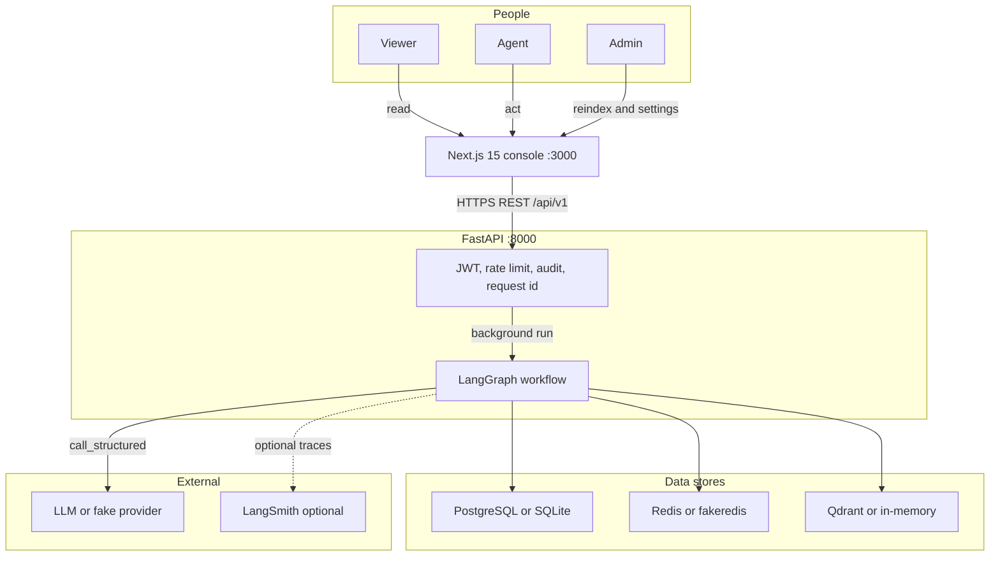
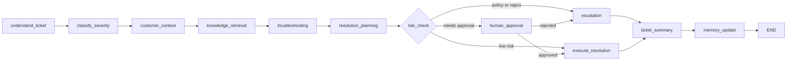
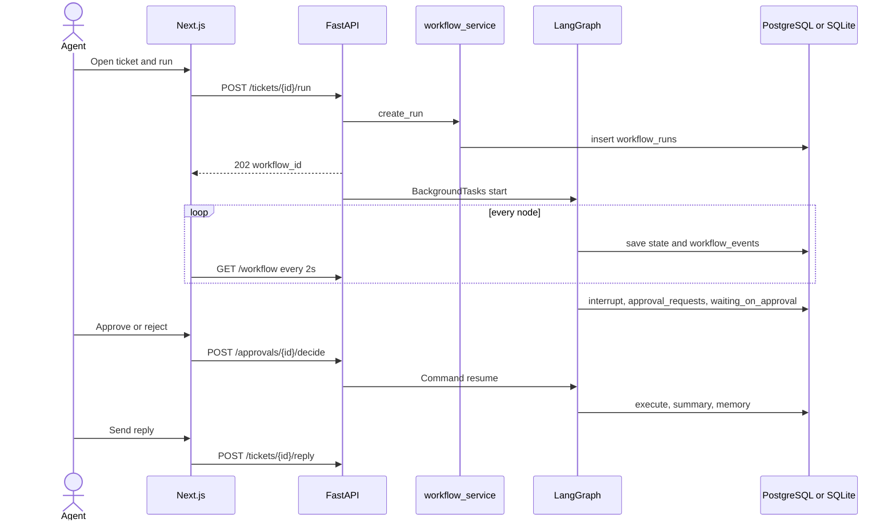
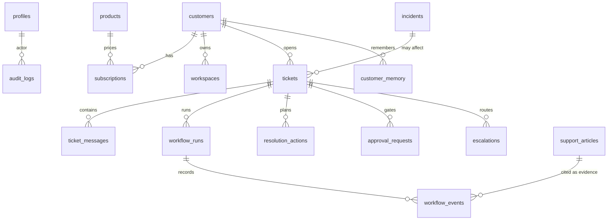
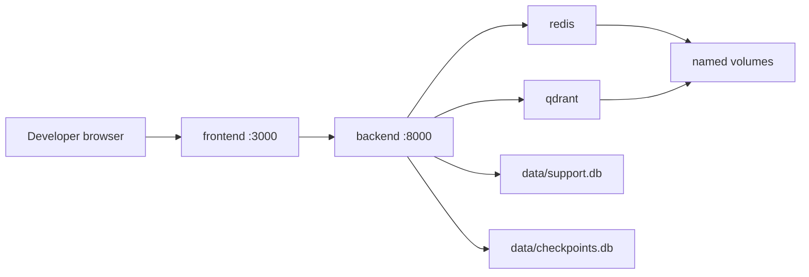
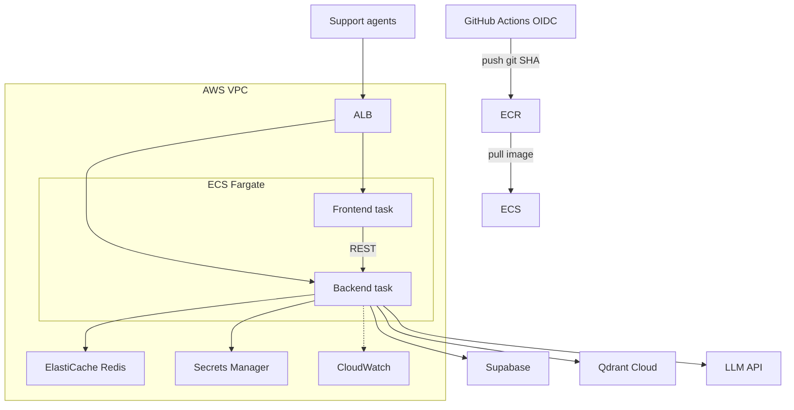

# CloudDesk architecture

Target architecture for the autonomous support-resolution platform. `CLAUDE.md` wins if this document disagrees with it.

This is the design to build. Application code is not in the repo yet. No cloud account has been applied, and nothing in these diagrams is deployed.

The product is used by support agents of the fictional SaaS **CloudDesk**. A ticket is understood, classified, investigated, and turned into a resolution plan. A human approves anything that spends money or changes an account. v1 integrations are mocks: the platform does not send real email and does not issue real refunds.

## How to create the diagrams in Eraser

Eraser cloud-architecture diagrams use [Eraser diagram-as-code](https://docs.eraser.io/architecture-diagram-syntax), not Mermaid. Mermaid pasted into a Cloud Architecture diagram will not lay out.

For each diagram below:

1. In [Eraser](https://app.eraser.io), create a diagram and set the type to **Cloud architecture**.
2. Open **Diagram as code**.
3. Paste one fenced `eraser` block, without the fence.
4. Leave the Mermaid block for a flowchart, sequence, or ER tool. Eraser can also generate those if you choose **Flow chart**, **Sequence diagram**, or **Entity relationship** and paste the matching block when the type is Mermaid-compatible. The `eraser` blocks are the ones that produce the component and infrastructure pictures.

Create one Eraser diagram per block. Do not paste two blocks into the same diagram; node names would collide.

| Diagram | Eraser type | What it shows |
|---|---|---|
| 1 | Cloud architecture | Complete logical system |
| 2 | Cloud architecture | Backend components and layers |
| 3 | Cloud architecture | LangGraph nodes |
| 4 | Cloud architecture | Local Docker Compose |
| 5 | Cloud architecture | AWS |
| 6 | Cloud architecture | Azure |
| 7 | Cloud architecture | GCP |
| 8 | Cloud architecture | CI/CD |
| 9 | Sequence diagram | Run, pause, approve, reply |
| M1–M4 | Mermaid | The same flows, plus the data model |

---

## 1. System context

Three roles share one console. The browser talks only to Next.js. Next.js calls FastAPI. FastAPI owns the workflow. Data stores and the model sit behind the backend.

| Actor | Enters through | May do |
|---|---|---|
| Viewer | Console | Read tickets, customers, knowledge, and audit |
| Agent | Console | Run a workflow, reply, request information, approve or reject, escalate |
| Admin | Console | Reindex knowledge and change settings |

Role rank is `viewer 1 < agent 2 < admin 3`, enforced by `require_role`. Demo users are `admin@clouddesk.demo`, `sam.agent@clouddesk.demo`, and `vic.viewer@clouddesk.demo`.

```eraser
direction down

Viewer [icon: users, color: grey, label: "Viewer"]
Agent [icon: users, color: blue, label: "Agent"]
Admin [icon: users, color: blue, label: "Admin"]

Console [icon: next, color: blue, label: "Next.js 15 console :3000"]

Platform [icon: fastapi, color: green, label: "FastAPI :8000"] {
  Edge [icon: shield, label: "JWT, rate limit, audit, request id"]
  Workflow [icon: langgraph, label: "LangGraph workflow"]
}

Stores [icon: postgres, color: blue, label: "Data stores"] {
  SQL [icon: postgres, label: "PostgreSQL or SQLite"]
  Cache [icon: redis, label: "Redis or fakeredis"]
  Vectors [icon: qdrant, label: "Qdrant or in-memory"]
}

Outside [icon: openai, color: purple, label: "External"] {
  Model [icon: openai, label: "LLM or fake provider"]
  Smith [icon: langgraph, label: "LangSmith optional"]
}

Viewer > Console: "read"
Agent > Console: "act"
Admin > Console: "reindex and settings"
Console > Edge: "HTTPS REST /api/v1"
Edge > Workflow: "background run"
Workflow > SQL: "tickets, events, memory"
Workflow > Cache: "session, limit, RAG cache"
Workflow > Vectors: "knowledge search"
Workflow > Model: "call_structured"
Workflow --> Smith: "optional traces"
```



---

## 2. Component architecture

The workflow is one component inside a normal web application. HTTP, SQL, prompts, retrieval, and tools stay in separate folders.

| Layer | Folder | Does | Must not |
|---|---|---|---|
| Frontend | `frontend/` | Pages, polling, typed client | Hold the service-role key |
| API | `backend/app/api/` | HTTP, validation, auth, RBAC, background tasks | Contain business rules |
| Services | `backend/app/services/` | Orchestrate repositories and the graph | Talk HTTP |
| Repositories | `backend/app/repositories/` | SQL through SQLAlchemy | Call a model |
| Core | `backend/app/core/` | Config, LLM factory, security, logging, Redis, guardrails, database | Import `agents/` |
| Tools | `backend/app/tools/` | `@tool` functions, `ToolPolicy`, `ToolRegistry` | Bypass the registry |
| Agents | `agents/` | State, graph, nodes, specialists, rules, prompts | Write SQL |
| RAG | `rag/` | Chunk, embed, retrieve, ingest | Know about tickets |
| Memory | `memory/` | Short-term and long-term facades | Store secrets |
| Integrations | `integrations/` | Protocols, mock adapters, MCP server | Be imported by `core` |

### 2.1 Frontend

Next.js 15 App Router. The backend is reached only through `frontend/lib/api.ts`. The bearer token lives in `localStorage`. A 401 sends the user to `/login?reason=expired`. The ticket screen polls `/workflow` every 2 seconds.

Pages: `/login`, `/dashboard`, `/tickets`, `/tickets/[id]`, `/customers`, `/customers/[id]`, `/knowledge`, `/escalations`, `/agents`, `/audit`, `/settings`, `/api/health`.

The ticket screen is three columns: messages and composer, customer context, and the workflow panel. The workflow panel shows the twelve graph steps, evidence, diagnosis, planned actions, and an editable reply. Viewer action buttons stay disabled. Approve and Reject render only when `approval_status` is `pending`.

### 2.2 Backend edge

Middleware order, outermost last: CORS, then RequestId, then RateLimit, then Audit.

| Concern | Behaviour |
|---|---|
| N1 JWT | HS256, Supabase-compatible. Demo tokens last 8 hours |
| N2 Rate limit | Fixed window in Redis. Demo ceiling is 120 requests per minute |
| N3 Request id | `X-Request-ID` on every response |
| N6 Audit | One `audit_logs` row for every non-GET request |

Health routes are unprefixed: `/health`, `/health/live` (no I/O, used by probes), `/health/ready` (database, Redis, vector store, LLM).

### 2.3 Specialists

Every specialist returns a Pydantic model. Every model call goes through `call_structured`. Policy is decided in `agents/rules.py` before the model is trusted.

| Agent | Node | Produces | Tools |
|---|---|---|---|
| Supervisor | `understand_ticket`, `classify_severity`, `ticket_summary` | Category, summary, severity | None. Rules classify, score severity, and scan for injection |
| Customer | `customer_context` | Customer, subscription, workspace, history, notes | `get_customer`, `get_subscription`, `get_ticket_history`. No model call |
| Knowledge | `knowledge_retrieval` | Cited evidence, similar cases | `search_docs` |
| Troubleshooting | `troubleshooting` | Probable causes and numbered steps | `check_service_status` |
| Resolution | `resolution_planning` | Summary, customer reply, internal notes, actions | Plans `update_ticket`, `create_refund_request`, `reset_demo_setting` |
| Escalation | `risk_check`, `escalation` | Escalation decision and named team | `create_escalation` |

Planned actions come from `ResolutionAgent.plan_actions`. The model does not invent tool calls.

### 2.4 Tools

All execution goes through `ToolRegistry.execute`. Unknown tools require approval. A tool exception becomes `ToolResult(ok=False)` and does not crash the graph. Timeout is `TOOL_TIMEOUT_SECONDS`.

| Tool | Writes | Needs approval |
|---|---|---|
| `get_customer`, `get_subscription`, `get_ticket_history` | No | No |
| `search_docs`, `check_service_status` | No | No |
| `update_ticket` | Tickets | No |
| `reset_demo_setting` | Workspace admin | Yes |
| `create_refund_request` | Billing | Yes. `MAX_REFUND_WITHOUT_APPROVAL` defaults to 0 |
| `create_escalation` | Escalations | No. This is the safe path |

`assess_risk()` returns `high` when the plan needs approval, a policy escalation fired, severity is critical, injection was detected, or output validation failed.

### 2.5 Complete logical diagram

Paste this into one Cloud Architecture diagram. It is the full component picture.

```eraser
direction down

People [icon: users, color: blue, label: "Support org"] {
  Viewer [icon: users, label: "Viewer"]
  AgentUser [icon: users, label: "Agent"]
  AdminUser [icon: users, label: "Admin"]
}

Frontend [icon: next, color: blue, label: "Next.js 15"] {
  ApiClient [icon: react, label: "lib/api.ts"]
  TicketPage [icon: next, label: "Ticket screen"]
  OtherPages [icon: react, label: "Lists, knowledge, audit, settings"]
}

Backend [icon: fastapi, color: green, label: "FastAPI"] {
  Middleware [icon: shield, label: "CORS, request id, rate limit, audit"]
  Routers [icon: server, label: "API routers"]
  Services [icon: workflow, label: "Services"]
  Repos [icon: postgres, label: "Repositories"]
  CoreBox [icon: python, label: "Core and guardrails"]
}

GraphBox [icon: langgraph, color: orange, label: "LangGraph"] {
  Supervisor [icon: users, label: "Supervisor"]
  CustomerAg [icon: users, label: "Customer agent"]
  KnowledgeAg [icon: qdrant, label: "Knowledge agent"]
  TroubleAg [icon: workflow, label: "Troubleshooting agent"]
  ResolveAg [icon: workflow, label: "Resolution agent"]
  EscalateAg [icon: shield, label: "Escalation agent"]
  RulesBox [icon: shield, label: "Policy rules"]
}

Capabilities [icon: workflow, color: grey, label: "Capabilities"] {
  Registry [icon: workflow, label: "ToolRegistry"]
  Retriever [icon: qdrant, label: "Hybrid retriever"]
  MemoryBox [icon: redis, label: "Memory facades"]
  Mocks [icon: server, label: "Mock integrations"]
  MCPSrv [icon: workflow, label: "MCP read-only server"]
}

DataPlane [icon: postgres, color: blue, label: "Data plane"] {
  SQL [icon: postgres, label: "PostgreSQL or SQLite"]
  Cache [icon: redis, label: "Redis or fakeredis"]
  Vectors [icon: qdrant, label: "Qdrant or in-memory"]
  CheckDB [icon: sqlite, label: "Checkpoint SQLite"]
}

Models [icon: openai, color: purple, label: "Model plane"] {
  LLM [icon: openai, label: "LLM or fake provider"]
  Smith [icon: langgraph, label: "LangSmith optional"]
}

Viewer > ApiClient: "read"
AgentUser > TicketPage: "run, approve, reply"
AdminUser > OtherPages: "reindex, settings"
ApiClient > Middleware: "Bearer JWT"
Middleware > Routers
Routers > Services
Services > Repos
Services > Supervisor: "astream"
RulesBox > Supervisor: "policy wins"
Supervisor > CustomerAg
CustomerAg > KnowledgeAg
KnowledgeAg > TroubleAg
TroubleAg > ResolveAg
ResolveAg > EscalateAg
ResolveAg > Registry
KnowledgeAg > Retriever
CustomerAg > MemoryBox
Registry > Mocks
MCPSrv --> Registry: "read-only"
Repos > SQL
MemoryBox > Cache
MemoryBox > SQL
Retriever > Vectors
Services > CheckDB: "interrupt state"
CoreBox > LLM: "call_structured"
CoreBox --> Smith: "optional"
```

### 2.6 Backend internals

Paste this when you want the layer rules as their own diagram.

```eraser
direction right

HTTP [icon: monitor, label: "Browser"]

Edge [icon: shield, color: orange, label: "Middleware"] {
  CORS [icon: shield, label: "CORS"]
  ReqId [icon: workflow, label: "Request id"]
  Limit [icon: shield, label: "Rate limit"]
  Audit [icon: lock, label: "Audit"]
  AuthN [icon: lock, label: "JWT RBAC"]
}

Layers [icon: fastapi, color: green, label: "Layers"] {
  API [icon: server, label: "api"]
  Svc [icon: workflow, label: "services"]
  Repo [icon: postgres, label: "repositories"]
  Core [icon: python, label: "core"]
}

Domain [icon: langgraph, color: orange, label: "Domain"] {
  Agents [icon: langgraph, label: "agents"]
  Tools [icon: workflow, label: "tools"]
  RAG [icon: qdrant, label: "rag"]
  Mem [icon: redis, label: "memory"]
  Integ [icon: server, label: "integrations"]
}

HTTP > CORS
CORS > ReqId > Limit > Audit > AuthN > API
API > Svc
Svc > Repo
Svc > Agents
Agents > Tools
Agents > RAG
Agents > Mem
Tools > Integ
Core > API: "settings, llm, guardrails"
Repo > Agents: "repositories only"
```

---

## 3. Workflow

Every ticket follows one path. Rules decide policy cases. The model judges only the grey area.

```text
Understand → Classify → Investigate → Retrieve → Troubleshoot → Decide → Resolve → Act → Escalate → Remember
```

Node order in `agents/graph.py`:

```text
understand_ticket → classify_severity → customer_context → knowledge_retrieval
  → troubleshooting → resolution_planning → risk_check
      ├─ escalation_required → escalation
      ├─ approval pending → human_approval
      │     ├─ approved → execute_resolution
      │     └─ rejected → escalation
      └─ low risk → execute_resolution
  → ticket_summary → memory_update → END
```

`human_approval` calls `interrupt()`. Code before `interrupt()` re-runs on resume, so it stays small and idempotent. The checkpointer stores state under `thread_id`. Tests use `InMemorySaver` when `CHECKPOINT_DB_PATH=:memory:`. A file-backed run uses `AsyncSqliteSaver`.

A second `POST /run` while the ticket is `waiting_on_approval` returns 409. Resuming a run that is not paused returns 409.

Rejection of an approval routes to escalation. `create_escalation` does not need a second approval.

```eraser
direction right

Understand [icon: workflow, label: "understand_ticket"]
Classify [icon: workflow, label: "classify_severity"]
Customer [icon: users, label: "customer_context"]
Knowledge [icon: qdrant, label: "knowledge_retrieval"]
Trouble [icon: workflow, label: "troubleshooting"]
Plan [icon: workflow, label: "resolution_planning"]
Risk [icon: shield, color: orange, label: "risk_check"]
Escalate [icon: shield, color: red, label: "escalation"]
Approve [icon: lock, color: orange, label: "human_approval"]
Execute [icon: workflow, color: green, label: "execute_resolution"]
Summary [icon: workflow, label: "ticket_summary"]
Remember [icon: redis, label: "memory_update"]
Done [icon: workflow, color: green, label: "END"]

Understand > Classify > Customer > Knowledge > Trouble > Plan > Risk
Risk > Escalate: "policy or reject"
Risk > Approve: "needs approval"
Risk > Execute: "low risk"
Approve > Execute: "approved"
Approve > Escalate: "rejected"
Escalate > Summary
Execute > Summary
Summary > Remember > Done
```



### 3.1 Run, pause, approve, reply

1. The console calls `POST /api/v1/tickets/{id}/run`.
2. `workflow_service.create_run()` writes `workflow_runs` and returns **202** `{workflow_id}`.
3. `BackgroundTasks` starts the graph. v1 runs the workflow in-process. A separate worker is a later extension.
4. After every node, state is saved. The console polls `GET /tickets/{id}/workflow` every 2 seconds.
5. `human_approval` interrupts. The service writes `approval_requests` and sets the ticket to `waiting_on_approval`.
6. `POST /approvals/{id}/approve` or reject calls `approval_service.decide()` and resumes with `Command(resume=…)`.
7. The tail is `execute_resolution`, then `ticket_summary`, then `memory_update`, then END.
8. Send reply is a separate call: `POST /tickets/{id}/reply`. The reply has already passed `validate_customer_output`.

Paste the next block into an Eraser **Sequence diagram**.

```eraser
Agent [icon: users, color: blue]
UI [icon: next, color: blue]
API [icon: fastapi, color: green]
RunSvc [icon: workflow, color: green]
Graph [icon: langgraph, color: orange]
DB [icon: postgres, color: blue]
Checkpoint [icon: sqlite, color: grey]

Agent > UI: Open ticket and run
UI > API: POST /tickets/id/run
activate API
API > RunSvc: create_run
RunSvc > DB: insert workflow_runs
API --> UI: 202 workflow_id
API > Graph: BackgroundTasks start_workflow
deactivate API

loop [label: every node, color: orange] {
  Graph > DB: save state
  Graph > DB: workflow_events
  UI > API: GET /workflow every 2s
}

Graph > Checkpoint: interrupt human_approval
Graph > DB: approval_requests and waiting_on_approval

Agent > UI: Approve or reject
UI > API: POST /approvals/id/decide
API > Graph: Command resume
Graph > DB: execute_resolution then summary then memory
Agent > UI: Send reply
UI > API: POST /tickets/id/reply
API > DB: ticket message
```



---

## 4. Knowledge and memory

### 4.1 RAG

`sample_data/knowledge_base/*.md` holds 15 articles. Front matter is `title`, `category`, `tags`, `summary`.

Chunk on headings, then 900-character windows with 150-character overlap. Each chunk is prefixed with `"{title} - {heading}"`.

Retrieval is semantic union BM25, then reciprocal rank fusion with `k=60`, then a heuristic rerank, then an optional model rerank, then one hit per article. Modes are `hybrid` (default), `semantic`, and `keyword`.

Offline embeddings are a hashed bag-of-words, 384 dimensions. Changing the embedding model requires admin `POST /knowledge/reindex`, which recreates the collection.

Customer-facing policy claims cite these articles. Evidence carries `id`, `title`, `source` (`kb://slug#section`), `snippet`, `score`, `url` (`/knowledge/<id>`), and `article_id`.

The vector store is selected by `VECTOR_STORE`: `memory` or `qdrant`. Nothing outside `rag/` knows which one is live.

### 4.2 Memory

| Tier | Store | Holds | Lifetime |
|---|---|---|---|
| Short-term | Redis or fakeredis | Conversation per ticket, workflow state, retrieval cache | 24 hours. Cache entries last 300 seconds |
| Long-term | `customer_memory` | `preference`, `past_issue`, `troubleshooting`, `note` | Permanent, de-duplicated |

`customer_context` recalls up to 10 notes. `memory_update` writes the past issue, the first three troubleshooting steps, and a resolution note. Every note passes `scrub()`. Exact duplicates are skipped.

Never stored: card numbers, API keys, passwords, raw ticket bodies, or anything about another customer. Cache key shape is `rag:{mode}:{category}:{top_k}:{query}`.

---

## 5. Data model

Two forms on purpose. SQLAlchemy models in `backend/app/models/entities.py` use JSON columns and `String(36)` UUIDs so the same code runs on SQLite and Postgres. `database/schema.sql` is the Postgres DDL. `schema.sql` is the authority for the table list once it is written. Until then the logical tables are the ones below.

`profiles`, `customers`, `subscriptions`, `workspaces`, `products`, `tickets`, `ticket_messages`, `support_articles`, `incidents`, `workflow_runs`, `workflow_events`, `resolution_actions`, `approval_requests`, `escalations`, `customer_memory`, `audit_logs`.

The workflow itself is data: `workflow_runs.state` is the `WorkflowState` JSON, plus events, approvals, and resolution actions.

Categories, defined first in `backend/app/schemas/common.py`: `login_issue`, `billing`, `api_failure`, `workspace_permissions`, `storage_quota`, `integration`, `feature_request`, `account`, `security`, `other`.

Statuses: `new`, `in_progress`, `waiting_on_customer`, `waiting_on_approval`, `escalated`, `resolved`, `closed`.

Severity: `low`, `medium`, `high`, `critical`. Channels: `email`, `chat`, `web`, `api`.



Relationships are logical. Foreign keys are fixed when `database/schema.sql` is written. Postgres enables RLS on the data tables. The backend uses the service-role key on the server. The browser receives only the anon key.

---

## 6. Security boundaries

| Boundary | Rule |
|---|---|
| Browser | Anon key and the user JWT only. No service-role key |
| Ticket text | Untrusted data. `wrap_untrusted` and `SECURITY_PREAMBLE`. CD-1013 must not export records |
| Model | Adds judgement in grey areas. Escalation, severity floor, refunds, deletions, disputes, security, and data loss are code |
| Severity | Rules may raise the model score. They never lower it |
| Tools | Registry only. Refunds and setting resets require a recorded approval |
| Customer reply | `validate_customer_output` blocks internal URLs, secrets, and another customer's data before the reply is shown |
| Memory | `scrub()` removes card numbers, API keys, and passwords |
| Logs and events | Decisions, tool results, evidence scores, timings, tokens, errors. No raw prompts, hidden chain-of-thought, other customers, or secrets |
| Deploy | Prod uses a reviewed plan and the prod var-file. `--auto-approve` is refused for staging and prod |

---

## 7. Local infrastructure

Demo mode runs with no API key and no cloud account.

| Setting | Local value |
|---|---|
| `DEMO_MODE` | `true` |
| `LLM_PROVIDER` | `fake` |
| `VECTOR_STORE` | `memory` |
| `USE_FAKE_REDIS` | `true` in tests |
| `DATABASE_URL` | `sqlite+aiosqlite:///./data/support.db` |
| `CHECKPOINT_DB_PATH` | `./data/checkpoints.db`, or `:memory:` in tests |
| Frontend | `:3000` |
| Backend | `:8000` |

Compose is `frontend → backend → redis, qdrant`, with `depends_on: service_healthy`, named volumes, and `restart: unless-stopped`.

Images: backend `python:3.12-slim`, non-root user `app`, `HEALTHCHECK` on `/health/live`, build context the repo root. Frontend `node:22-alpine`, `output: "standalone"`, non-root, `HEALTHCHECK` on `/api/health`.

```eraser
direction right

Dev [icon: monitor, color: blue, label: "Developer browser"]

Compose [icon: docker, color: blue, label: "Docker Compose"] {
  Web [icon: next, label: "frontend :3000"]
  Api [icon: fastapi, label: "backend :8000"]
  RedisC [icon: redis, label: "redis"]
  QdrantC [icon: qdrant, label: "qdrant"]
  Vol [icon: docker, label: "named volumes"]
}

HostFiles [icon: sqlite, color: grey, label: "Host data/"] {
  SupportDB [icon: sqlite, label: "support.db"]
  Checkpoint [icon: sqlite, label: "checkpoints.db"]
}

Dev > Web: "HTTPS localhost"
Web > Api: "REST"
Api > RedisC: "cache and rate limit"
Api > QdrantC: "vectors when not memory"
Api > SupportDB: "tickets"
Api > Checkpoint: "paused graphs"
RedisC > Vol
QdrantC > Vol
```



Offline tests skip Compose. They use SQLite, fakeredis, the in-memory vector store, the fake LLM, and an in-memory checkpointer.

---

## 8. Cloud infrastructure

The same Terraform module set is composed from `deployment/aws`, `deployment/azure`, and `deployment/gcp`: networking, container-registry, secrets, compute, load-balancer, monitoring, and redis. Environments are var-files under `environments/{dev,staging,prod}/`. They are not copies of the modules. Remote state uses a git-ignored `backend.hcl`. Secrets enter only as `TF_VAR_*`.

These products stay outside every cloud account: **Supabase** (Postgres and JWT), **Qdrant Cloud**, and the **LLM API**.

v1 background work stays inside the backend process. A restart can drop an in-memory pause. File checkpoints survive only if that file is on a volume. A separate worker is not part of v1.

Image tags equal the git SHA. The image that was tested is the image that ships.

### 8.1 AWS

| Module | Service |
|---|---|
| Networking | VPC |
| Container registry | ECR |
| Compute | ECS Fargate, frontend and backend tasks |
| Load balancer | ALB |
| Secrets | Secrets Manager |
| Monitoring | CloudWatch |
| Redis | ElastiCache, from the shared redis module |
| External | Supabase, Qdrant Cloud, LLM API |

```eraser
direction down

Users [icon: users, color: blue, label: "Support agents"]
GH [icon: github-actions, color: grey, label: "GitHub Actions OIDC"]

AWS [icon: aws-vpc, color: orange, label: "AWS VPC"] {
  ALB [icon: aws-elastic-load-balancing, label: "ALB"]
  ECS [icon: aws-fargate, label: "ECS Fargate"] {
    WebTask [icon: next, label: "Frontend task"]
    ApiTask [icon: fastapi, label: "Backend task"]
  }
  Cache [icon: aws-elasticache, label: "ElastiCache Redis"]
  Secrets [icon: aws-secrets-manager, label: "Secrets Manager"]
  Logs [icon: aws-cloudwatch, label: "CloudWatch"]
  Registry [icon: aws-elastic-container-registry, label: "ECR"]
}

External [icon: supabase, color: purple, label: "Outside the account"] {
  Supa [icon: supabase, label: "Supabase Postgres and JWT"]
  QdrantCloud [icon: qdrant, label: "Qdrant Cloud"]
  LLMApi [icon: openai, label: "LLM API"]
}

Users > ALB: HTTPS
ALB > WebTask
ALB > ApiTask
WebTask > ApiTask: REST
GH > Registry: "push git SHA"
Registry > ECS: "pull image"
ApiTask > Secrets: "read TF_VAR secrets"
ApiTask > Cache
ApiTask > Supa
ApiTask > QdrantCloud
ApiTask > LLMApi
ApiTask --> Logs: "JSON logs"
```



### 8.2 Azure

| Module | Service |
|---|---|
| Container registry | ACR |
| Compute | Container Apps, frontend and backend |
| Secrets | Key Vault |
| Monitoring | Log Analytics |
| Redis | Azure Cache for Redis |
| Load balancer | Load-balancer module in front of Container Apps ingress |
| External | Supabase, Qdrant Cloud, LLM API |

```eraser
direction down

Users [icon: users, color: blue, label: "Support agents"]
GH [icon: github-actions, color: grey, label: "GitHub Actions OIDC"]

Azure [icon: azure-container-apps-environments, color: blue, label: "Azure"] {
  Ingress [icon: shield, label: "Load balancer module"]
  Apps [icon: azure-container-apps-environments, label: "Container Apps"] {
    WebApp [icon: next, label: "Frontend app"]
    ApiApp [icon: fastapi, label: "Backend app"]
  }
  Cache [icon: azure-cache-redis, label: "Azure Cache for Redis"]
  Vault [icon: azure-key-vaults, label: "Key Vault"]
  Logs [icon: azure-log-analytics-workspaces, label: "Log Analytics"]
  Registry [icon: azure-container-registries, label: "ACR"]
}

External [icon: supabase, color: purple, label: "Outside the account"] {
  Supa [icon: supabase, label: "Supabase Postgres and JWT"]
  QdrantCloud [icon: qdrant, label: "Qdrant Cloud"]
  LLMApi [icon: openai, label: "LLM API"]
}

Users > Ingress: HTTPS
Ingress > WebApp
Ingress > ApiApp
WebApp > ApiApp: REST
GH > Registry: "push git SHA"
Registry > Apps: "pull image"
ApiApp > Vault
ApiApp > Cache
ApiApp > Supa
ApiApp > QdrantCloud
ApiApp > LLMApi
ApiApp --> Logs: "JSON logs"
```

### 8.3 GCP

| Module | Service |
|---|---|
| Networking | VPC |
| Container registry | Artifact Registry |
| Compute | Cloud Run, frontend and backend services |
| Load balancer | Cloud Load Balancing |
| Secrets | Secret Manager |
| Monitoring | Cloud Logging |
| Redis | Managed Redis from the shared redis module |
| External | Supabase, Qdrant Cloud, LLM API |

```eraser
direction down

Users [icon: users, color: blue, label: "Support agents"]
GH [icon: github-actions, color: grey, label: "GitHub Actions OIDC"]

GCP [icon: gcp-virtual-private-cloud, color: green, label: "GCP VPC"] {
  GLB [icon: gcp-cloud-load-balancing, label: "Cloud Load Balancing"]
  Run [icon: gcp-cloud-run, label: "Cloud Run"] {
    WebSvc [icon: next, label: "Frontend service"]
    ApiSvc [icon: fastapi, label: "Backend service"]
  }
  Cache [icon: redis, label: "Managed Redis"]
  Secrets [icon: gcp-secret-manager, label: "Secret Manager"]
  Logs [icon: gcp-cloud-logging, label: "Cloud Logging"]
  Registry [icon: gcp-artifact-registry, label: "Artifact Registry"]
}

External [icon: supabase, color: purple, label: "Outside the account"] {
  Supa [icon: supabase, label: "Supabase Postgres and JWT"]
  QdrantCloud [icon: qdrant, label: "Qdrant Cloud"]
  LLMApi [icon: openai, label: "LLM API"]
}

Users > GLB: HTTPS
GLB > WebSvc
GLB > ApiSvc
WebSvc > ApiSvc: REST
GH > Registry: "push git SHA"
Registry > Run: "pull image"
ApiSvc > Secrets
ApiSvc > Cache
ApiSvc > Supa
ApiSvc > QdrantCloud
ApiSvc > LLMApi
ApiSvc --> Logs: "JSON logs"
```

---

## 9. Delivery pipeline

GitHub Actions, when the workflows exist and the repository is pushed with OIDC configured:

| Workflow | Does |
|---|---|
| `test.yml` | ruff, pytest, npm lint, test, and build |
| `security.yml` | gitleaks, pip-audit, Trivy, checkov |
| `docker-build.yml` | Image build |
| `terraform-validate.yml` | `terraform validate` |
| `_deploy.yml` | `bootstrap-registry` → `build-and-push` → `plan` → human approval → `apply` → `smoke` |

Prod apply uses the GitHub Environment `prod-apply` with required reviewers. Cloud auth is OIDC. There are no long-lived cloud keys.

Scripts under `deployment/scripts/` are `deploy`, `build_and_push`, `smoke_test`, `rollback`, and `destroy`. Each takes `<cloud> <env>`. The script itself refuses `--auto-approve` for staging and prod.

```eraser
direction right

Dev [icon: users, label: "Engineer"]
Git [icon: github, label: "GitHub"]

CI [icon: github-actions, color: grey, label: "Pull request"] {
  Test [icon: github-actions, label: "test.yml"]
  Sec [icon: shield, label: "security.yml"]
  Image [icon: docker, label: "docker-build.yml"]
  Tf [icon: terraform, label: "terraform-validate.yml"]
}

Release [icon: github-actions, color: orange, label: "Deploy"] {
  Boot [icon: docker, label: "bootstrap-registry"]
  Push [icon: docker, label: "build-and-push"]
  Plan [icon: terraform, label: "terraform plan"]
  Gate [icon: lock, color: red, label: "prod-apply reviewers"]
  Apply [icon: terraform, label: "terraform apply"]
  Smoke [icon: shield, label: "smoke"]
}

Cloud [icon: aws-fargate, label: "AWS or Azure or GCP"]

Dev > Git: "push SHA"
Git > Test
Git > Sec
Git > Image
Git > Tf
Image > Boot
Boot > Push > Plan > Gate > Apply > Smoke
Apply > Cloud: "same SHA that was tested"
```

Stage 17, the deployment agent in `../deployment-agent/`, is optional and is not required to finish the support platform. It may only call allow-listed scripts, never shell commands composed by a model. One session is one project, one cloud, and one environment.

---

## 10. Observability

JSON logs include `request_id` and `workflow_id` on every line.

`WorkflowTracer` writes `workflow_events` and never raises. Event names: `node_started`, `node_completed`, `tool_called`, `llm_called`, `approval_requested`, `approval_resolved`, `error`, `workflow_completed`.

Operators can see decisions, tool calls and results, evidence with scores, node timings, token counts, and errors. They cannot see raw prompts, hidden chain-of-thought, other customers' data, or secrets.

Token cost is an estimate. The fake provider records `0.0`. LangSmith is off unless `LANGCHAIN_TRACING_V2` and `LANGCHAIN_API_KEY` are set. The project name is `clouddesk-support`.

Business metrics are tracked and are not hard-coded: share of tickets resolved without a human edit, median time to first response, escalation precision, and refund approvals per week. Refunds are never zero-touch.

---

## 11. What is intentionally absent

- A customer-facing chat widget.
- Real email delivery and real refunds.
- Languages other than English.
- A separate workflow worker.
- A durable checkpoint service outside the backend task.
- The Stage 17 deployment agent, until stages 13–16 exist.
- Any claim that these diagrams have been applied to a live account.
