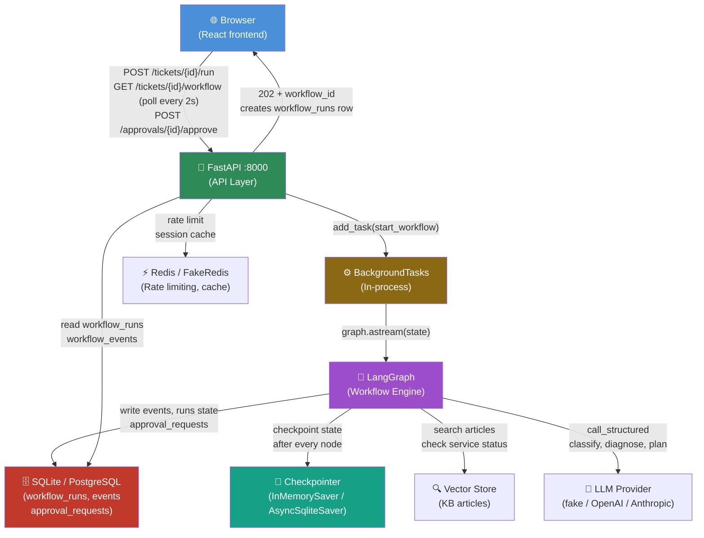
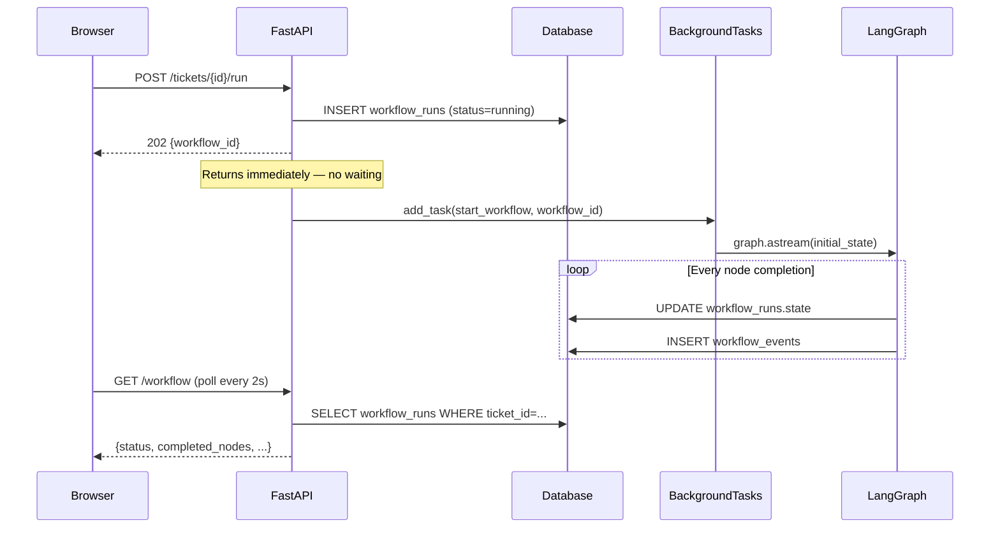
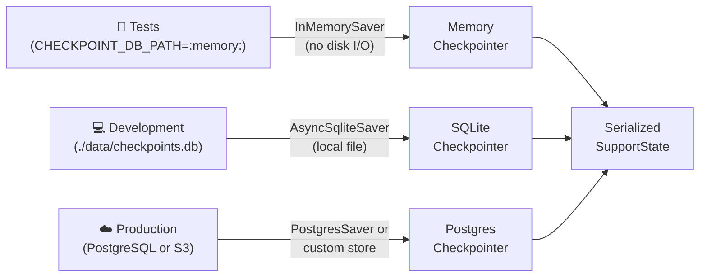
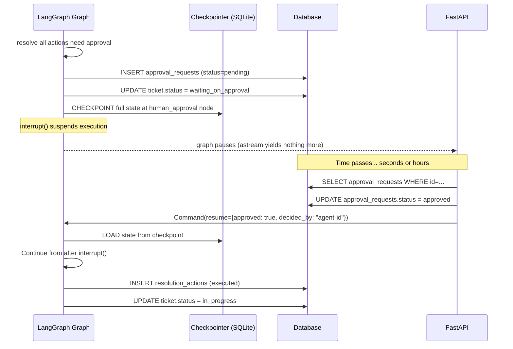
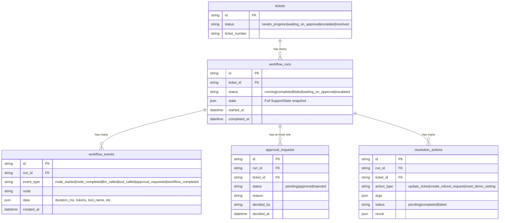
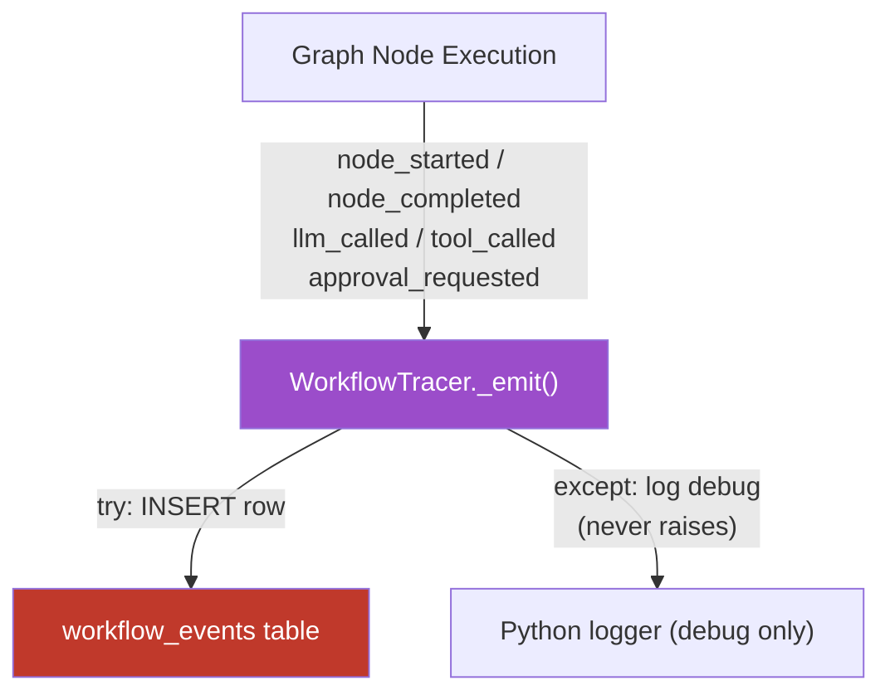
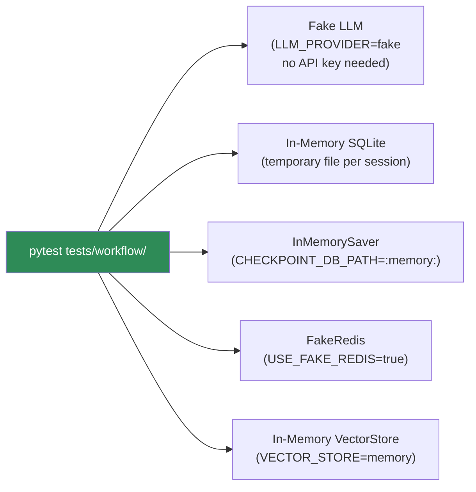

# Phase 10 — Infra & Component Wiring: Workflow Graph and Approval

**Audience:** Interview board including non-technical members.

---

## Overview

Phase 10 wires together the AI workflow engine (LangGraph), the web API (FastAPI), the database (SQLite/PostgreSQL), and the in-process checkpoint store. The result is a system where:
- A single HTTP request starts a long-running AI pipeline
- The pipeline runs in the background while the browser polls for progress
- The pipeline can pause mid-way and wait for a human to click "Approve"
- Every step is recorded so it can be inspected later

---

## Component Architecture at End of Phase 10

---

## How FastAPI BackgroundTasks Work

**Why BackgroundTasks, not Celery?**
- v1 is designed to run offline with zero infrastructure dependencies
- BackgroundTasks runs in the same process as the API — no message queue, no worker, no broker needed
- For production scale, the same `start_workflow` function can be called from a Celery/RQ worker with one line change

---

## LangGraph Checkpoint Infrastructure

**What gets checkpointed?**
Every time a node completes, LangGraph automatically serializes the entire `SupportState` (all 20+ fields) and writes it to the checkpointer. This means:
- If the server restarts, the graph can resume from exactly where it left off
- The human_approval interrupt stores the state before pausing
- On resume, the graph reloads state and continues from the interrupt point

**The interrupt/resume mechanism:**

---

## Database Tables Used in Phase 10

---

## WorkflowTracer — Observability Layer

The `WorkflowTracer` writes `workflow_events` rows. It is designed to **never raise an exception** — a tracing bug must never kill a workflow run.

**Events never stored (privacy rules §16):**
- Raw prompts sent to the LLM
- Chain-of-thought / hidden reasoning
- Other customers' data
- Secrets (API keys, passwords)

**Events always stored:**
- Node timing (duration_ms)
- LLM token counts and estimated cost
- Tool names and success/failure
- Approval request IDs and decisions

---

## Test Infrastructure

All tests run offline in ~14 seconds with zero infrastructure dependencies. The same test suite validates the entire 319-test project.

---

## Network/Routing Summary

| Request | Route | Handler | Background? |
|---|---|---|---|
| Start workflow | `POST /api/v1/tickets/{id}/run` | `run_workflow()` | Yes — BackgroundTasks |
| Poll progress | `GET /api/v1/tickets/{id}/workflow` | `get_workflow()` | No — sync DB read |
| Get events | `GET /api/v1/tickets/{id}/events` | `get_events()` | No — sync DB read |
| Approve action | `POST /api/v1/approvals/{id}/approve` | `approve()` | No — inline resume |
| Reject action | `POST /api/v1/approvals/{id}/reject` | `reject()` | No — inline resume |

---

## Key Infrastructure Decisions

| Decision | Choice | Reason |
|---|---|---|
| Background execution | In-process BackgroundTasks | Zero dependencies for v1; easy to migrate to Celery/RQ |
| State persistence | SQLite (dev) / PostgreSQL (prod) | Same SQLAlchemy models work for both |
| Checkpoint store | In-memory (tests) / SQLite file (dev) | Tests need no disk; dev needs persistence across restarts |
| Event storage | Relational DB rows | Queryable, auditable, never in LLM prompts |
| Approval mechanism | LangGraph interrupt() + Command(resume=...) | Built-in, composable, state-safe |
