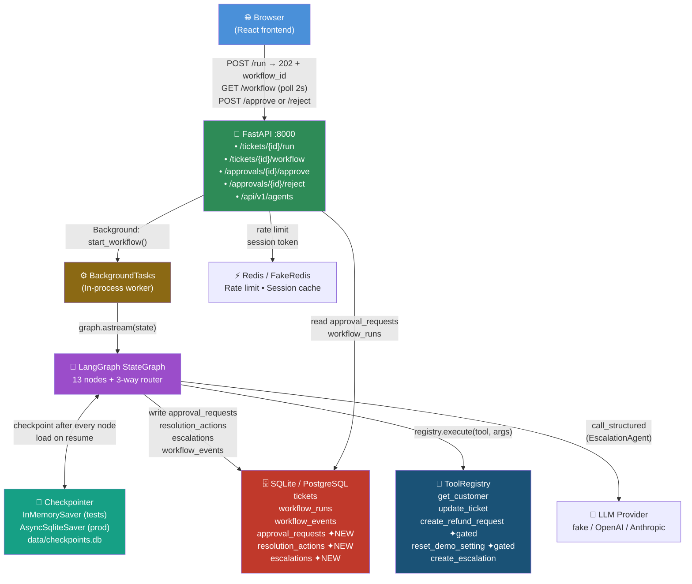
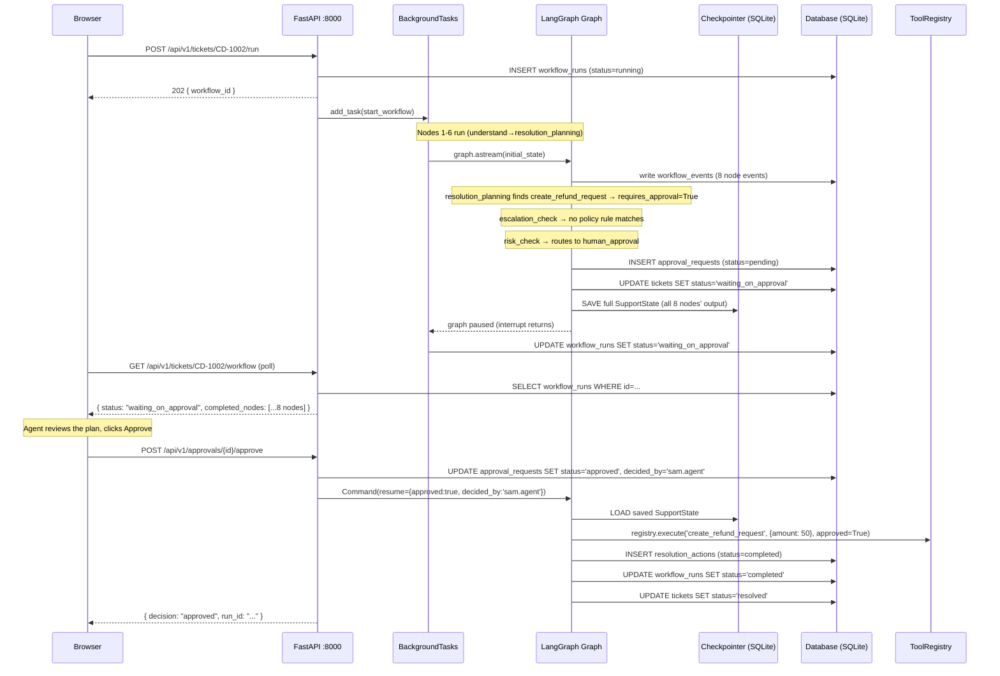
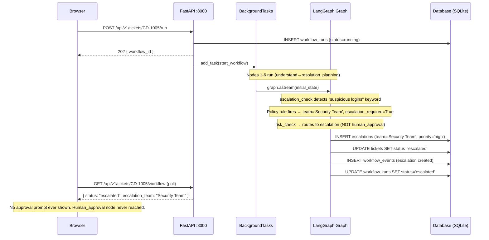
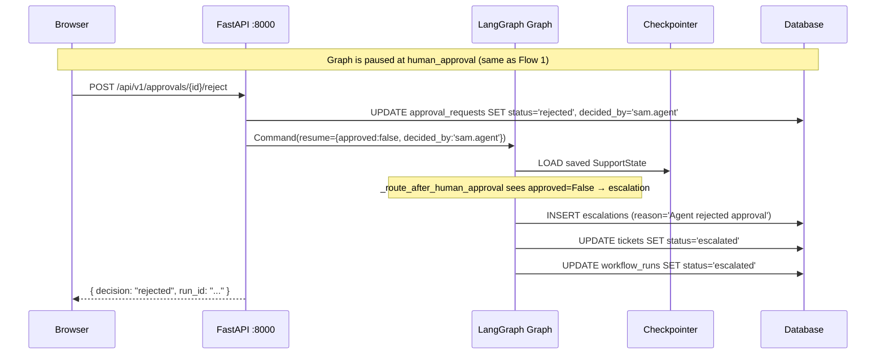
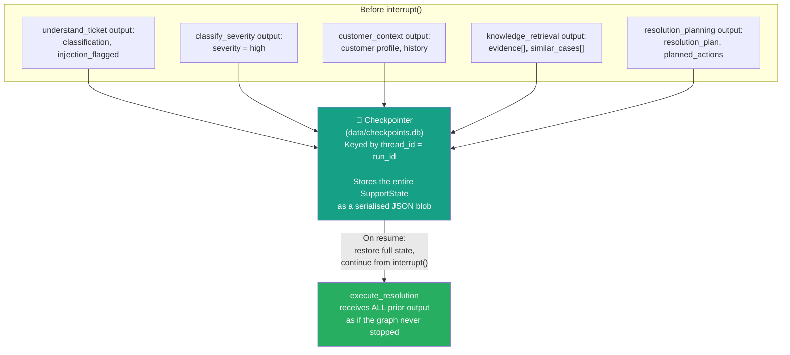
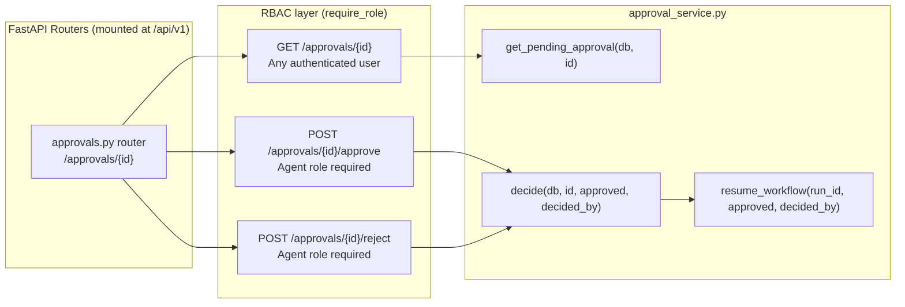
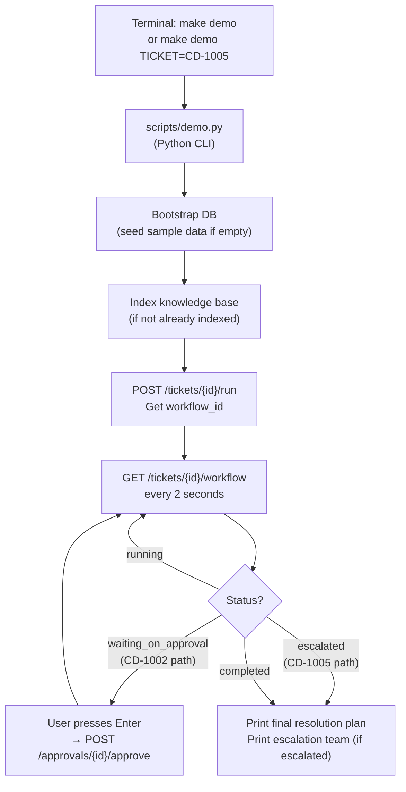
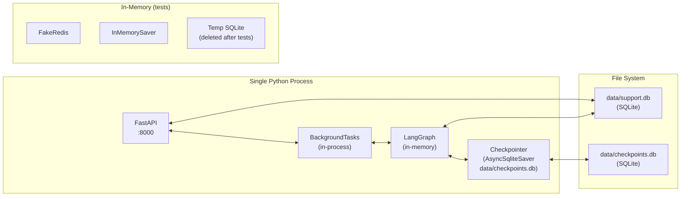

# Phase 11 — Infra & Component Wiring: Approval & Escalation

**Audience:** Interview board including non-technical members.

---

## Overview

Phase 11 extends the Phase 10 component wiring with two new flows:

1. **The approval flow** — a request that pauses mid-workflow and waits for a human click to resume.
2. **The escalation flow** — a request that bypasses the approval gate and routes straight to a specialist team record.

Both flows share the same infrastructure components (FastAPI, LangGraph, SQLite/PostgreSQL, the checkpointer). What changes is the **path** those requests take through those components and the new tables that are written along the way.

---

## Component Architecture at End of Phase 11

---

## Flow 1: The Approval Path (CD-1002 — Refund Ticket)

This flow shows what happens when the resolution plan contains a `create_refund_request` action.

---

## Flow 2: The Auto-Escalation Path (CD-1005 — Security Breach)

This flow shows what happens when a policy rule fires before human_approval is ever reached.

---

## Flow 3: The Reject-to-Escalation Path

This flow shows what happens when an agent reviews and rejects an approval request.

---

## The Checkpointer: What It Stores and Why

**Why is this important?** The execute_resolution node needs access to outputs from every earlier node — the customer's subscription plan, the evidence from the knowledge base, the planned actions, the ticket ID. Without the checkpointer, all of that would be lost when the graph pauses. The checkpointer makes the pause completely transparent to the executing nodes.

---

## Approval API Routing

**RBAC enforcement note:** `require_role("agent")` is a FastAPI dependency injected on the approve and reject endpoints. If a viewer token is presented, the dependency raises `HTTPException(403)` before the service layer is even called. The viewer cannot approve even if they guess the approval ID.

---

## Race Condition Protection

```mermaid
flowchart TD
    Agent1["Agent 1 clicks Approve"] -->|"POST /approvals/{id}/approve"| Check1
    Agent2["Agent 2 also clicks Approve\n(race condition)"] -->|"POST /approvals/{id}/approve"| Check2

    Check1["approval_service.decide()\nLoads approval from DB\napproval.status == 'pending' ✓"] -->|"UPDATE status='approved'"| Commit["DB commit\n(atomic)"]
    Check2["approval_service.decide()\nLoads approval from DB\napproval.status == 'approved' ✗"] -->|"status != 'pending'"| Error["raise ValueError('already approved')\n→ HTTP 409 Conflict"]

    Commit --> Resume["resume_workflow()\nGraph continues once"]
    Error --> UI2["Agent 2 sees:\n409 Conflict — already decided"]
```

The database `UPDATE` is atomic. Only one transaction succeeds; the other sees the already-updated status and returns 409.

---

## Demo Script Component Wiring

The demo script is a **self-contained end-to-end test in a terminal**. It wires through the full HTTP API (not direct function calls), which means it exercises the same RBAC, rate limiting, audit logging, and serialisation paths that the real frontend would use.

---

## Network Ports and Process Boundaries (Phase 11)

**Production note:** In this phase everything runs in one process. The checkpointer and the main database are separate SQLite files intentionally — the checkpointer only LangGraph reads/writes; the application DB is owned by the FastAPI layer. When migrating to Postgres, only `DATABASE_URL` and `CHECKPOINT_DB_PATH` change — the code is the same.

---

## Summary: What Phase 11 Added to the Infrastructure

| Component | Before Phase 11 | After Phase 11 |
|---|---|---|
| `human_approval` node | Did not exist | Calls `interrupt()`, writes `approval_requests`, pauses graph |
| `execute_resolution` node | Stub | Calls ToolRegistry for every planned action, writes `resolution_actions` |
| `escalation` node | Did not exist as a wired node | Writes `escalations`, updates ticket status |
| Approvals API | Did not exist | 3 endpoints: GET / approve / reject with RBAC |
| Approval service | Did not exist | Decides, records decision, resumes paused graph |
| New DB tables | — | `approval_requests`, `resolution_actions`, `escalations` |
| Demo script | Did not exist | CD-1002 (approve path) and CD-1005 (escalation path) |
