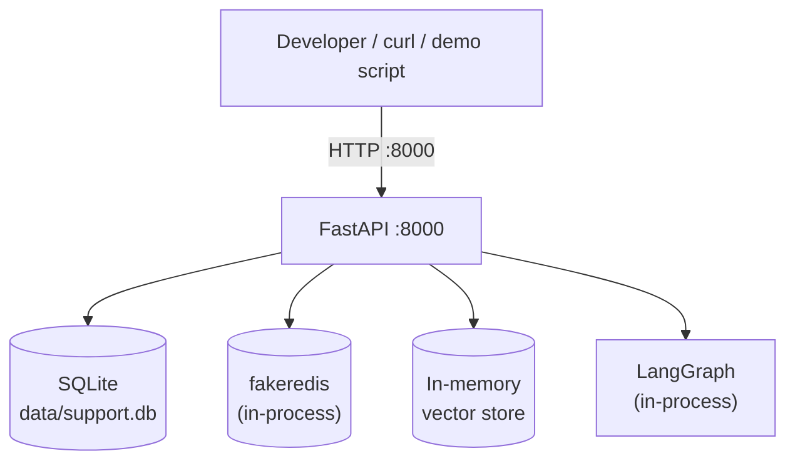
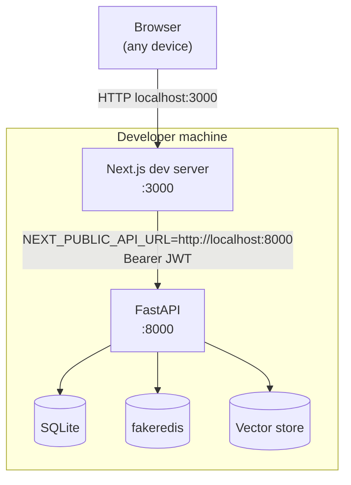
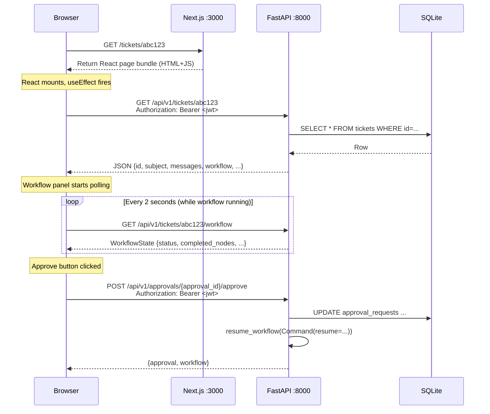
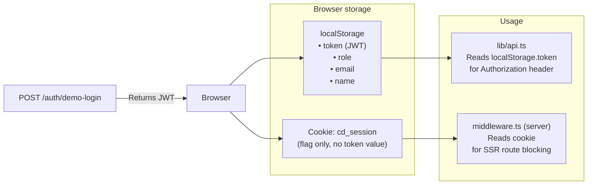
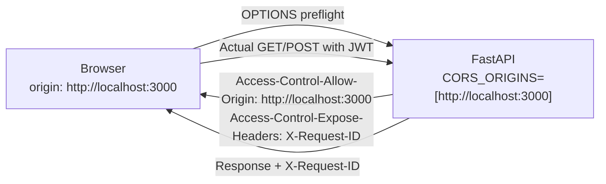
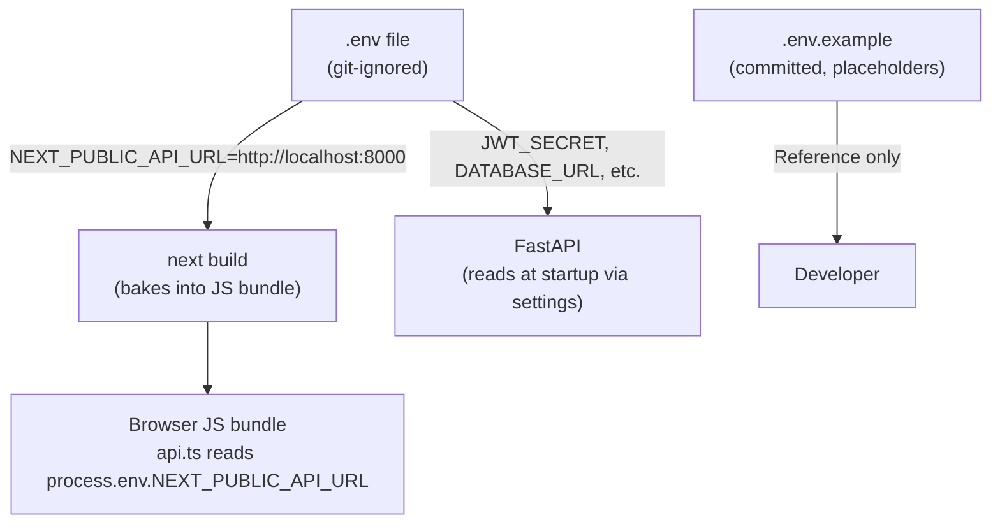
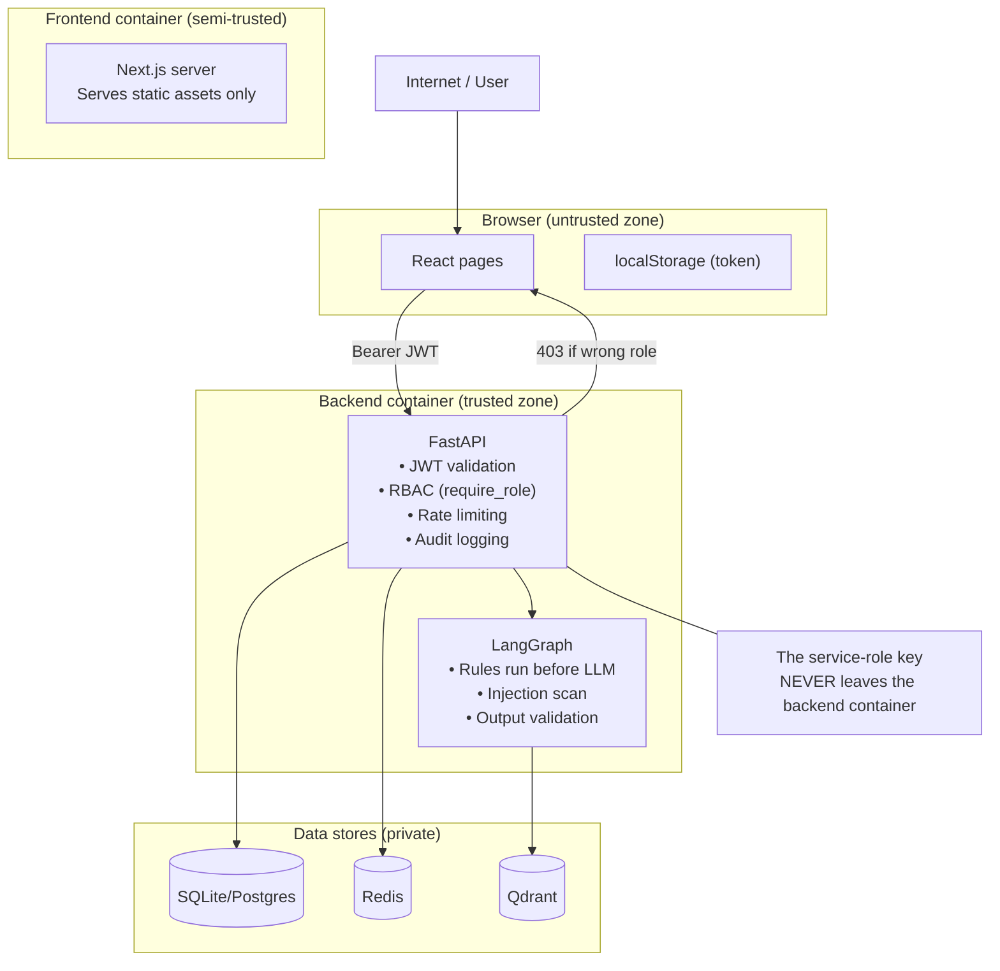

# Phase 12 — Infrastructure Design Evolution: Agent Console

This document explains the infrastructure wiring added in Phase 12 — specifically how the new Next.js frontend fits into the system, how it communicates with the backend, and what changes when the application runs in Docker versus locally.

---

## Before Phase 12: Backend only

Before Phase 12, all infrastructure lived in the backend tier.



There was no browser-facing process. External callers accessed the backend directly with bearer tokens.

---

## Phase 12: Adding the Next.js frontend process

Phase 12 adds a **second process** — the Next.js development server (or production Node.js server) — that runs alongside the backend.



**What the browser does:** Every page load asks Next.js for the HTML and JavaScript. After that, the browser talks directly to the FastAPI backend for data (tickets, workflow state, etc.).

**What Next.js does:** Serves the React application code. In development it also does hot-reloading. It never connects to the database, Redis, or the vector store — those are exclusively the backend's concern.

**What NEXT_PUBLIC_API_URL does:** Next.js bakes environment variables that start with `NEXT_PUBLIC_` into the JavaScript bundle at build time. The variable `NEXT_PUBLIC_API_URL=http://localhost:8000` tells the `lib/api.ts` client where to send API requests.

---

## Port map for local development

| Service | Port | Started by |
|---|---|---|
| Next.js (dev) | 3000 | `npm run dev` in `frontend/` |
| FastAPI | 8000 | `make backend` |
| SQLite | (file) | Embedded in FastAPI process |
| fakeredis | (in-process) | Embedded in FastAPI process |
| In-memory vector store | (in-process) | Embedded in FastAPI process |

Both ports are on `localhost`. CORS on the FastAPI backend allows `http://localhost:3000` as an origin.

---

## Request lifecycle through the two-tier stack

This diagram shows what happens when an agent opens ticket CD-1002 in the browser.



---

## Cookie and localStorage: Why both?

The session state lives in two browser storage mechanisms for two different reasons.



| Mechanism | Why needed |
|---|---|
| `localStorage` (JWT) | The `fetch` calls in `lib/api.ts` run in the browser. They read the token from `localStorage` and add it to the `Authorization: Bearer` header. `localStorage` is only accessible in the browser — Next.js middleware running on the server cannot see it. |
| Cookie `cd_session` | Next.js middleware runs on the server (or at the edge) before the page renders. Cookies are sent on every HTTP request automatically, so the middleware can read it. The cookie does not contain the JWT — it is just a boolean flag saying "a session was established." The real security check is the backend's JWT validation. |

---

## CORS wiring

The browser is on port 3000. The backend is on port 8000. Because they are on different ports, the browser's same-origin policy would normally block the API calls. CORS (Cross-Origin Resource Sharing) is configured on the FastAPI backend to allow this.



The `X-Request-ID` header is exposed through CORS so the browser developer tools can see it, which helps trace requests back to log entries in the backend.

---

## How Docker changes the wiring (preview for Phase 14)

When Docker Compose is added in Phase 14, the two services run in isolated containers on a shared private network. The browser can no longer reach the backend directly on `localhost:8000` — it must go through the Next.js container, which proxies to the backend by its container name.

```mermaid
graph TD
    Browser["Browser\n(host machine)"]
    NginxOrNext["Next.js container\n:3000 (exposed to host)"]
    FastAPIContainer["FastAPI container\n:8000 (internal only)"]
    RedisContainer["Redis container\n:6379 (internal only)"]
    QdrantContainer["Qdrant container\n:6333 (internal only)"]
    SQLiteVol[("SQLite volume\n/app/data")]

    Browser -->|http://localhost:3000| NginxOrNext
    NginxOrNext -->|http://backend:8000\n(Docker network name)| FastAPIContainer
    FastAPIContainer --> RedisContainer
    FastAPIContainer --> QdrantContainer
    FastAPIContainer --> SQLiteVol
```

In Docker Compose, `NEXT_PUBLIC_API_URL` becomes `http://backend:8000` (the container service name), not `http://localhost:8000`. This means the frontend image must be **rebuilt** per environment — the `NEXT_PUBLIC_` value is baked in at build time.

---

## Environment variable flow



The `.env` file is never committed (listed in `.gitignore`). The `.env.example` file documents every variable with a placeholder value so a new developer knows what to fill in.

---

## Security boundary diagram



The key security rule Phase 12 reinforces: **the service-role key (database admin credential) is never exposed to the frontend**. The Next.js application does not connect to the database. It only calls the backend API, which enforces its own authentication and role checks before doing anything.
