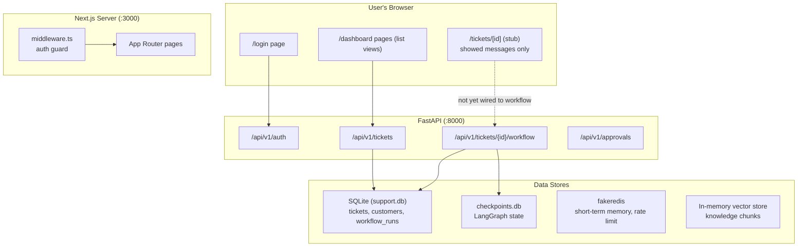
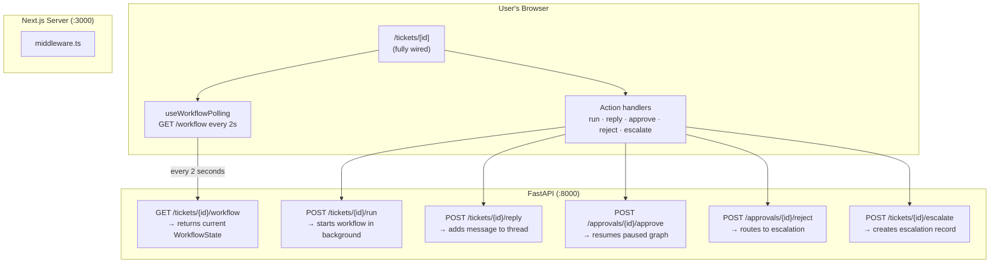
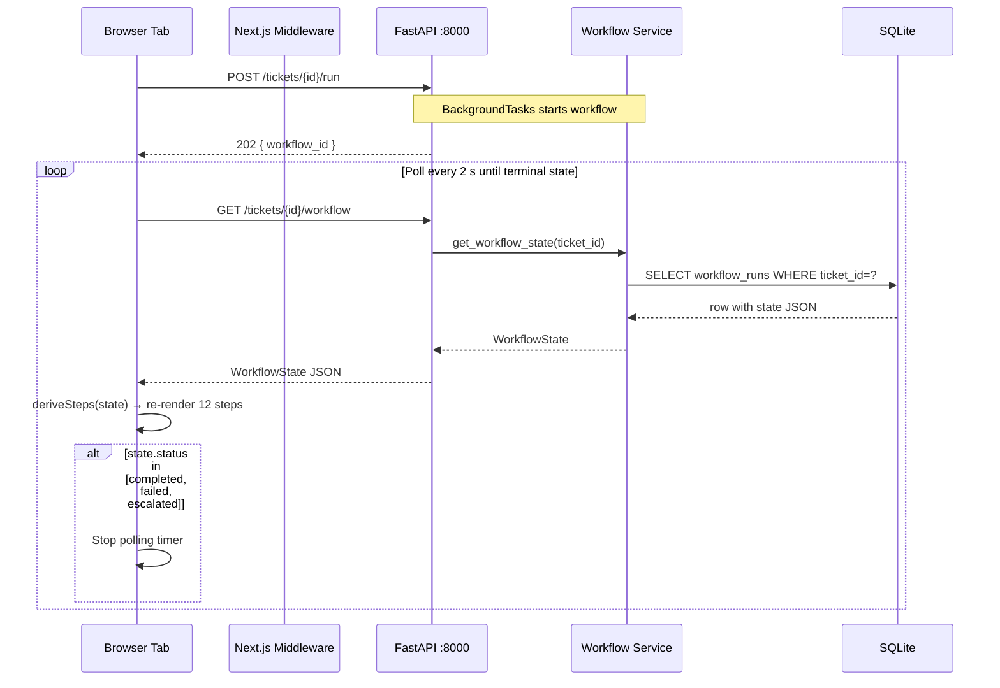
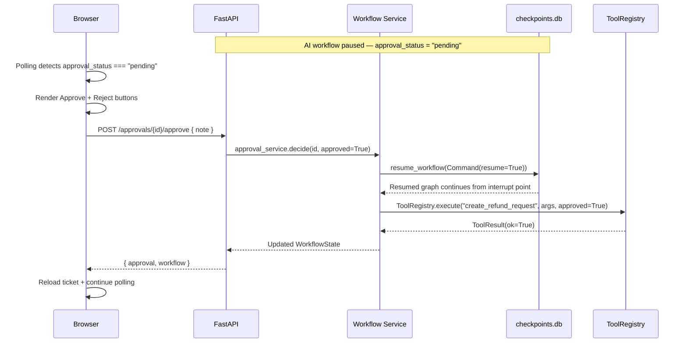
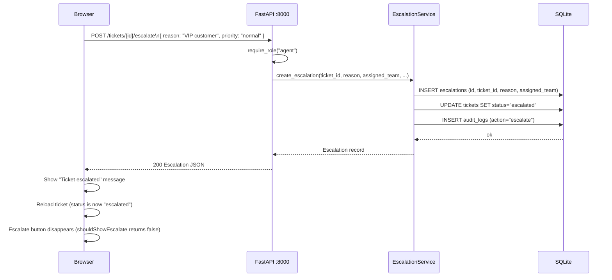
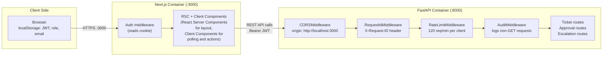
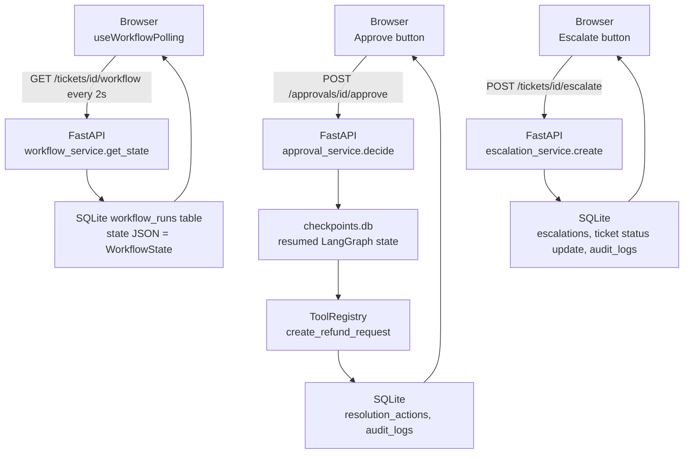

# Phase 13 — Ticket Workflow Screen: Infrastructure and Component Wiring

## Overview

Phase 13 adds no new backend infrastructure. It wires the already-running services together through the browser's ticket detail screen. The infrastructure story for this phase is entirely about **how the browser communicates with the API** to drive the live workflow panel.

---

## Component Map at the Start of Phase 13

The `TICKET_STUB` → `WORKFLOW_RT` connection was not yet made. Phase 13 completes it.

---

## What Phase 13 Adds to the Wiring

---

## The Polling Loop in Detail

The browser does not receive push notifications. It uses a timed polling loop to stay up to date with the AI workflow's progress.

**Key networking details:**
- All requests carry `Authorization: Bearer <JWT>` from localStorage
- The API validates the JWT on every request (Phase 3 middleware)
- If the fetch throws (network down), the hook retries after 5 seconds instead of 2 seconds
- If the server returns 401, the browser is redirected to `/login?reason=expired`

---

## The Approval Interrupt Flow

When the AI hits a step that requires human approval (e.g. a refund), the LangGraph workflow **pauses itself** and stores its full state in `checkpoints.db`. The browser detects this via the `approval_status === "pending"` field on `WorkflowState` and shows the Approve/Reject buttons.

---

## The Manual Escalate Flow

The agent can escalate a ticket manually when the AI did not auto-escalate it. This is a simple REST write — no graph resume involved.

---

## Network Topology for Phase 13

**Middleware order (outermost to innermost):**
1. CORS — allows requests from the Next.js origin
2. RequestId — stamps every request and response with `X-Request-ID`
3. RateLimit — 120 requests per minute per client IP, using Redis
4. Audit — writes `audit_logs` for every non-GET request
5. Routes — the actual handlers

---

## Data Flow Summary

---

## What Changed vs Phase 12

| Aspect | Phase 12 | Phase 13 |
|---|---|---|
| Ticket detail page | Static — showed messages and customer info | Dynamic — polling, live 12-step tracker |
| Workflow connection | No connection to AI workflow state | Polls `/tickets/{id}/workflow` every 2 seconds |
| Action buttons | None wired | Run, Reply, Approve, Reject, Escalate all functional |
| Helper logic | Inline conditionals in page | Extracted to pure functions in `hooks.ts` |
| Test coverage | StatusPill, EmptyState, WorkflowSteps, API | Plus: TicketActions (approve/reject/escalate conditionals) |
