# Phase 14 — Infrastructure Design Evolution

> **Purpose:** Explain how CloudDesk's infrastructure evolved in Phase 14 — from a developer laptop to a fully containerised, cloud-deployable platform. Each section shows the wiring and routing with diagrams and plain-English explanations.

---

## Baseline: Where We Were Before Phase 14

Before Phase 14, the entire platform ran on a developer's laptop with no containers, no cloud, and simulated services:

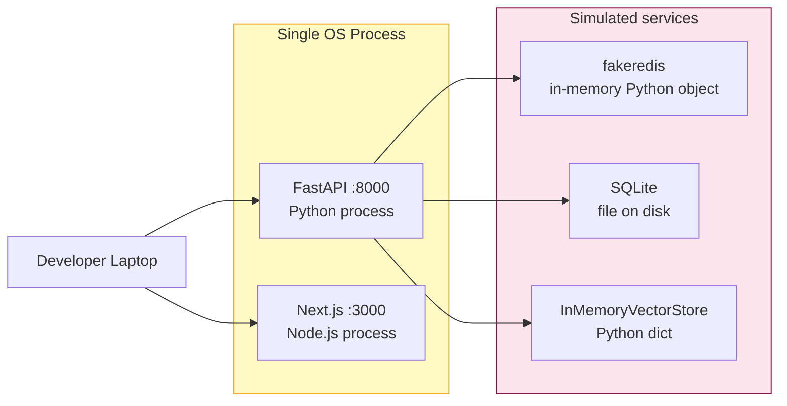

**Problem:** Works only on this exact machine with this exact Python/Node version. Cannot be shipped to anyone else.

---

## Evolution 1 — Multi-Stage Docker Builds (P14-2)

### What Changed

We wrapped each service in its own Docker image. The build process has two stages, like baking a cake vs. serving it:

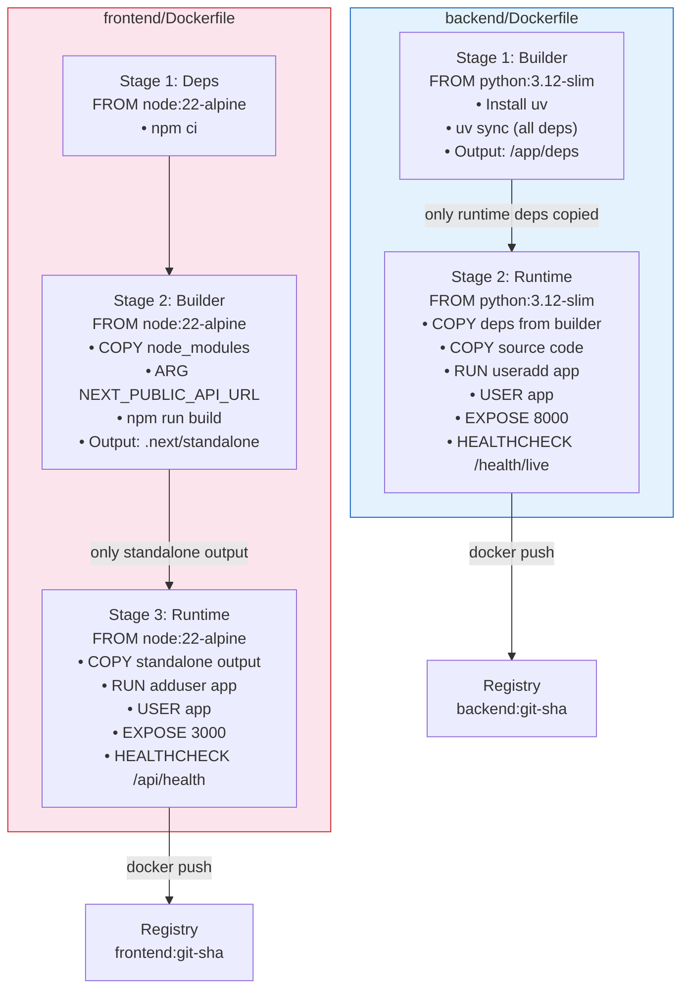

### Why Multi-Stage?

| Stage | Contains | Size |
|---|---|---|
| Builder | Compiler, uv, all dev packages | Large (~800MB) |
| Runtime | Only the installed packages needed to run | Small (~200MB) |

The build stage is **thrown away** — only the runtime stage gets shipped. This means attackers cannot use build tools inside a running container.

### Why Non-Root?

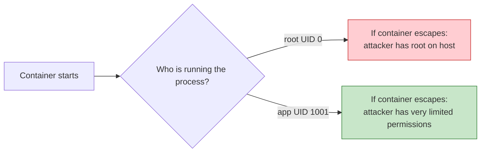

---

## Evolution 2 — Docker Compose Local Stack (P14-3)

### Full Stack Component Wiring

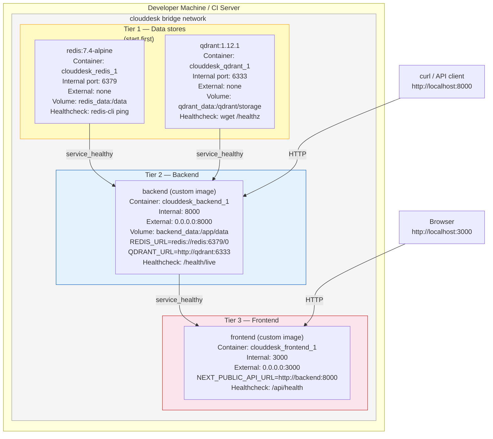

### Startup Sequence

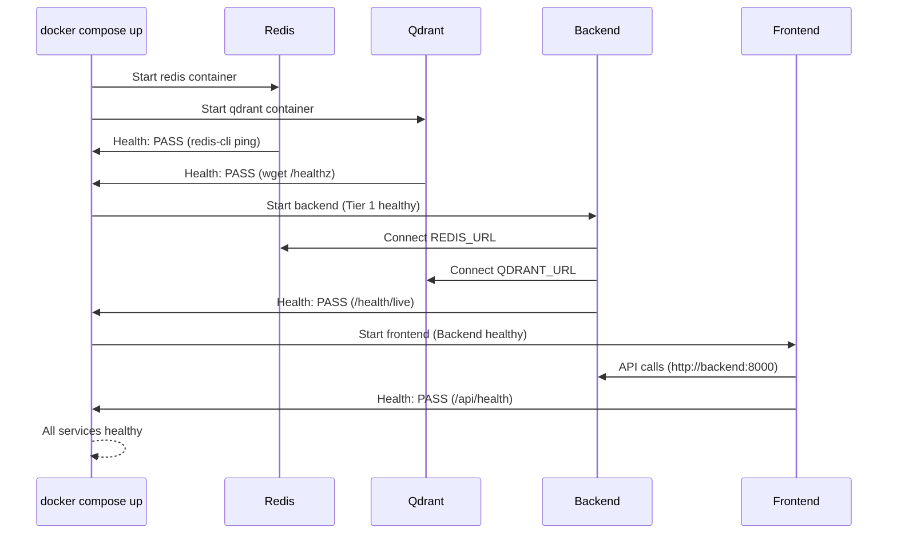

### Volume Layout

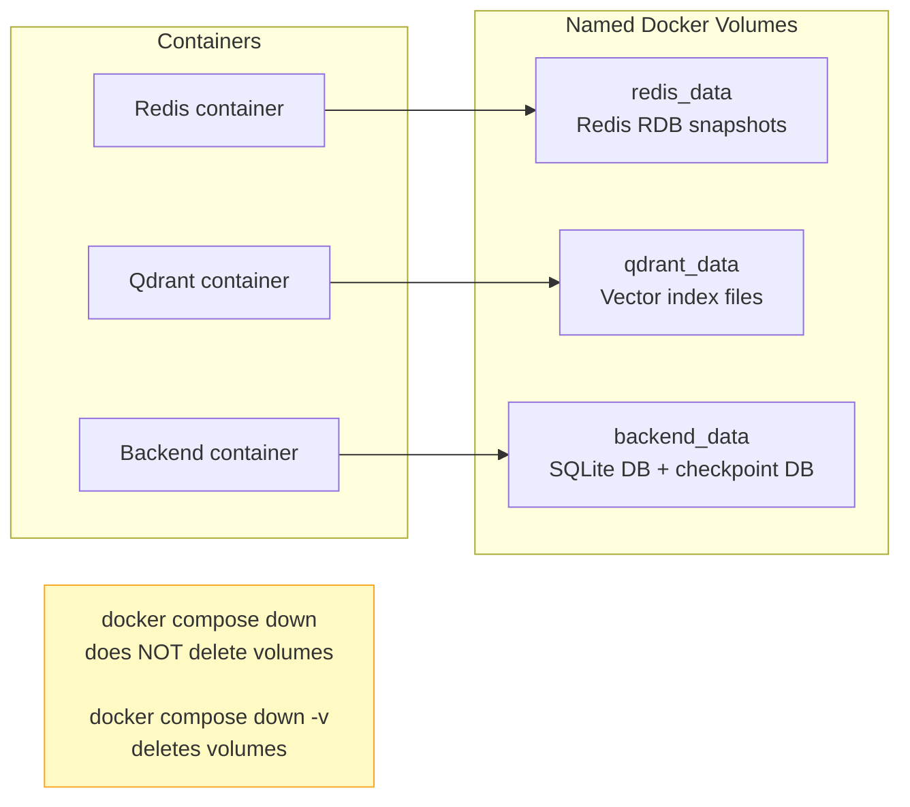

---

## Evolution 3 — Cloud Infrastructure (P14-4)

### Three-Cloud Architecture Overview

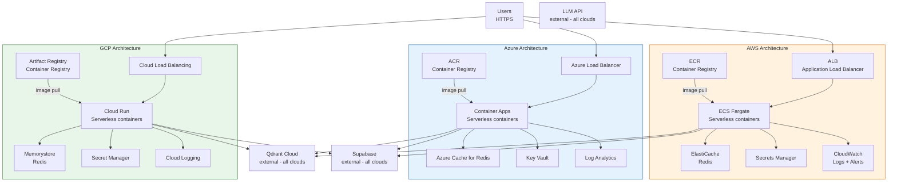

### Terraform Module Wiring

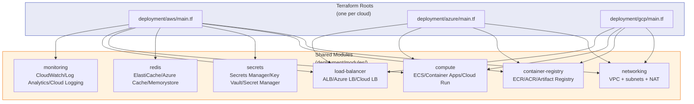

### Secret Routing (Never in Code)

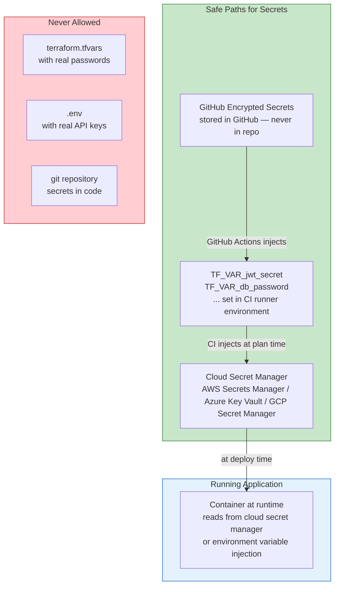

---

## Evolution 4 — CI/CD Pipeline Infrastructure (P14-4 continued)

### GitHub Actions Workflow Infrastructure

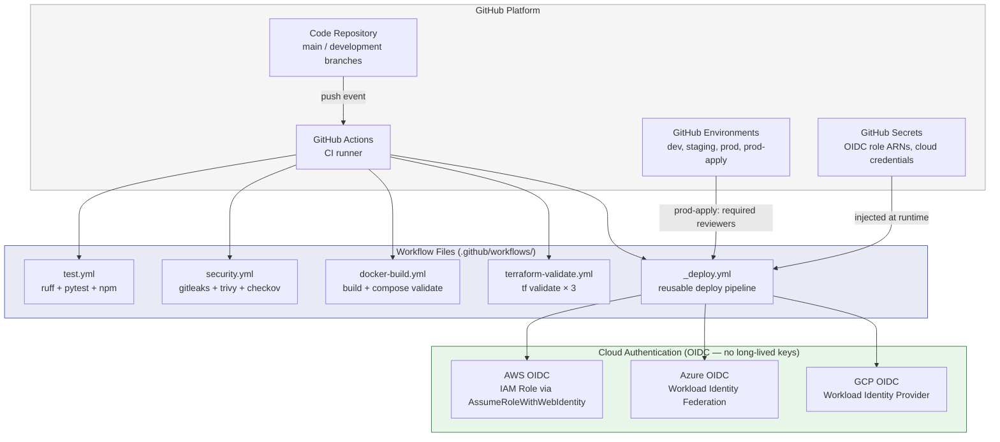

### Deploy Pipeline Routing

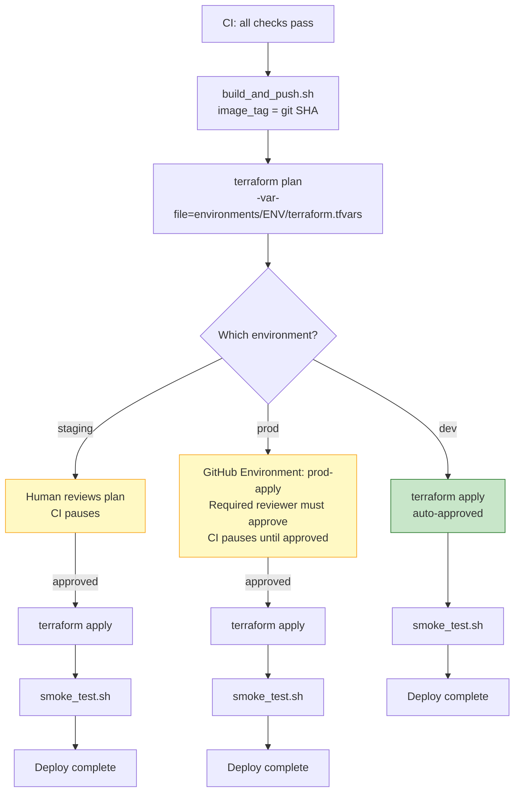

---

## Evolution 5 — Kubernetes Manifests (P14-4)

For organisations that run Kubernetes instead of managed container services:

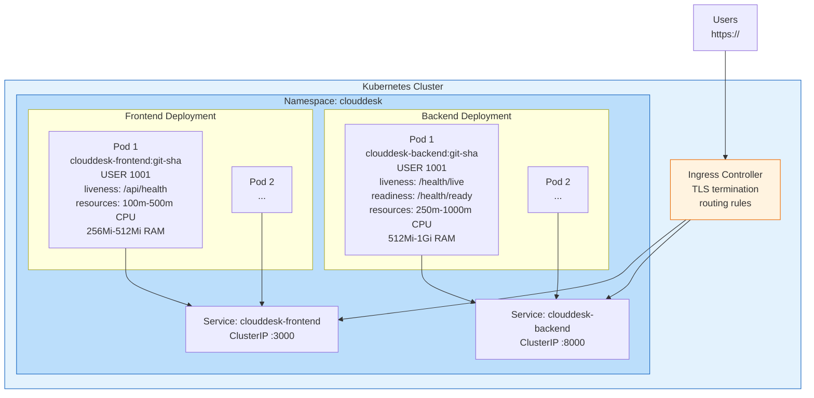

---

## Final State — Complete Infrastructure Picture

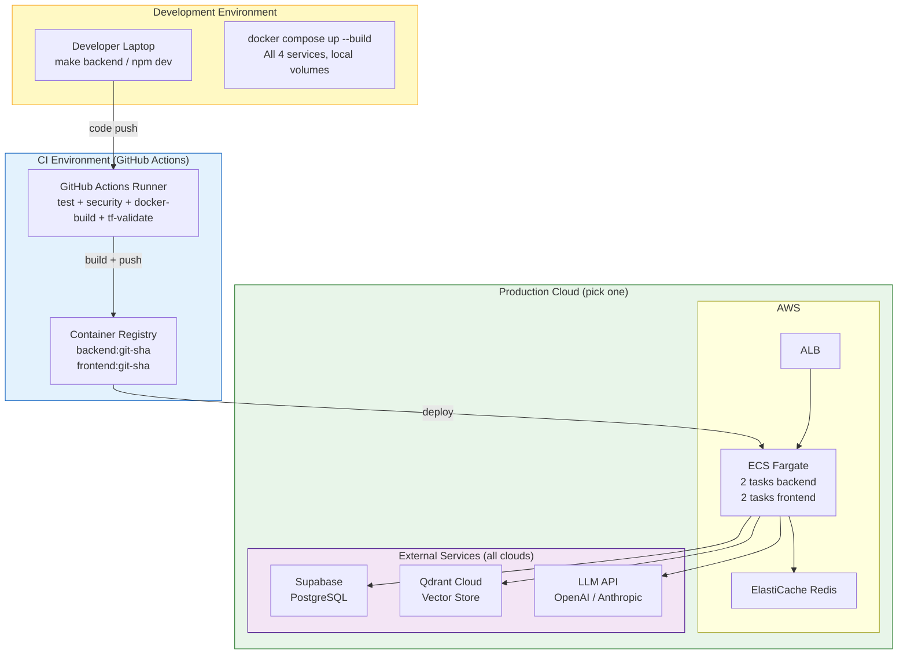

---

## Networking Summary Table

| Component | Protocol | From → To | Port | Auth |
|---|---|---|---|---|
| Browser → Frontend | HTTPS | Internet → Load Balancer | 443 | none (public) |
| Load Balancer → Frontend | HTTP | LB → Container | 3000 | none (internal) |
| Frontend → Backend | HTTPS/HTTP | Container → Container | 8000 | Bearer JWT |
| Backend → Redis | Redis | Container → Redis | 6379 | password |
| Backend → Qdrant | HTTP | Container → Qdrant | 6333 | API key |
| Backend → PostgreSQL | TCP | Container → DB | 5432 | connection string |
| Backend → LLM API | HTTPS | Container → External | 443 | API key |
| CI → Cloud Registry | HTTPS | GitHub Actions → Registry | 443 | OIDC token |
| Terraform → Cloud APIs | HTTPS | CI runner → Cloud | 443 | OIDC role |

---

## Honest Status at End of Phase 14

| Item | Status |
|---|---|
| Docker images build locally | ✅ Verified |
| `docker compose up --build` runs | ✅ Verified |
| All 419 tests pass | ✅ Verified |
| Terraform files are syntactically valid | ✅ Verified locally (`terraform validate`) |
| CI workflows created | ✅ Files committed |
| Cloud deployed (AWS / Azure / GCP) | ❌ No cloud credentials configured |
| CI pipelines executed on GitHub | ❌ Needs secrets configured in GitHub |
