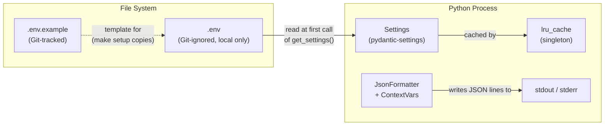
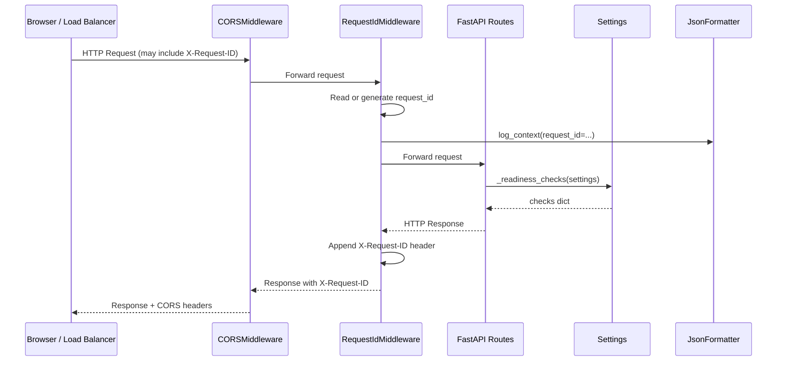
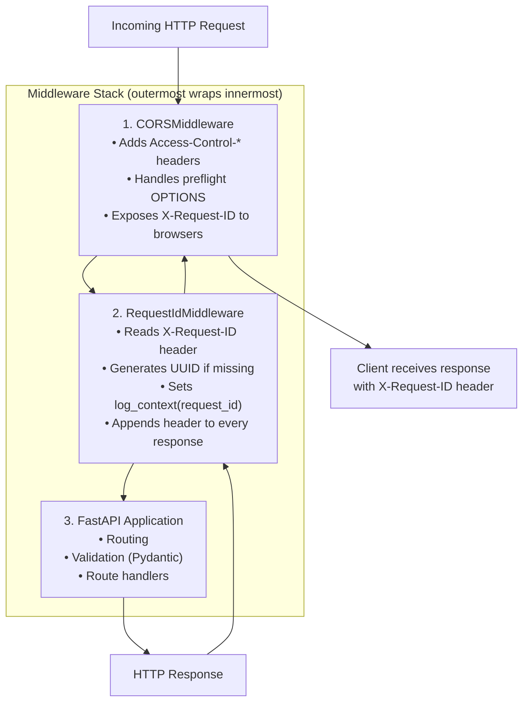
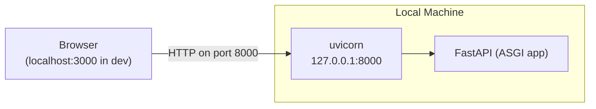
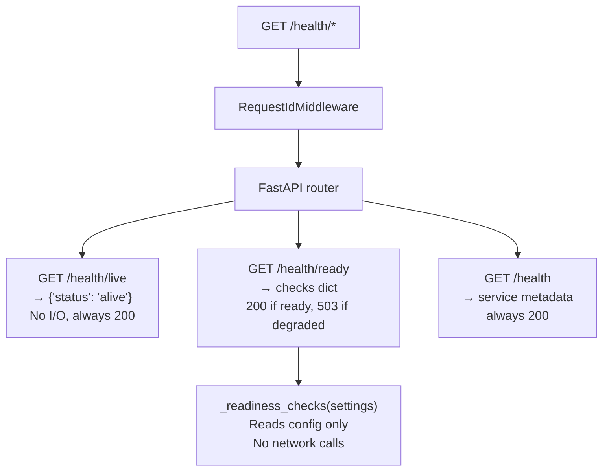
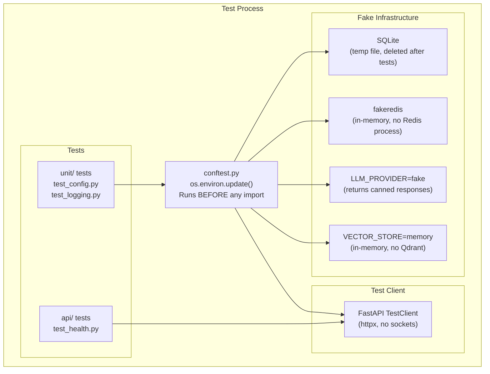
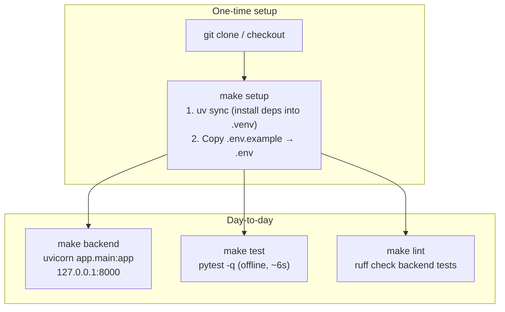
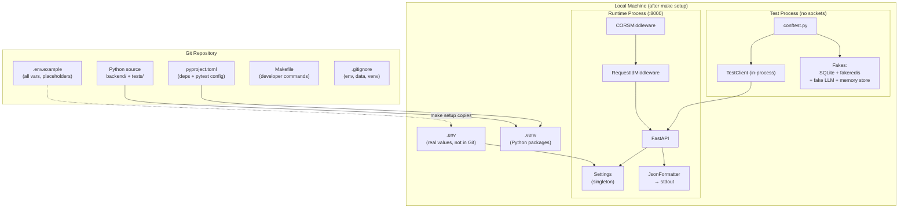
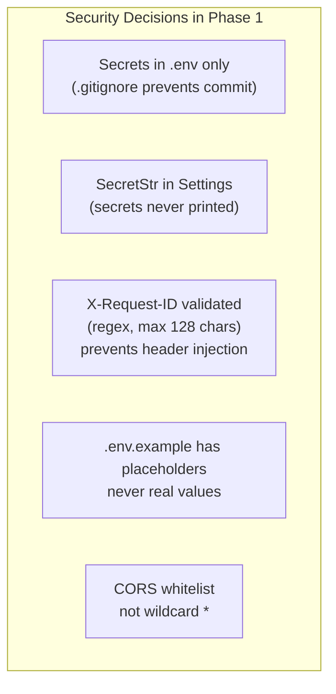

# Phase 1 — Infrastructure Design Evolution

> This document explains how the infrastructure, networking, and component wiring of CloudDesk evolves through Phase 1. Each section covers what exists at a given point, how components talk to each other, and why the choices were made.

---

## What "infrastructure" means in Phase 1

In Phase 1, there is **no Docker yet** (Docker and Compose come in Phase 14). The infrastructure is entirely local:

- A Python virtual environment (`.venv`)
- A single FastAPI process on port 8000
- No running database, Redis, or vector store (they are faked in tests)

Despite this simplicity, the *wiring patterns* are established here — the same patterns that the full Docker stack will follow later.

---

## Stage 1 — After P1-1: Config and Logging (No Network Yet)

The first infrastructure decision is **how the app reads its own configuration**.

### Component wiring

### Key wiring rules established here

1. **`.env` is the single source of truth for runtime values.** No hardcoded values in Python files (except defaults).
2. **`get_settings()` is a singleton.** Every part of the app calls `get_settings()` and gets the same object. This means you cannot have two parts of the app with different configs.
3. **`ContextVar` for log enrichment.** Python's `ContextVar` lets a log record carry the current `request_id` without passing it as a function argument. This is "ambient context" — set it once, used everywhere in that coroutine.

---

## Stage 2 — After P1-2: HTTP Server and Middleware Stack

The FastAPI process now listens on a port and processes HTTP requests. This introduces the **middleware stack** — a chain of wrappers around every route.

### HTTP request flow

### Middleware stack (outermost to innermost)

> **Future middleware (added in Phase 3):** The order after Phase 3 will be:
> `CORS → RequestId → RateLimit → Audit`
> This order is intentional: rate limiting happens before audit logging so that rejected requests are not unnecessarily written to the audit log.

### Port and network binding

- Binds to `127.0.0.1` (loopback only) in development — not reachable from other machines.
- In production (Phase 14), this will be a Docker container behind a load balancer.
- CORS is configured to allow `http://localhost:3000` by default (the Next.js dev server).

### Health endpoint routing

---

## Stage 3 — After P1-3: Test Infrastructure Wiring

The test harness introduces a **parallel, isolated infrastructure** that runs entirely in memory. No ports, no sockets.

### Test infrastructure wiring

### Key isolation properties

| Property | How it works |
|---|---|
| No real database | `DATABASE_URL=sqlite+aiosqlite:///./tmp/.../support.db` — temp file, cleaned up |
| No real Redis | `USE_FAKE_REDIS=true` — `fakeredis` library replaces Redis in memory |
| No real LLM | `LLM_PROVIDER=fake` — deterministic canned responses, no API key needed |
| No real vector store | `VECTOR_STORE=memory` — Python dict, no Qdrant process |
| No real HTTP sockets | `TestClient` from `httpx` calls the ASGI app in-process, no TCP |

### Why this matters architecturally

The test suite proves an important design guarantee: **every external dependency can be replaced with a fake.** This is only possible because all dependencies are accessed through abstraction:
- Config: `get_settings()` — overridable by env vars
- Database: `DATABASE_URL` — SQLite for tests, Postgres for production
- Redis: `USE_FAKE_REDIS` flag — same code, different backend
- LLM: `LLM_PROVIDER` — same interface, different implementation

This pattern (sometimes called "ports and adapters") means the core business logic never depends directly on a specific infrastructure choice.

---

## Stage 4 — After P1-4: Full Phase 1 Infrastructure Picture

After adding `Makefile` and `.env.example`, the complete local infrastructure looks like this:

### Developer workflow

### Full Phase 1 infrastructure diagram

---

## Infrastructure that does NOT exist yet in Phase 1

| Component | Added in |
|---|---|
| PostgreSQL / SQLite (real) | Phase 2 |
| Redis (real, for rate limiting) | Phase 3 |
| JWT authentication | Phase 3 |
| Qdrant (vector store) | Phase 5 |
| Docker containers | Phase 14 |
| Docker Compose networking | Phase 14 |
| Kubernetes / cloud deploy | Phase 14 |

---

## Security posture after Phase 1

Even at this early stage, several security decisions are locked in:

---

## Summary

Phase 1 establishes the **infrastructure skeleton** that every later phase builds on:

1. **Configuration layer:** `.env` → `Settings` singleton → every component that needs config
2. **Middleware stack:** `CORS → RequestId → FastAPI` (will grow in Phase 3)
3. **Request tracing:** `X-Request-ID` flows from client → middleware → logs → response
4. **Test isolation:** Every real infrastructure component has a fake equivalent; tests run in-process
5. **Developer ergonomics:** One-command setup and run via `Makefile`

The infrastructure does no real work yet — no tickets, no AI, no database writes — but every pattern that the full system will use is already in place.
