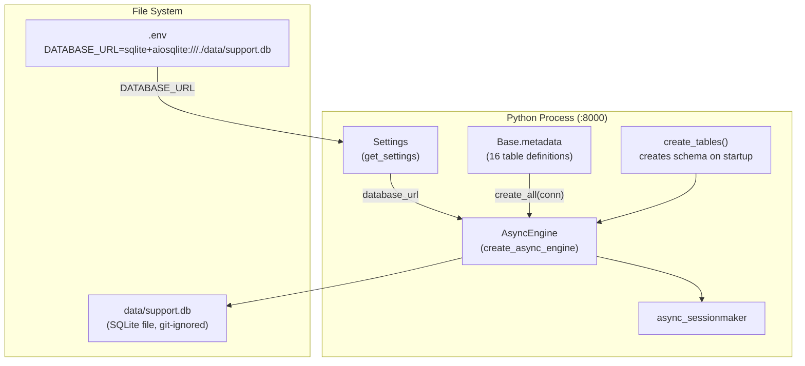
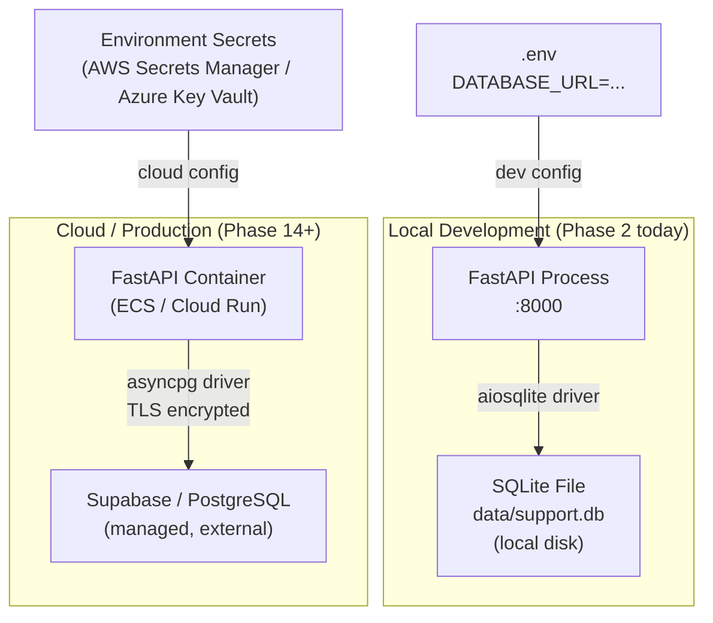
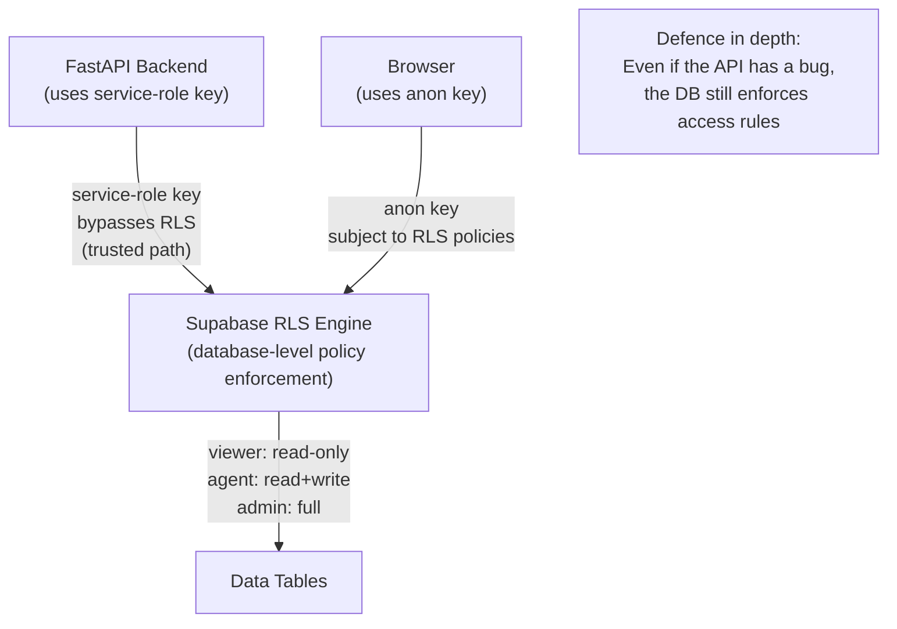
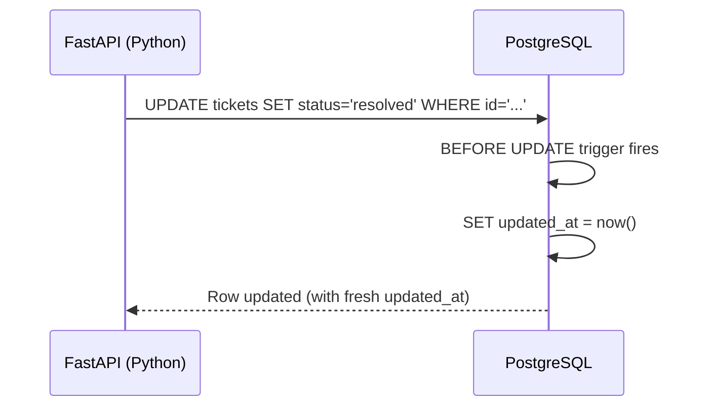
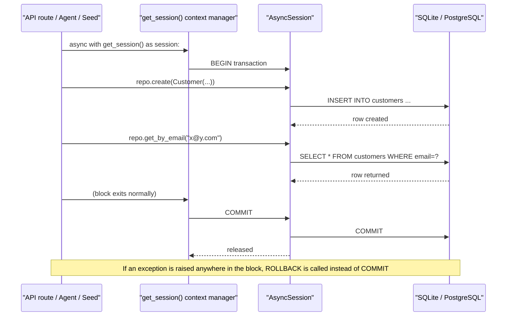
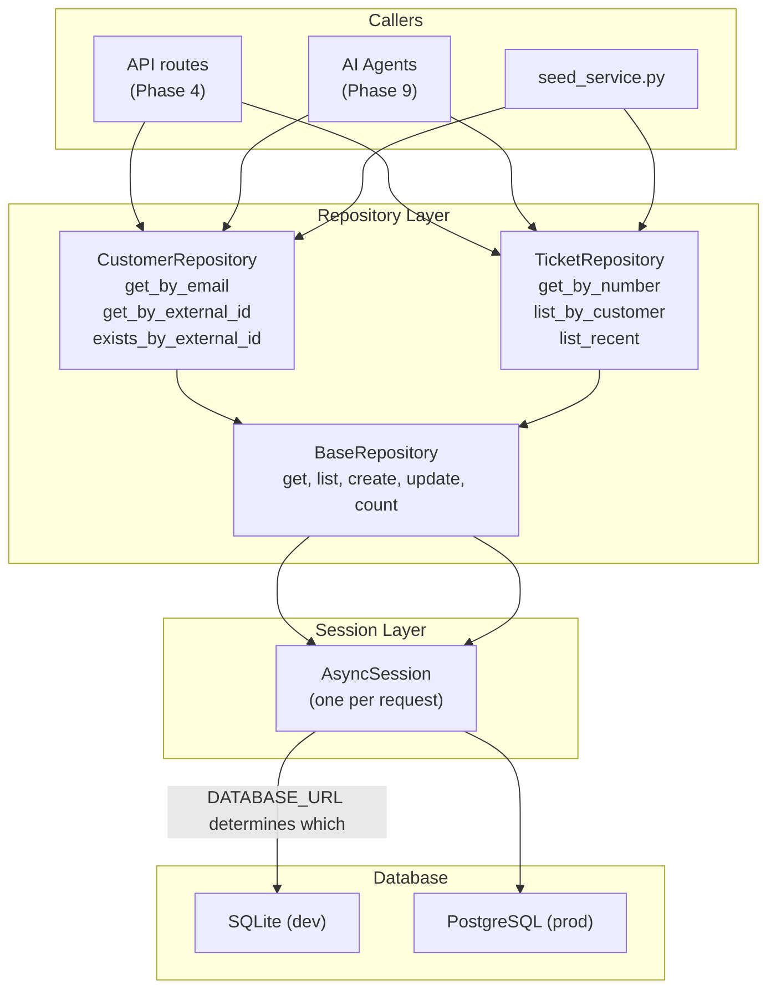
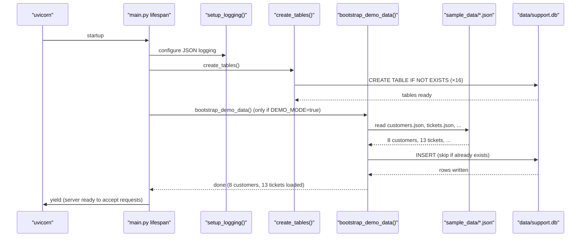
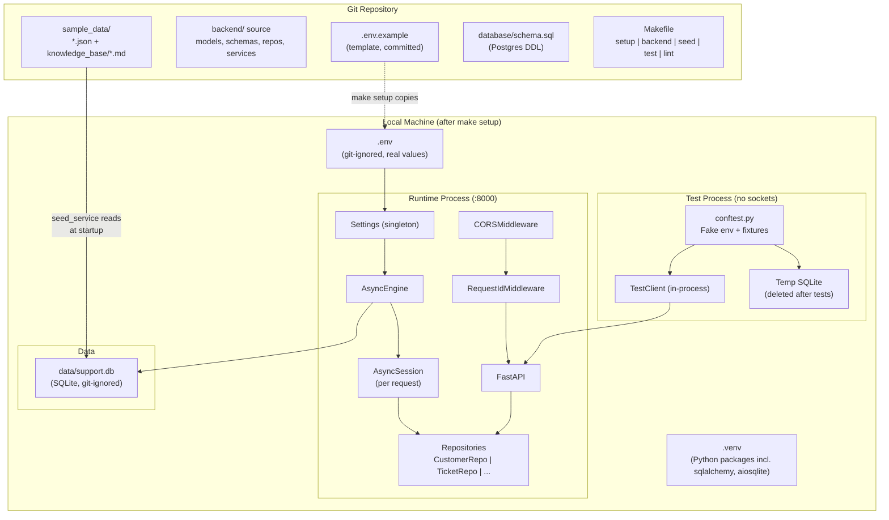
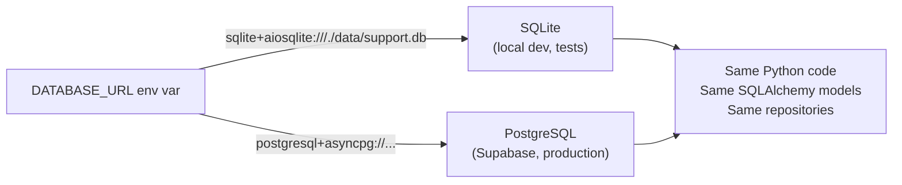
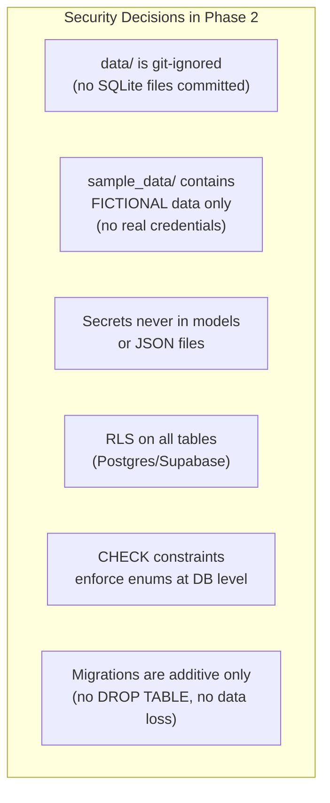

# Phase 2 — Infrastructure Design Evolution

> This document explains how the infrastructure, storage, and component wiring of CloudDesk evolves through Phase 2. Each section covers what exists at a given point, how data flows between components, and why the choices were made.

---

## What "infrastructure" means in Phase 2

Phase 2 introduces the first **persistent storage layer**. Before Phase 2, the app had no databases — everything lived in process memory and disappeared on restart. After Phase 2:

- A SQLite file (`data/support.db`) stores all application data locally.
- An async SQLAlchemy engine manages connections.
- The seed service writes demo data into the database on first startup.

Docker and cloud databases are still future phases (Phase 14 and production deployment). But the **wiring patterns** established here are exactly what the Docker stack will follow later.

---

## Stage 1 — After P2-1: Database Engine Added to the Runtime

The first infrastructure addition is the database engine and session management.

### Component wiring

### Key wiring rules established here

1. **`DATABASE_URL` controls everything.** Change one environment variable to switch from SQLite to PostgreSQL. The application code never imports a specific database driver.
2. **`create_tables()` is idempotent.** It uses `create_all(checkfirst=True)`, meaning it only creates tables that do not already exist. Running it twice is safe.
3. **`AsyncEngine` with `aiosqlite`.** Python's `asyncio` allows the web server to handle thousands of concurrent requests while some are waiting for database I/O. The async engine is essential for performance.

---

## Stage 2 — After P2-2: Postgres Schema (Cloud-Ready Wiring)

This stage establishes what the infrastructure looks like when deployed to the cloud. No new Python runtime code — this is about the Supabase/Postgres picture.

### Local vs. cloud infrastructure

### Database security in Supabase (RLS wiring)

### `updated_at` trigger wiring

The trigger runs at the database level — the application code never needs to manually set `updated_at`. This prevents the common bug where code forgets to update the timestamp.

---

## Stage 3 — After P2-3: Repository Layer Wiring

The repository layer sits between the application logic and the raw database session. It is the "connector" that every part of the app uses to talk to the database.

### Session lifecycle per request

### Repository call chain

---

## Stage 4 — After P2-4: Startup Sequence and Data Flow

The final stage adds the demo data bootstrap to the startup sequence.

### Full startup sequence

### Complete Phase 2 infrastructure diagram

---

## Infrastructure that does NOT exist yet in Phase 2

| Component | Added in |
|---|---|
| JWT authentication | Phase 3 |
| Redis rate limiting | Phase 3 |
| HTTP API routes | Phase 4 |
| Vector store (Qdrant / in-memory) | Phase 5 |
| Docker containers | Phase 14 |
| Docker Compose networking | Phase 14 |
| Cloud deployment (AWS/Azure/GCP) | Phase 14 |

---

## Two-database portability

A critical property established in Phase 2 is that the same Python code runs on two different databases depending on a single environment variable:

The only differences between environments are:
1. The `DATABASE_URL` value
2. For Postgres: `JSON` column type becomes `JSONB`, UUID handling is native
3. For Postgres: RLS policies are enforced; for SQLite: they are not (but the app-level RBAC will cover this in Phase 3)

---

## Security posture after Phase 2

---

## Summary

Phase 2 adds the data storage layer to the infrastructure:

1. **Storage engine:** `AsyncEngine` connects to SQLite (dev) or Postgres (prod) via a single env var.
2. **Schema management:** `create_tables()` runs at startup; Postgres has authoritative DDL in `schema.sql`.
3. **Session management:** `get_session()` context manager guarantees commits and rollbacks.
4. **Repository layer:** All database access goes through typed repositories — no raw SQL in business logic.
5. **Demo bootstrap:** `bootstrap_demo_data()` runs at startup in demo mode and is idempotent.
6. **Cloud-ready:** RLS policies and the Postgres DDL are production-grade from day one.
