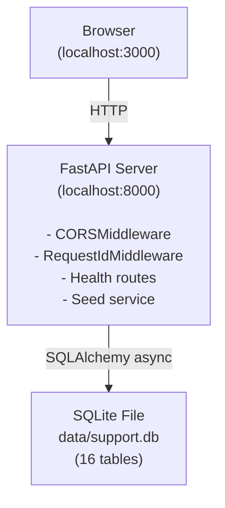
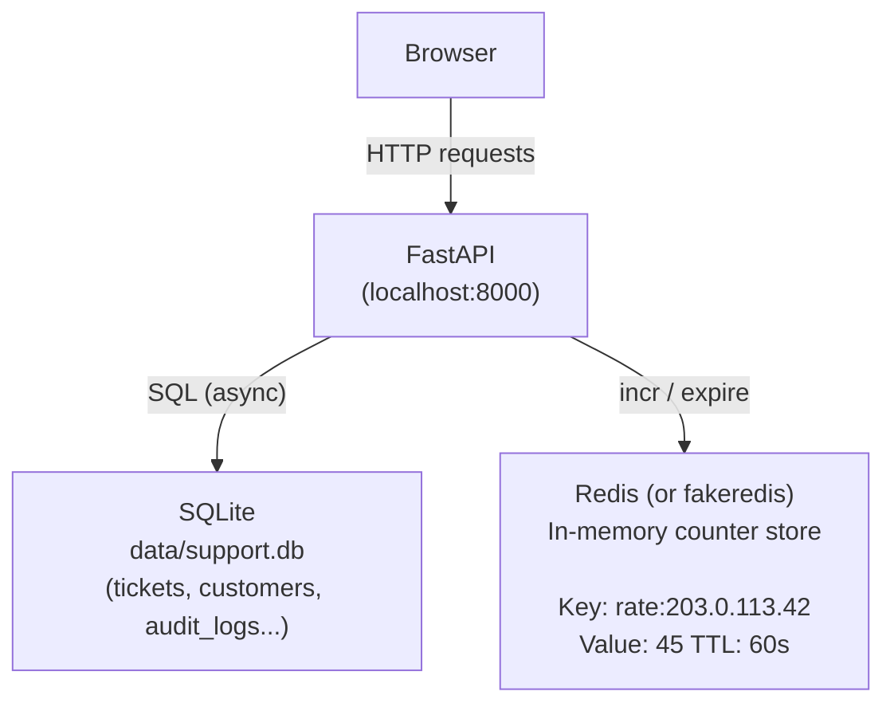
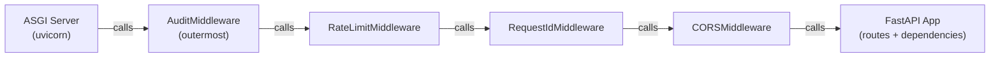
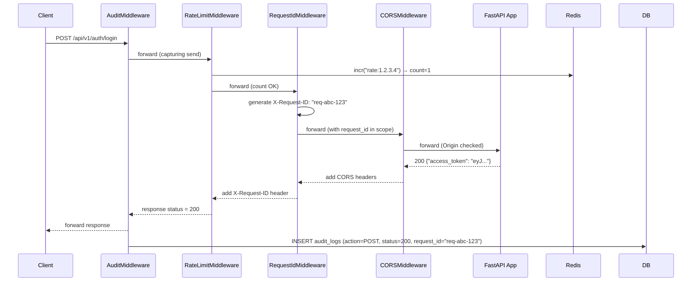
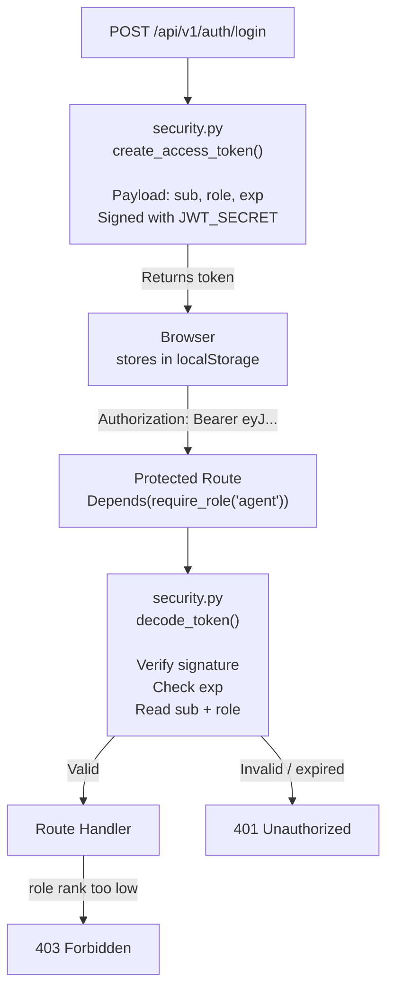
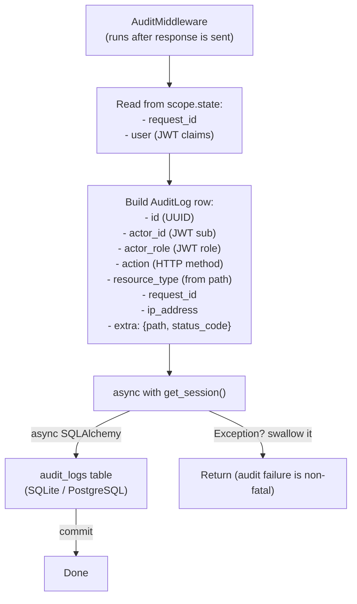
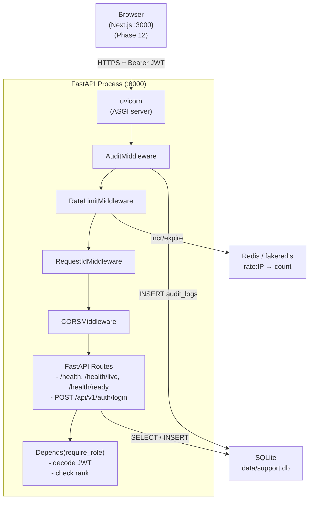

# Phase 3 — Infrastructure Design Evolution: Identity and Request Guards

> This document explains how the infrastructure wiring changed in Phase 3, focusing on the new components (JWT auth, Redis, audit logging) and how they connect to the existing FastAPI + SQLite stack.

---

## Infrastructure before Phase 3 (end of Phase 2)

At the end of Phase 2, the running infrastructure looked like this:



**What was missing:**
- No login endpoint
- No token verification
- No rate counter store
- No audit writing

---

## New infrastructure component added in Phase 3: Redis

Phase 3 introduces **Redis** as a second data store — but only for one job: counting requests per IP.



**Two modes for Redis:**

| Mode | When | Component |
|---|---|---|
| `USE_FAKE_REDIS=true` | Tests, demo mode | `fakeredis.FakeRedis` — pure Python, in-memory, no server needed |
| Real Redis | Production | `redis.from_url(REDIS_URL)` — connects to a real Redis server |

The same application code uses both. The factory function in `core/redis.py` picks the right one based on the environment variable.

---

## The new middleware stack wiring

The most important infrastructure change in Phase 3 is the **middleware layering**. Each middleware wraps the next like nested containers.

### How the wrapping works (code-level wiring)

```python
# In create_app():
cors_app       = CORSMiddleware(app=api, ...)
request_id_app = RequestIdMiddleware(cors_app)
rate_limit_app = RateLimitMiddleware(request_id_app)
audit_app      = AuditMiddleware(rate_limit_app)
return audit_app  # This is what the ASGI server calls
```

Each middleware holds a reference to the next. When the outermost (`AuditMiddleware`) is called, it calls `RateLimitMiddleware`, which calls `RequestIdMiddleware`, and so on.

### Visual wiring of the middleware chain



### Request flow through the stack



---

## JWT token infrastructure wiring

JWTs create a **stateless auth** pattern — no session table, no DB lookup per request.



**JWT_SECRET is never exposed to the browser.** It lives only in the `.env` file on the server. The signed token can be verified by anyone with the secret, but cannot be forged without it.

---

## Audit log infrastructure: the write path

The `audit_logs` table already existed in Phase 2 (created by `create_tables()` from entities.py). Phase 3 is the first time it gets written.



**Critical design rule:** A failing audit write must **never** prevent the user's request from succeeding. The middleware catches all exceptions silently. This follows the same principle used in the workflow tracer later (Phase 9): telemetry must not break operations.

---

## Component map after Phase 3



---

## Environment variable wiring for Phase 3 components

| Variable | Phase 3 purpose | Demo default |
|---|---|---|
| `JWT_SECRET` | Signs and verifies tokens | Set to `"clouddesk-test-jwt-secret"` in tests |
| `SUPABASE_JWT_SECRET` | Alternative to JWT_SECRET (Supabase-compatible) | Empty (unused in demo) |
| `REDIS_URL` | Real Redis connection string | Empty (fakeredis is used instead) |
| `USE_FAKE_REDIS` | Switch to fakeredis | `true` in tests and demo |
| `RATE_LIMIT_PER_MINUTE` | Requests per 60-second window | `120` |

**Priority rule for JWT secret:** `effective_jwt_secret` checks `SUPABASE_JWT_SECRET` first (for Supabase production deployments), falls back to `JWT_SECRET`. This means swapping to Supabase auth in production requires only one environment variable change — no code change.

---

## Infrastructure delta: what changed between Phase 2 and Phase 3

| Component | Phase 2 | Phase 3 |
|---|---|---|
| Middleware count | 2 (CORS, RequestId) | 4 (Audit, RateLimit, RequestId, CORS) |
| Data stores | SQLite only | SQLite + Redis (or fakeredis) |
| Endpoints | /health, /health/live, /health/ready | + POST /api/v1/auth/login |
| Auth tables written | — | audit_logs (on every non-GET) |
| Token infrastructure | None | JWT (HS256, 8h expiry, PyJWT) |
| New Python packages | None | PyJWT, fakeredis, redis |

---

## In one sentence

> Phase 3 wires four middleware layers in a specific nesting order, connects a Redis rate-limit counter to the middleware stack, issues and verifies JWT tokens entirely within the Python process (no external auth service), and writes an audit row to SQLite after every state-changing request — with every component designed to fail safely so security infrastructure never breaks the core request path.
