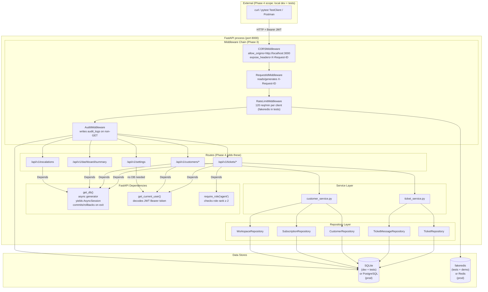
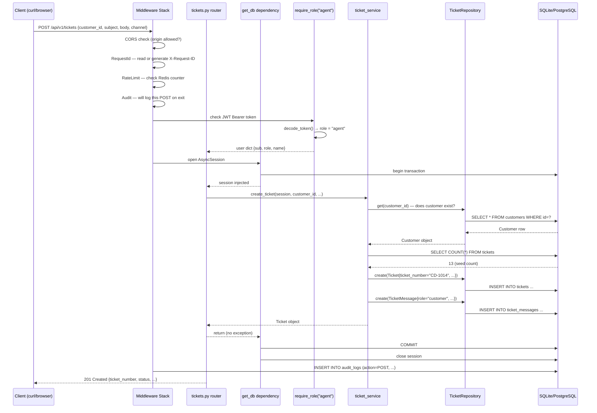
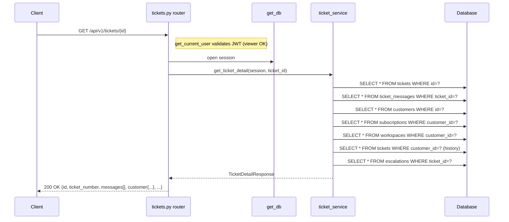
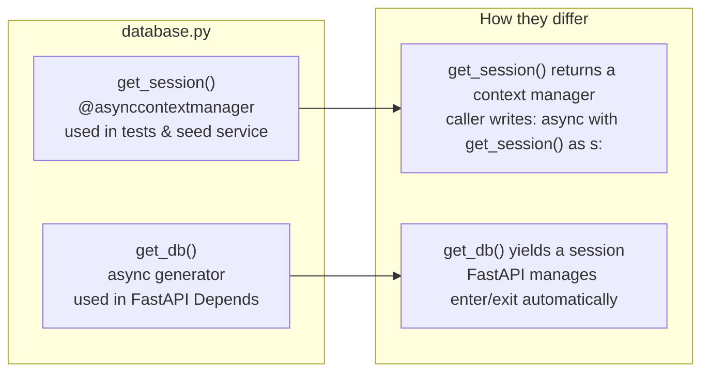
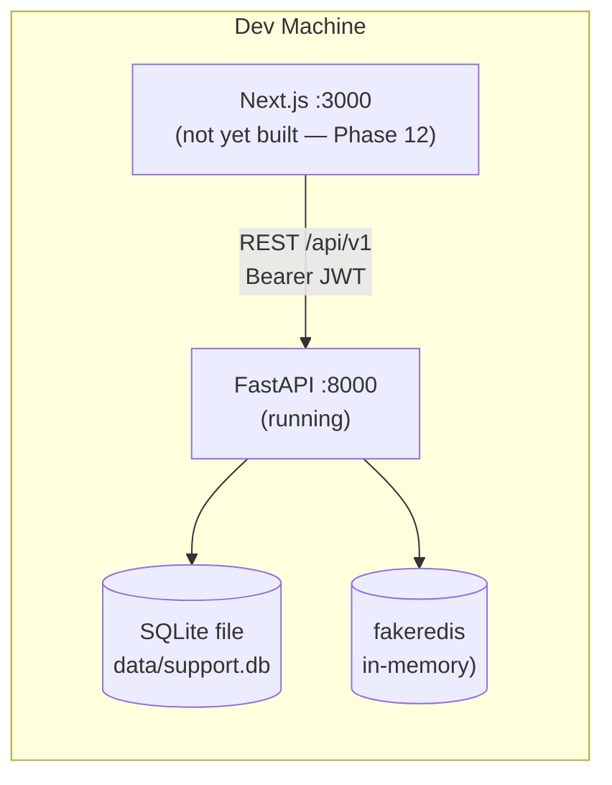

# Phase 4 — Infrastructure Design Evolution: Support API

> This document explains the component wiring, routing, and data flow introduced in Phase 4 from an infrastructure perspective.

---

## What changed at the infrastructure level in Phase 4

Phase 4 is primarily a **software routing** phase rather than an infrastructure phase — no new services or containers were added. What changed is how HTTP requests flow *through* the existing application to reach new business logic.

The key infrastructure additions:
1. **New URL routes** mounted in the FastAPI application.
2. **A new database session dependency** (`get_db`) wired into those routes.
3. **TypeScript types** placed in the frontend directory (even though the Next.js frontend doesn't exist yet).

---

## Component wiring at the end of Phase 4



---

## Request lifecycle diagram — creating a ticket



---

## Request lifecycle diagram — getting ticket detail



---

## The `get_db` dependency — plumbing detail



Both functions open the same underlying `AsyncSession`, commit on success, and roll back on failure. They are two entry points to the same session factory — one for code that explicitly manages the context, and one for FastAPI's dependency injection system.

---

## File layout added in Phase 4

```
backend/
└── app/
    ├── api/
    │   ├── tickets.py        ← NEW: ticket CRUD routes
    │   ├── customers.py      ← NEW: customer read routes
    │   ├── dashboard.py      ← NEW: summary stub
    │   ├── escalations.py    ← NEW: escalations stub
    │   └── settings.py       ← NEW: config introspection
    ├── schemas/
    │   ├── tickets.py        ← NEW: Pydantic request/response models
    │   ├── customers.py      ← NEW: Pydantic customer models
    │   └── workflow.py       ← NEW: stub workflow state schema
    ├── services/
    │   ├── ticket_service.py ← NEW: ticket business logic
    │   └── customer_service.py ← NEW: customer business logic
    └── core/
        └── database.py       ← UPDATED: added get_db() async generator

frontend/
└── lib/
    └── types.ts              ← NEW: TypeScript type definitions (Phase 12 will use these)

docs/
└── API_CONTRACT.md           ← VERIFIED: routes and types authoritative here

tests/
└── api/
    ├── test_tickets.py       ← NEW: ticket API tests
    └── test_customers.py     ← NEW: customer API tests
```

---

## Network topology at end of Phase 4



**Note:** In Phase 4 development, the frontend does not exist. All API testing is done via pytest (TestClient) or curl. The frontend will be built in Phase 12 and will use `frontend/lib/types.ts` created here.

---

## What infrastructure is NOT yet present

| Component | Needed for | Phase |
|-----------|-----------|-------|
| Qdrant vector store | Knowledge retrieval | 5 |
| LangGraph executor | AI workflow | 9 |
| Checkpoint database | Resume on restart | 9 |
| Redis (real, not fake) | Rate limit in prod | Prod deploy |
| Docker containers | Deployment | 14 |
| Next.js frontend | UI | 12 |
