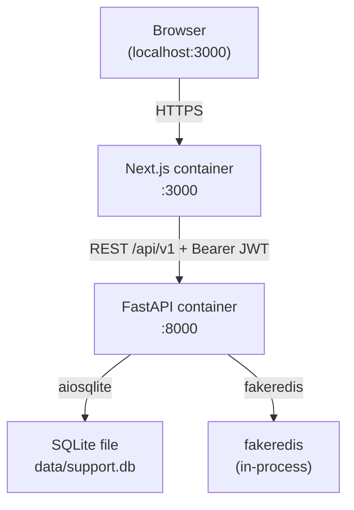
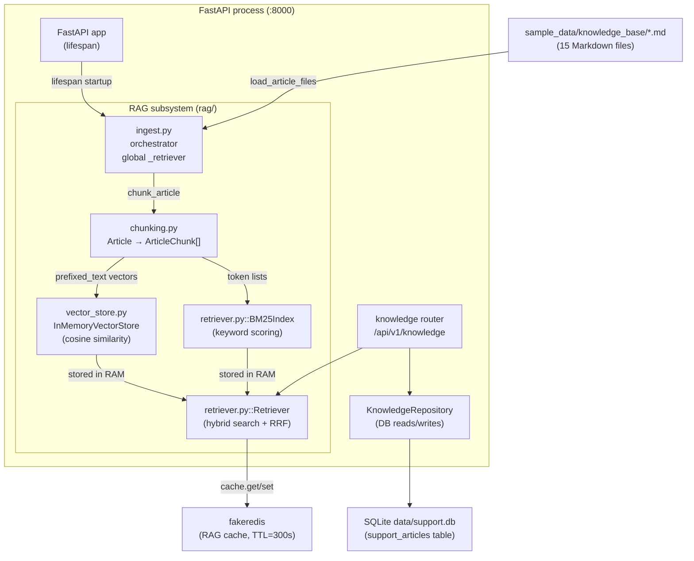
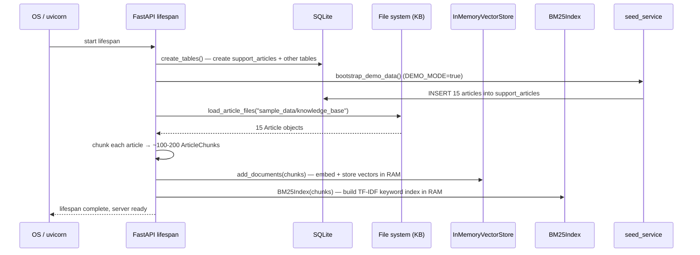
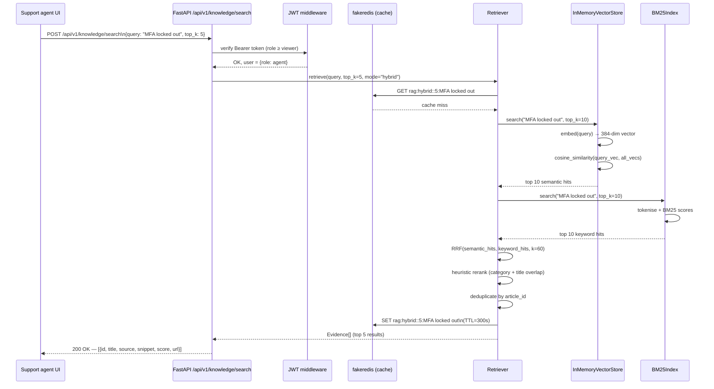
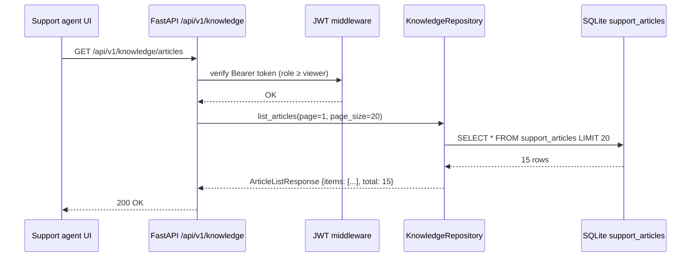
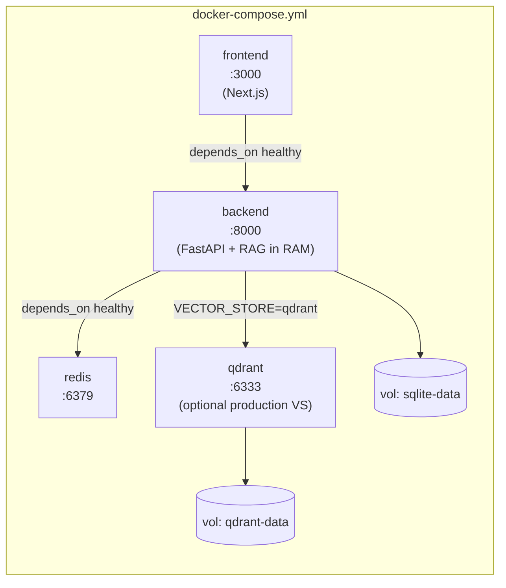
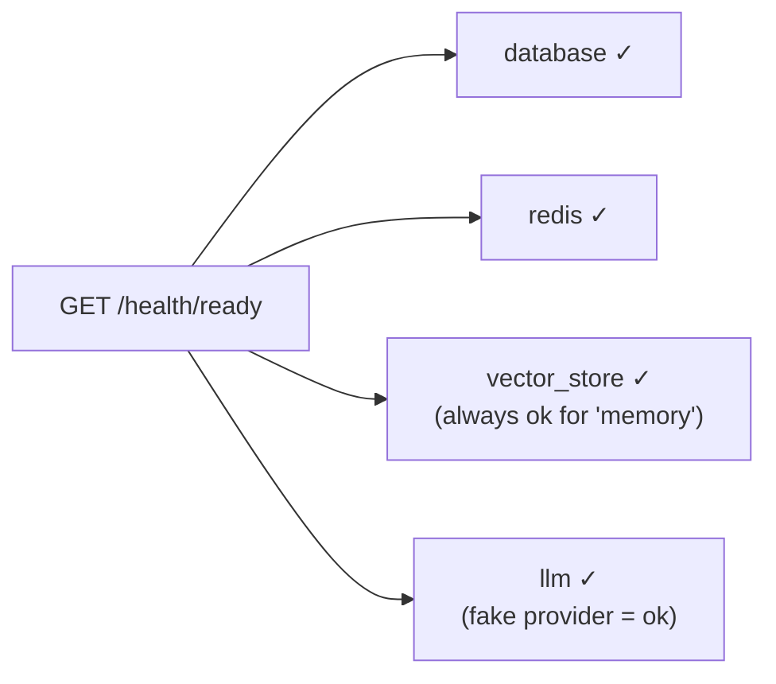
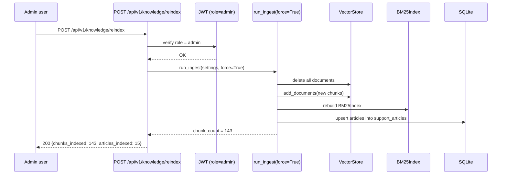

# Phase 5 — Infrastructure & Component Wiring: Knowledge Pipeline

---

## Infrastructure baseline from Phase 4

Before Phase 5, the runtime components were:



Phase 5 adds two new in-process components (**vector store** and **BM25 index**) and one optional
external service (**Qdrant**), plus the ingest pipeline that feeds them.

---

## New components introduced in Phase 5

### Component map



---

## Startup sequence (lifespan)

When FastAPI starts (or when TestClient enters its context), the lifespan runs:



---

## Request flow: knowledge search



---

## Request flow: article list / detail



---

## Docker Compose wiring (Phase 5 additions)

Phase 5 adds no new containers. The vector store and BM25 index are **in-process** RAM structures
inside the FastAPI container. The optional Qdrant service was already defined in `docker-compose.yml`
and is only activated in production.



Environment variable that controls which vector store is used:

| `VECTOR_STORE` | Used in | Vector store |
|---|---|---|
| `memory` (default) | Tests, demo | InMemoryVectorStore (RAM) |
| `qdrant` | Production | QdrantVectorStore (Qdrant container) |

---

## Environment variables added in Phase 5

| Variable | Default | Purpose |
|---|---|---|
| `VECTOR_STORE` | `memory` | Switch between in-memory and Qdrant |
| `QDRANT_URL` | `http://qdrant:6333` | Qdrant service address |
| `QDRANT_API_KEY` | *(empty)* | Qdrant API key (production) |
| `QDRANT_COLLECTION` | `clouddesk_knowledge` | Collection name in Qdrant |
| `EMBEDDING_PROVIDER` | `fake` | Embedding model provider |
| `EMBEDDING_MODEL` | `fake` | Model name |
| `EMBEDDING_DIMENSIONS` | `384` | Vector dimensions (must match model) |
| `SAMPLE_DATA_DIR` | `sample_data` | Root dir for KB articles |

---

## Health and observability

The `/health/ready` endpoint already checks the vector store:



The ingest pipeline logs the number of chunks indexed at startup, visible in JSON logs:
```json
{"event": "ingest_complete", "chunks": 143, "articles": 15, "elapsed_ms": 240}
```

---

## Reindex flow (admin operation)


