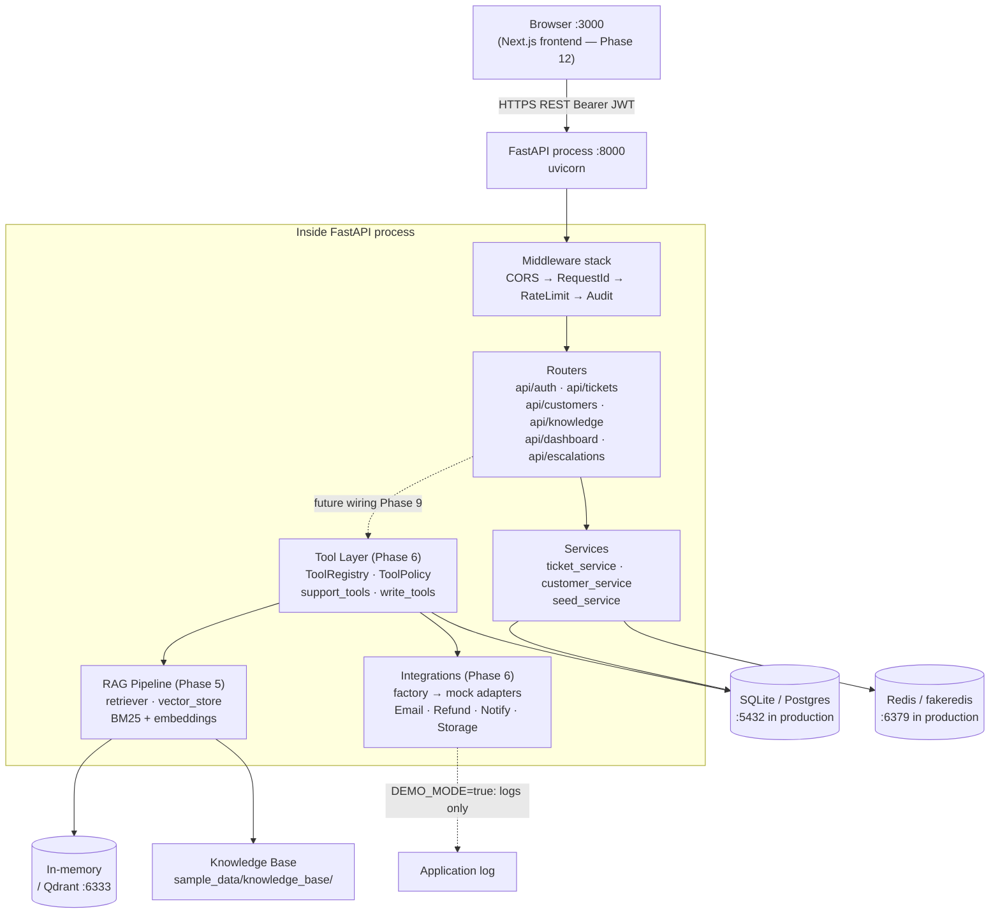
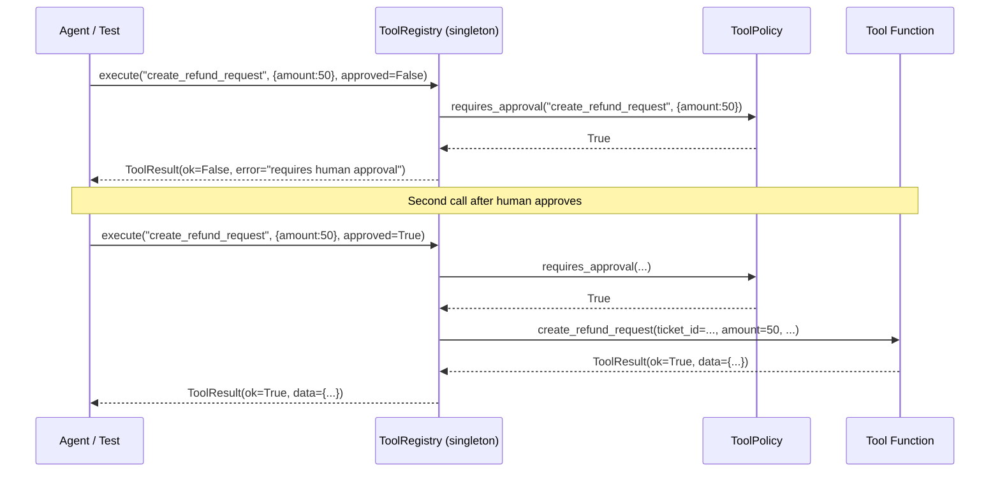
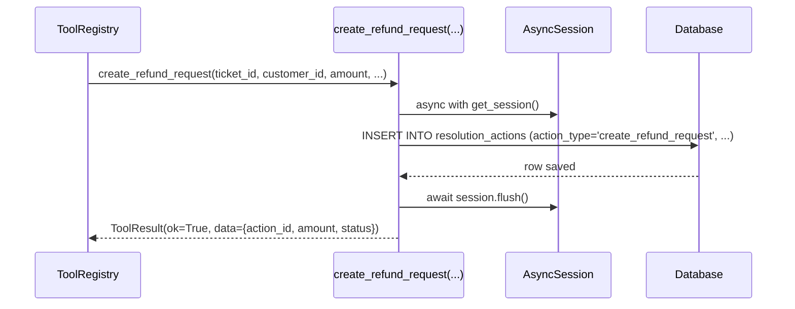
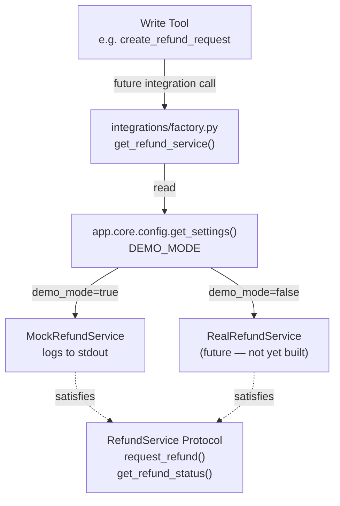
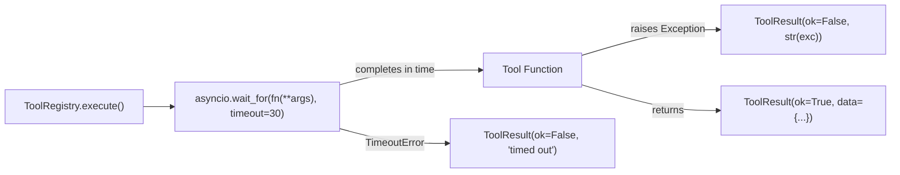

# Phase 6 — Infrastructure and Component Wiring

## Overview

Phase 6 introduces the **Tool Layer** inside the FastAPI backend process and a new top-level `integrations/` package that sits outside the backend but is imported by tool functions.  
No new network services or containers are added — this phase wires components **within** the existing backend process.

---

## Component map at the end of Phase 6



---

## P6-1: Tool Registry and Policy wiring

The `ToolRegistry` is a module-level singleton created on first import.  
On creation it auto-registers all tools by calling `register_support_tools` and `register_write_tools`.



---

## P6-2: Read-only tools — DB access path

Each read-only tool opens its own short-lived `AsyncSession` via `get_session()`.  
No session is shared across tool calls.

```mermaid
graph LR
    Tool["Tool Function\ne.g. get_customer(customer_id)"]
    Session["AsyncSession\n(from get_session context manager)"]
    Engine["SQLAlchemy Async Engine\n(sqlite+aiosqlite or postgresql+asyncpg)"]
    DB[("Database")]

    Tool -->|async with get_session()| Session
    Session --> Engine
    Engine -->|SQL SELECT| DB
    DB -->|rows| Engine
    Engine -->|ORM objects| Session
    Session -->|commit / rollback| Engine
    Tool -->|returns ToolResult| Registry["ToolRegistry"]
```

The `search_docs` tool is different — it does not touch the database:

```mermaid
graph LR
    Tool["search_docs(query, category, top_k, mode)"]
    Retriever["RAG Retriever (Phase 5)\nhybrid / semantic / keyword"]
    VStore["Vector Store\nIn-memory / Qdrant"]
    BM25["BM25 Index\nin-memory"]
    Result["Evidence list\nid · title · snippet · score · url"]

    Tool -->|await get_retriever()| Retriever
    Retriever --> VStore
    Retriever --> BM25
    Retriever -->|RRF fusion + rerank| Result
    Result -->|ToolResult(ok=True, data={evidence:[...]})| Tool
```

---

## P6-3: Write tools — approval gate + DB write path



`reset_demo_setting` additionally updates the `workspaces.settings` JSON column:

```mermaid
graph LR
    Tool["reset_demo_setting(workspace_id, setting_key, setting_value)"]
    Session["AsyncSession"]
    DB[("workspaces table\nsettings JSON column")]
    Action["resolution_actions table\naudit record"]

    Tool -->|GET workspace| Session
    Session --> DB
    Tool -->|PATCH settings JSON| DB
    Tool -->|INSERT audit record| Action
    Tool -->|ToolResult(ok=True)| Registry["ToolRegistry"]
```

---

## P6-4: Mock Integrations — component wiring

The integration layer sits in the top-level `integrations/` package, **outside** `backend/`.  
Tool functions import from `integrations.factory`, never from `integrations.mock.services` directly.



---

## Timeout and error containment

Every tool call is wrapped in `asyncio.wait_for` with `TOOL_TIMEOUT_SECONDS` (default 30 s).



**The workflow graph above the registry never sees an exception.** It only ever sees `ToolResult`.

---

## Directory layout after Phase 6

```text
CloudDesk/
├── backend/
│   └── app/
│       └── tools/
│           ├── __init__.py        ← re-exports ToolPolicy, ToolResult, ToolRegistry
│           ├── policy.py          ← ToolPolicy rulebook + ToolResult dataclass
│           ├── registry.py        ← ToolRegistry enforcer + singleton get_registry()
│           ├── support_tools.py   ← 5 read-only tool functions
│           └── write_tools.py     ← 4 write tool functions
│
├── integrations/
│   ├── __init__.py
│   ├── protocols.py               ← EmailService, RefundService, NotificationService, StorageService
│   ├── factory.py                 ← get_email_service() etc. — selects mock vs. real
│   └── mock/
│       ├── __init__.py
│       └── services.py            ← Mock*Service classes (offline-safe)
│
└── tests/
    └── unit/
        └── test_tool_policy.py    ← 27 unit tests (all passing offline)
```

---

## Runtime environment variables relevant to Phase 6

| Variable | Default | Effect |
|---|---|---|
| `TOOL_TIMEOUT_SECONDS` | `30` | Maximum seconds a single tool call may run |
| `APPROVAL_REQUIRED_FOR_REFUNDS` | `true` | Whether `create_refund_request` always needs approval |
| `MAX_REFUND_WITHOUT_APPROVAL` | `0` | Dollar threshold below which refunds auto-approve |
| `DEMO_MODE` | `true` | Selects mock integration adapters |

---

## What is NOT wired yet

| Component | Phase |
|---|---|
| Agents calling ToolRegistry | Phase 9 (specialist agents) |
| Approval interrupt in the graph | Phase 10 |
| Approval UI for agents | Phase 12 |
| Real email / billing adapters | Phase 13 / production |
