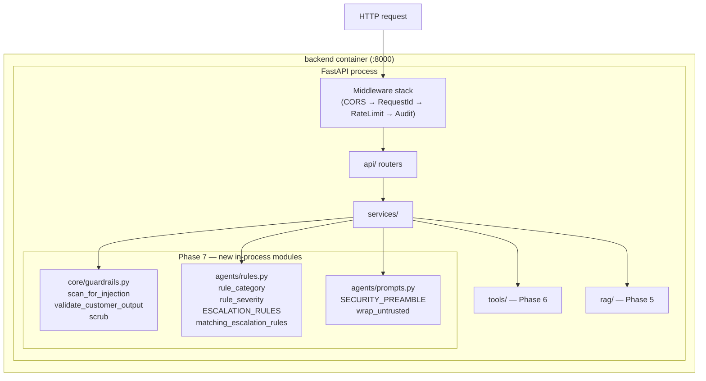
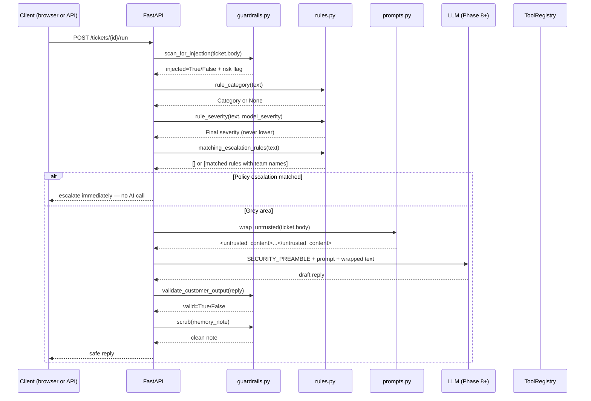
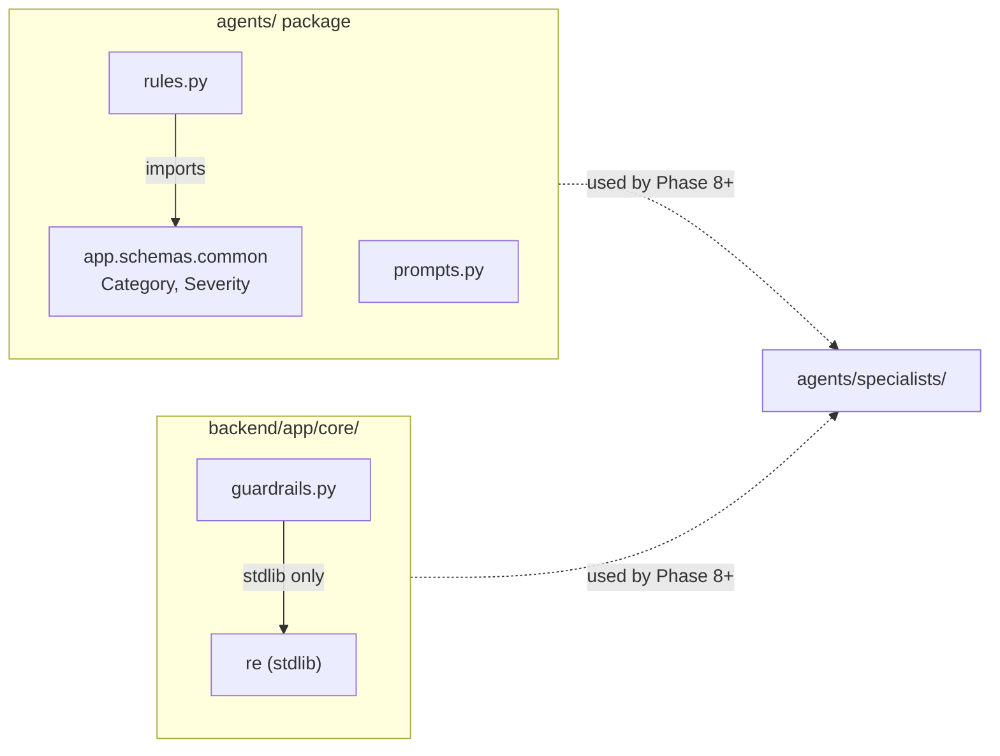
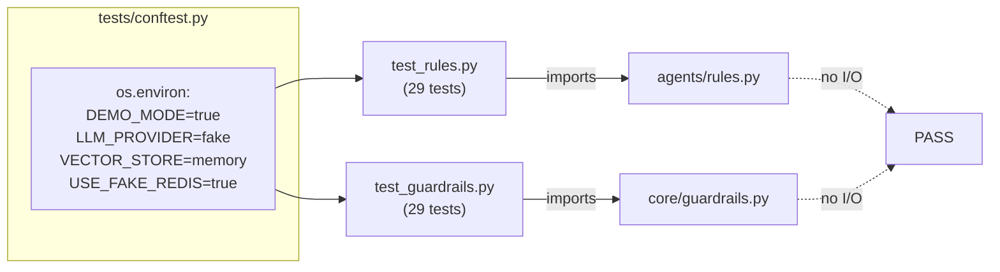
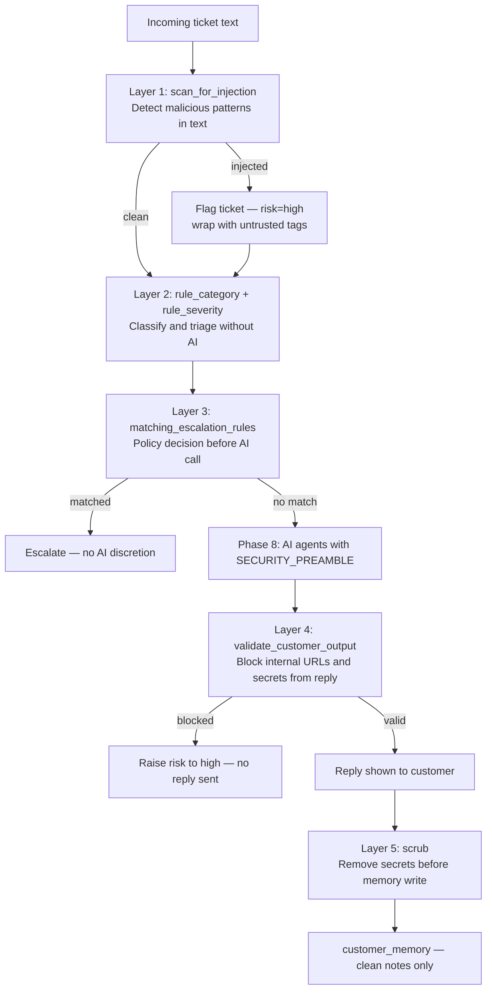

# Phase 7 — Infrastructure and Component Wiring: Rules and Guardrails

## Overview

Phase 7 introduces no new network services, containers, or databases.  
Its contribution is entirely **in-process logic** — pure Python modules that sit
between the incoming request and the AI call. No new ports are opened, no new
volumes are mounted, and no external services are called.

This makes Phase 7 the lightest infrastructure phase of the entire build.

---

## Component wiring: where the new code lives

All three new modules are plain Python — they are imported directly by the service
layer. They have zero runtime dependencies (no HTTP calls, no database reads, no
external processes).

---

## Call-time flow: rules and guardrails in a ticket run

---

## Module dependency map

Key observation: `guardrails.py` has zero application imports — it only uses Python's
built-in `re` module. `rules.py` imports only the `Category` and `Severity` enums
from `app.schemas.common`. Both modules are therefore testable with no database,
no Redis, no LLM — which is why the 58 Phase 7 tests run in under 0.5 seconds.

---

## No infrastructure changes

| Component | Phase 7 change |
|---|---|
| `backend` container | None — same image, same port |
| `frontend` container | None |
| `redis` | None |
| `qdrant` | None |
| `PostgreSQL / SQLite` | None |
| Docker Compose | None |
| `.env` / `.env.example` | None — no new env vars |

---

## Test isolation

Phase 7 tests run with the same offline harness as all prior phases:

No network, no file system, no database. The rules and guardrails are pure logic,
so they run identically in CI, in a Docker container, and on a developer laptop
with no credentials configured.

---

## Security posture added by Phase 7

Five layers, all deterministic, all running before or after the AI — never relying on
the AI to enforce them.
