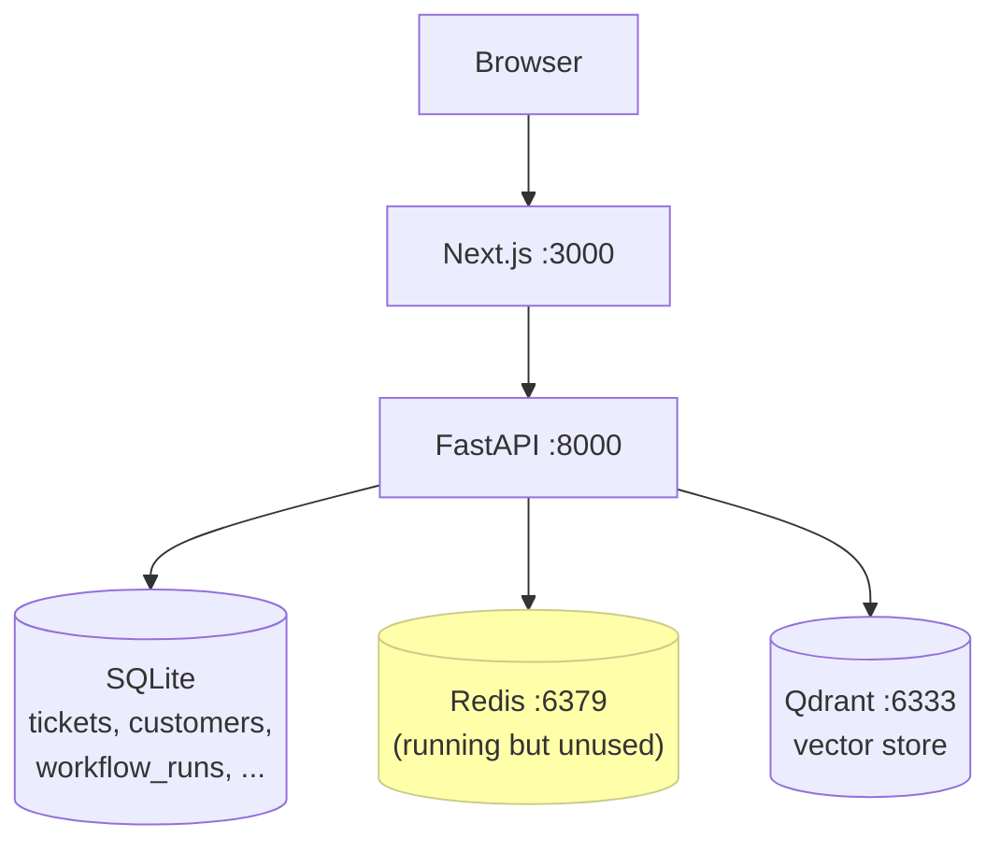
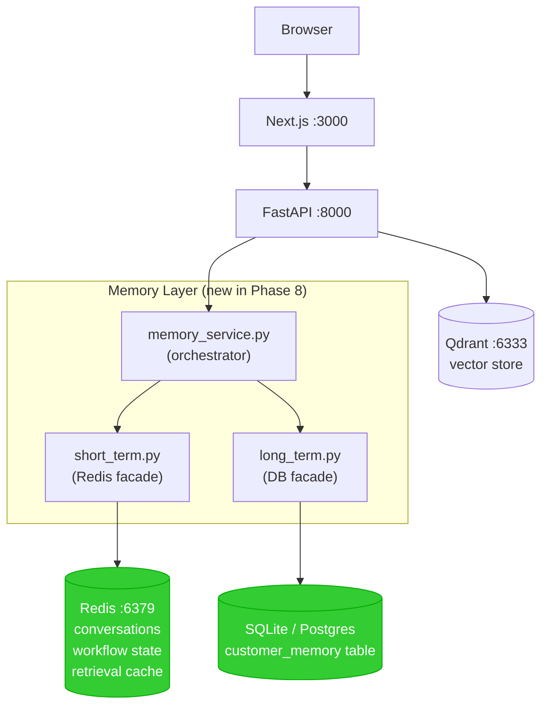
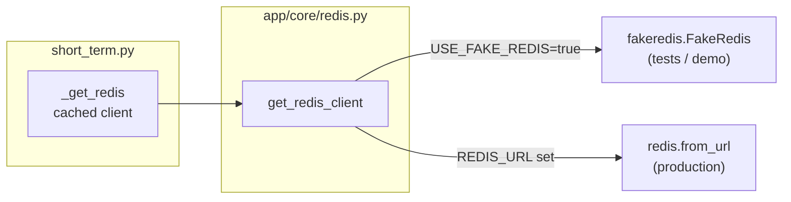
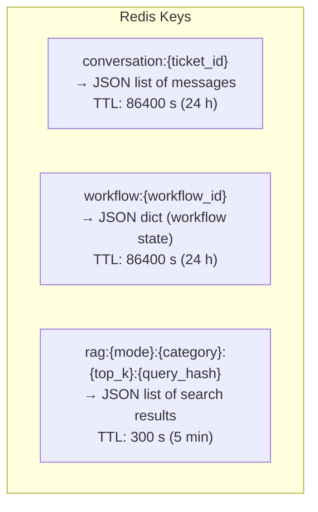
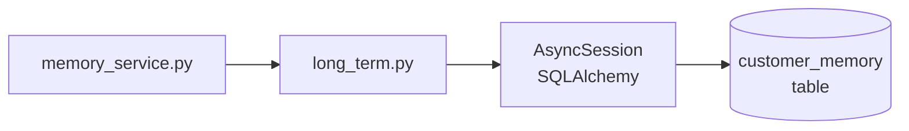
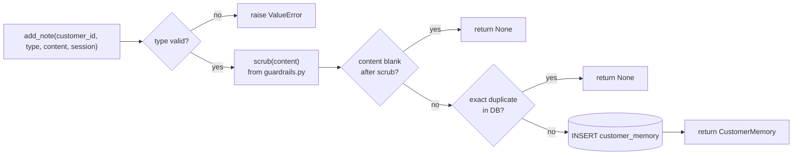
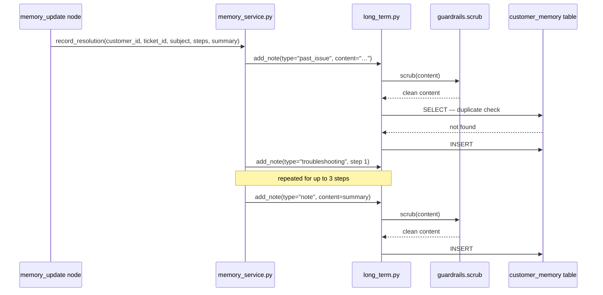
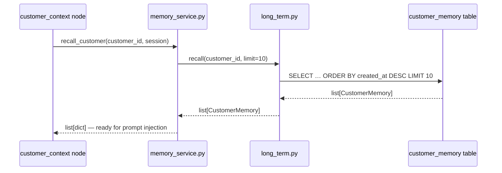
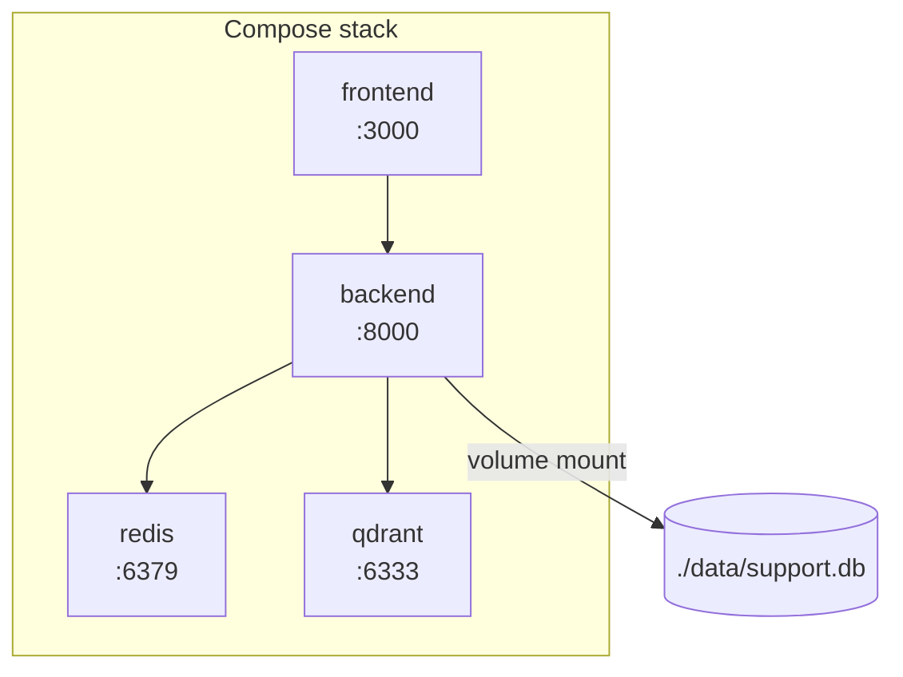

# Phase 8 — Infrastructure Design Evolution: Memory

## Overview

Phase 8 activates two storage systems that were declared in Phase 1 and 2 but not used:
**Redis** (already running in Docker) and the `customer_memory` table (already defined in
the SQLite/Postgres schema). This phase wires them into the application for the first time.

No new Docker containers are added. Everything runs on the existing infrastructure.

---

## Component map before Phase 8

Redis was running but no application code read from or wrote to it.
The `customer_memory` table existed in the schema but had no access layer.

---

## Component map after Phase 8

Green = now actively used.

---

## Redis connection and key design

### How the connection is made

The same `get_redis_client()` function that was defined in Phase 1 is reused.
The short_term module caches the returned client so only one connection exists per process.

### Key namespace and TTL

The `{query_hash}` is an MD5 of the query string (first 16 chars) to keep key lengths bounded.

---

## Database wiring for long-term memory

### Table already existed — now it has an access layer

`long_term.py` receives an `AsyncSession` from the caller (always the memory service).
It never creates its own session — sessions are passed in and committed by the caller.
This is the same pattern used in all other repository layers.

### The safety pipeline inside every write

---

## Data flow: ticket resolved → memory written

---

## Data flow: new ticket starts → memory read

---

## Docker Compose: no changes

Phase 8 uses the Redis and SQLite/Postgres services already declared in `docker-compose.yml`.
No new services, volumes, or environment variables are needed.

The `USE_FAKE_REDIS=true` env var in `.env` / `conftest.py` makes tests skip the real Redis
container entirely and use fakeredis in-process instead.

---

## Environment variables involved

| Variable | Default | Effect |
|---|---|---|
| `REDIS_URL` | `""` | Real Redis connection string (e.g. `redis://redis:6379/0`) |
| `USE_FAKE_REDIS` | `false` | `true` → use fakeredis in-process (tests, offline demo) |
| `DATABASE_URL` | `sqlite+aiosqlite:///./data/support.db` | Where customer_memory rows are stored |

---

## Summary

Phase 8 turns two previously-declared but unused infrastructure components — Redis and the
`customer_memory` table — into a working two-tier memory system. All writes are
secret-scrubbed and de-duplicated before they reach storage. The Docker topology does not
change; only new application code is added.
