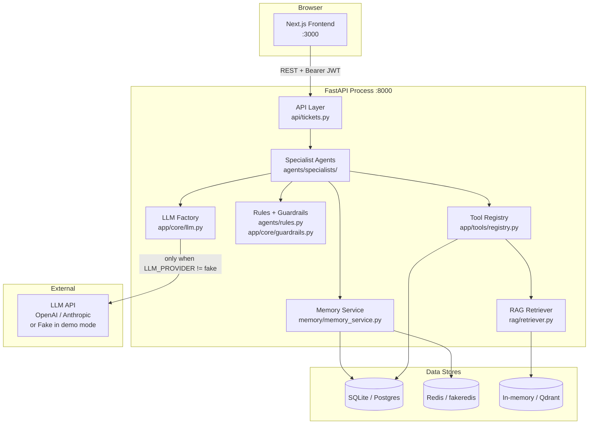
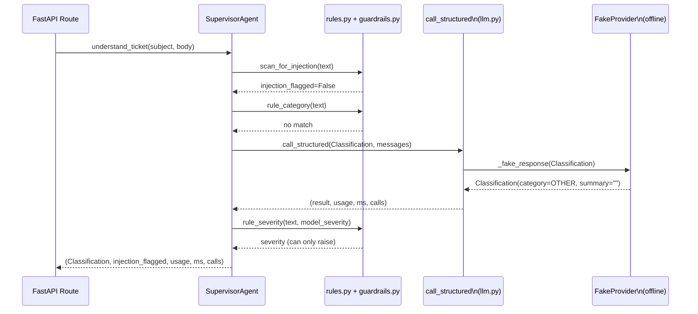
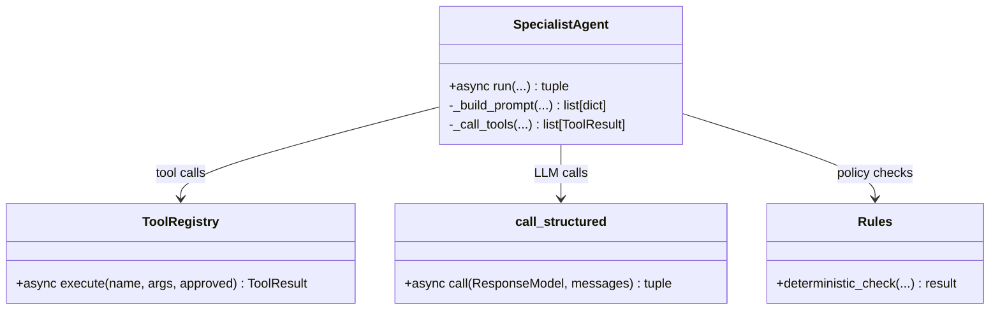
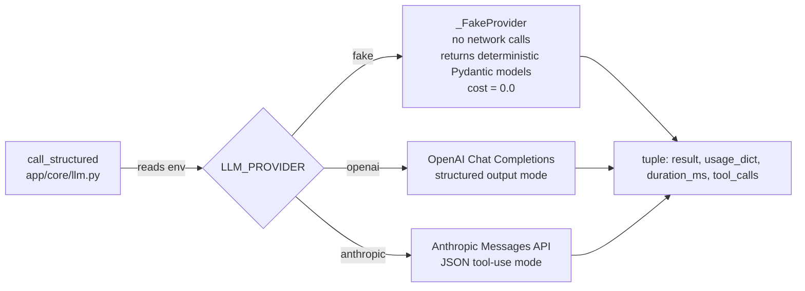
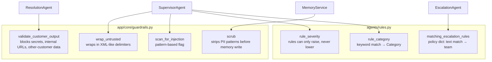
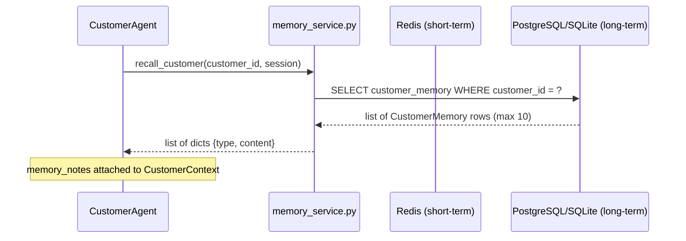
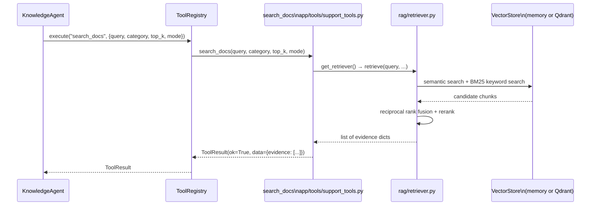
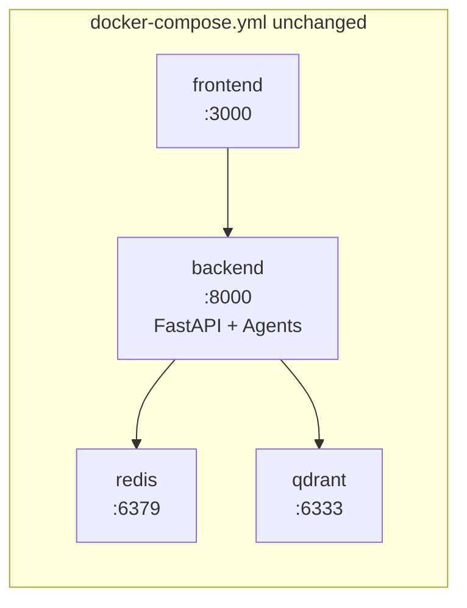

# Phase 9 — Infrastructure & Component Wiring: Specialist Agents

## Overview

Phase 9 adds the agent layer — six specialist Python classes — that sit **between** the FastAPI API layer and the tool/RAG/memory layers built in earlier phases. No new infrastructure services were added. The agents run inside the same FastAPI process as background tasks.

---

## Component Map After Phase 9

---

## How an Agent Call Flows Through the System

---

## Agent Internal Architecture

Each specialist agent follows the same pattern:

The key constraint: **every tool call goes through ToolRegistry** — agents cannot call tools directly. ToolRegistry enforces approval gates, timeouts, and audit logging.

---

## LLM Factory: Provider Abstraction

All agents call `call_structured()` and receive the same 4-tuple regardless of which LLM provider is configured. The agents have zero provider-specific code.

---

## Rules and Guardrails Layer

The rules and guardrails layer is **always deterministic** — no LLM calls, no randomness. It can be unit-tested in isolation with simple string inputs.

---

## Memory Integration in Phase 9

CustomerAgent reads memory; it does **not** write. Writing happens in the `memory_update` node that runs at the very end of the workflow (Phase 10).

---

## RAG Integration in Phase 9

In tests, the retriever is not initialised, so `search_docs` returns `ToolResult(ok=False)`. KnowledgeAgent handles this gracefully by returning an empty evidence list.

---

## Docker / Deployment Impact

Phase 9 adds no new containers or environment variables. The agents are Python classes instantiated at request time — stateless, no persistent resources, no additional ports.

The only file-level impact is in `backend/` and `agents/` — no Dockerfile changes, no compose changes, no new environment variables required. `LLM_PROVIDER=fake` (the default) means the backend starts and processes tickets with no API key configured.
