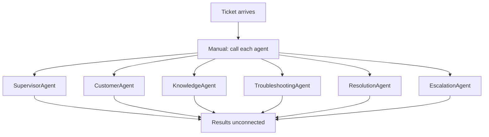
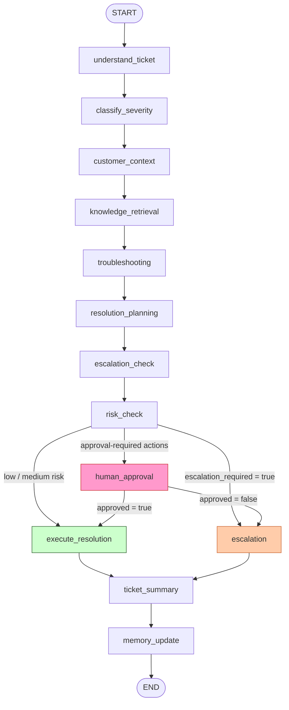
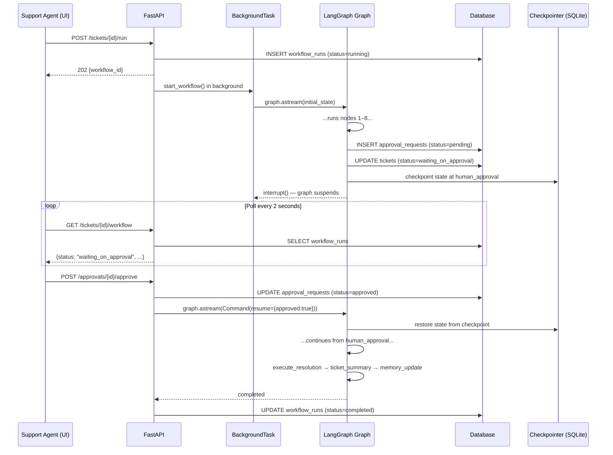
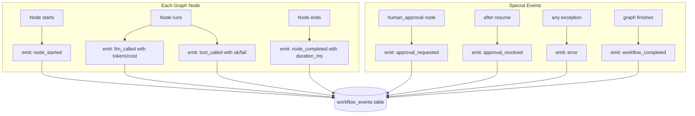
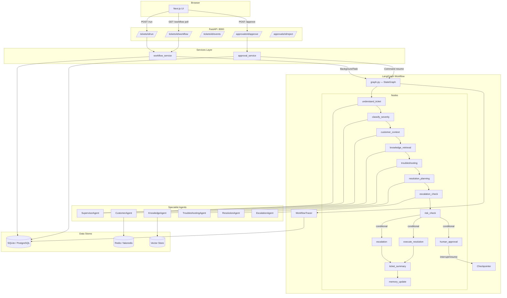

# Phase 10 — Project System Design Evolution

## Overview

Phase 10 integrates all specialist agents into a single orchestrated workflow. The design evolved from "six separate agents that can be called individually" (Phase 9) to "one graph that orchestrates them all in sequence with conditional routing, an approval gate, and escalation paths."

---

## Stage 1: Starting Point (End of Phase 9)

At the end of Phase 9, we had six specialist agents that could each be called independently. There was no orchestration, no shared state, no routing logic, and no way to run a ticket end-to-end. The workflow endpoint was a stub returning `"not_implemented_until_phase_10"`.

**Problem**: No shared state. No routing. No execution of actions. No approval gate. No observability.

---

## Stage 2: LangGraph StateGraph — Linear Pipeline

The first step was to wire the agents into a linear sequence using LangGraph's `StateGraph`. Every node reads from and writes to a single shared `SupportState` object — a TypedDict that accumulates findings as the ticket moves through the graph.

```mermaid
flowchart LR
    START --> understand_ticket
    understand_ticket --> classify_severity
    classify_severity --> customer_context
    customer_context --> knowledge_retrieval
    knowledge_retrieval --> troubleshooting
    troubleshooting --> resolution_planning
    resolution_planning --> escalation_check
    escalation_check --> risk_check
    risk_check --> execute_resolution
    execute_resolution --> ticket_summary
    ticket_summary --> memory_update
    memory_update --> END
```

**Key design decisions at this stage:**
- Each node returns a **partial dict** — it only sets the keys it owns
- Two reducer fields (`errors`, `completed_nodes`) use `operator.add` — they append rather than overwrite
- `token_usage` uses a custom `merge_usage` reducer that sums token counts across nodes
- A node never sees the full state of the graph — only what previous nodes wrote

---

## Stage 3: Conditional Routing — Branching After risk_check

The linear graph was extended with conditional edges after `risk_check`. The routing function `_route_after_risk()` reads the state and returns a string that tells LangGraph which node to visit next.

**Three routing outcomes after `risk_check`:**

| Condition | Route To |
|---|---|
| `escalation_decision.escalation_required == True` | `escalation` node |
| Any `planned_action.requires_approval == True` | `human_approval` node |
| Neither | `execute_resolution` node |

**After `human_approval`:**

| Decision | Route To |
|---|---|
| `approved == True` | `execute_resolution` |
| `approved == False` | `escalation` |

---

## Stage 4: The Approval Gate — LangGraph interrupt()

The most architecturally significant addition in Phase 10 is the human approval gate, implemented using LangGraph's `interrupt()` primitive.

**What "interrupt" means:** The graph's execution suspends at the `human_approval` node. The entire state (all outputs from nodes 1–8) is saved to a SQLite database by the checkpointer. When the agent approves, the graph is resumed with `Command(resume={approved: True, decided_by: "agent-id"})`. The graph restores from the checkpoint and continues as if it never stopped.

---

## Stage 5: Observability Layer

Every node emits events to `workflow_events` via `WorkflowTracer`.

**WorkflowTracer design rule:** Every `_emit()` call is wrapped in a try/except that swallows failures. Telemetry errors are logged at DEBUG level and never propagate to the workflow.

---

## Stage 6: Full System Architecture at End of Phase 10

---

## Key Design Decisions Summary

| Decision | Why |
|---|---|
| LangGraph StateGraph | Built-in checkpointing, interrupt/resume, conditional edges — exactly what approval gates need |
| TypedDict with Annotated reducers | Partial state updates from each node without overwriting; type safety |
| `interrupt_before=["human_approval"]` | Graph pauses before the node runs on first entry; resumes inside it |
| Idempotent pre-interrupt code | The code before `interrupt()` can run twice on resume; it checks for existing DB rows first |
| WorkflowTracer never raises | Telemetry failures must not break a live support case |
| `_route_after_risk` reads escalation_decision AND planned_actions | Two separate high-risk paths need separate routing keys |
| BackgroundTasks (in-process) for v1 | No external queue needed; acceptable for demo load; production moves to a worker |
| `_serialise_state` before DB write | Pydantic models are not JSON-serialisable; must be `.model_dump()`'d before storing in JSON column |
