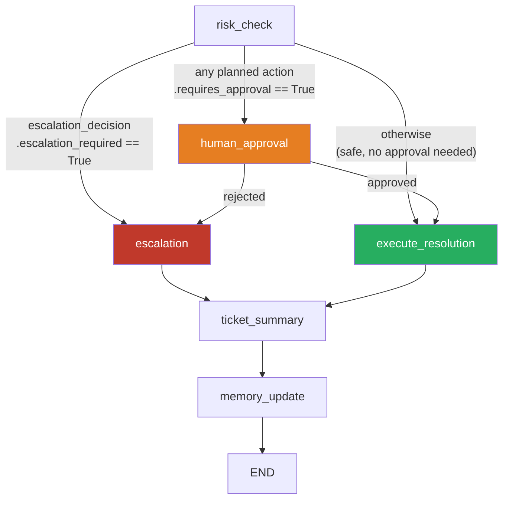
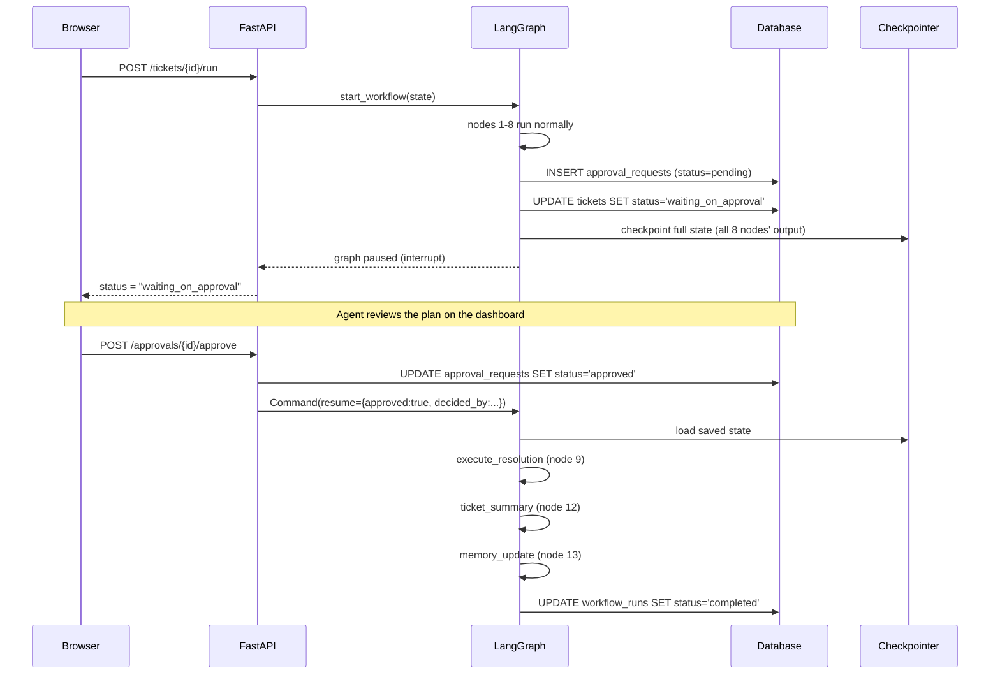
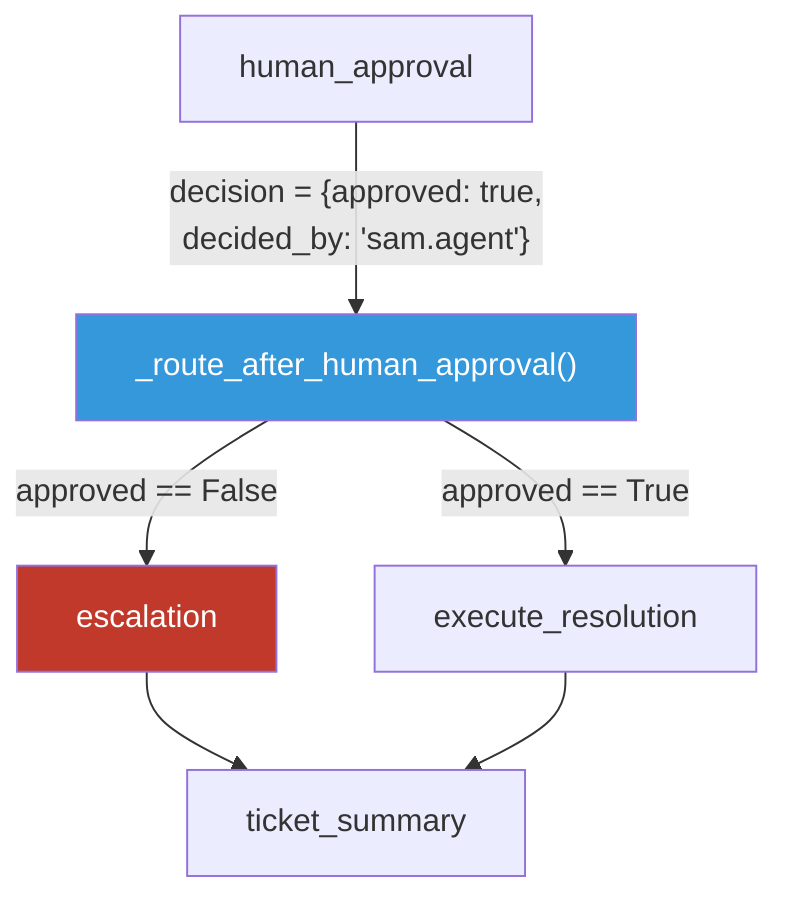
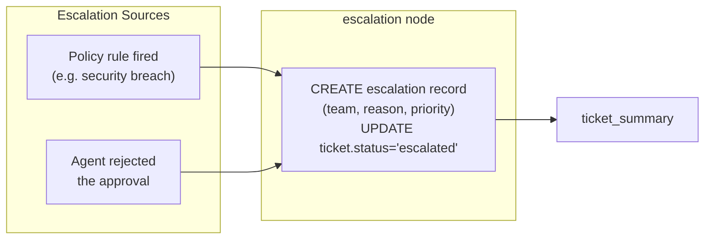
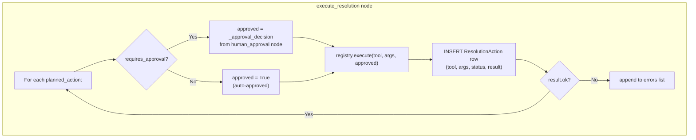
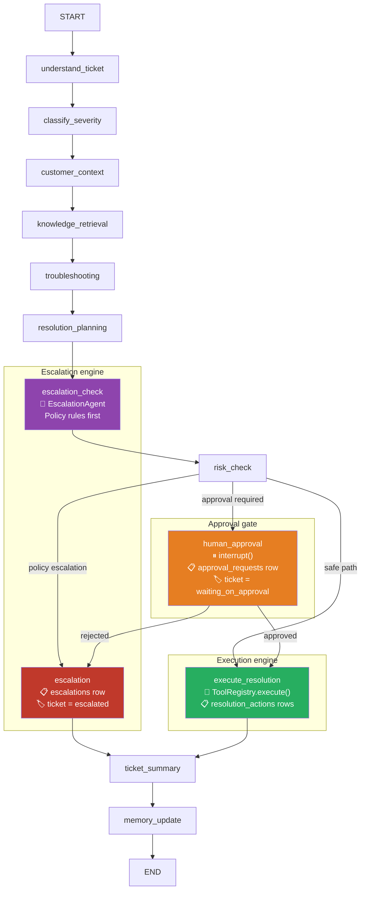
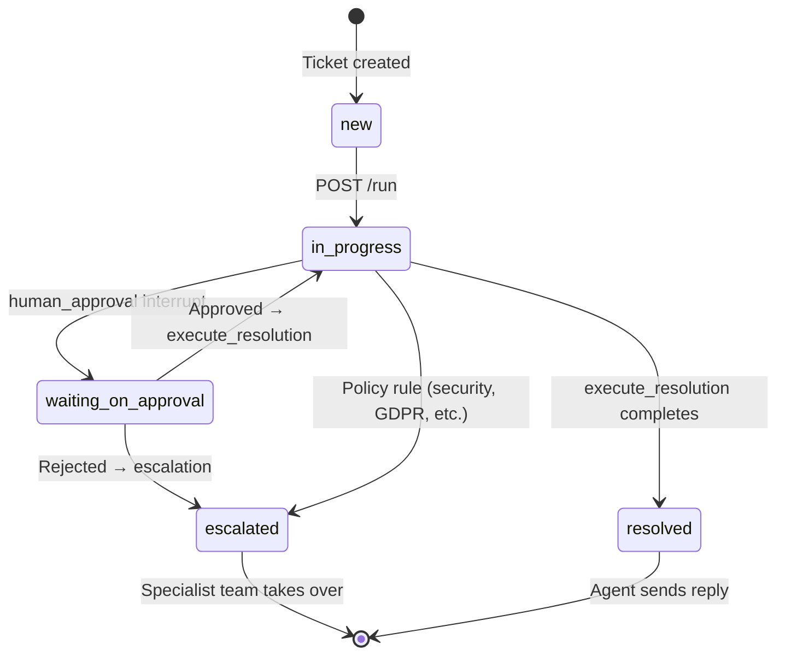
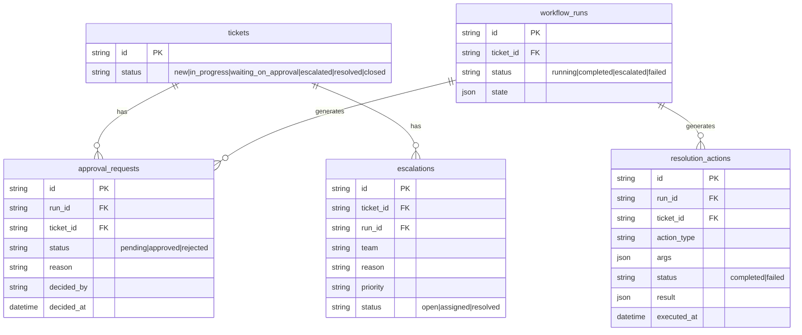

# Phase 11 — Project System Design Evolution: Approval & Escalation

## Overview

Phase 10 gave us a workflow graph — a linear+branching pipeline that could run a support ticket from start to finish. However, it lacked the **decision gateways** that make it production-safe: the ability to pause for human review, to route high-risk cases to specialist teams, and to reliably execute the planned actions. Phase 11 adds those three layers on top of the Phase 10 skeleton.

---

## Stage 1: Starting Point (End of Phase 10)

At the end of Phase 10, the graph ran nodes in sequence, computed a resolution plan, and called `execute_resolution` immediately — without pausing, without checking if human approval was needed, and without a real escalation path.

```mermaid
flowchart LR
    START --> understand_ticket
    understand_ticket --> classify_severity
    classify_severity --> customer_context
    customer_context --> knowledge_retrieval
    knowledge_retrieval --> troubleshooting
    troubleshooting --> resolution_planning
    resolution_planning --> escalation_check
    escalation_check --> risk_check
    risk_check --> execute_resolution["execute_resolution\n(stub — did nothing)"]
    execute_resolution --> ticket_summary
    ticket_summary --> memory_update
    memory_update --> END

    style execute_resolution fill:#aaa,color:#000
```

**What was missing:**
- No approval gate — a refund would have executed without any human review
- No escalation node — the escalation_check result was computed but never acted on
- execute_resolution was a stub — it returned immediately without calling any tools
- No approval_requests table was being written
- No demo script to prove end-to-end behaviour

---

## Stage 2: Adding the Three-Way Router at risk_check

The first structural change was replacing the single edge from `risk_check → execute_resolution` with a three-way conditional fork. The routing function `_route_after_risk()` decides the path:

**Key design rule:** The routing function reads from state — it does not make any AI calls. Routing is deterministic and testable.

---

## Stage 3: Implementing the Human Approval Interrupt

The `human_approval` node uses LangGraph's `interrupt()` to suspend the graph and persist the full workflow state to the checkpointer database. This introduces a new lifecycle state for the ticket: `waiting_on_approval`.

**Idempotency guarantee:** The code that creates the `approval_requests` row runs before `interrupt()`. On resume, that same code runs again (LangGraph's guarantee). It checks "does a pending approval already exist?" before inserting — so a server restart between pause and resume does not create duplicate records.

---

## Stage 4: Adding the Reject Path

Rejection is a first-class outcome — not an error, not a timeout. When the agent clicks "Reject," the workflow resumes with `approved = False`. The routing function `_route_after_human_approval()` sends the ticket to the escalation node.

This design means **rejection is audited the same way as approval** — the approval_requests row records who rejected, when, and the workflow events log shows the escalation that followed.

---

## Stage 5: Implementing the Escalation Node

The `escalation` node is the final destination for two types of tickets:
- Policy-triggered escalations (security breach, GDPR, data loss, etc.)
- Human-rejected approvals

It writes an `Escalation` record and sets the ticket status to `escalated`.

**The escalation_check vs escalation split:** `escalation_check` is an AI-aware **decision node** (it runs the EscalationAgent). `escalation` is a pure **write node** — it creates database records and has no AI logic. Keeping them separate means: (a) the AI check can be bypassed in tests, (b) the write step can be called from two paths (policy route and reject route) without duplicating code.

---

## Stage 6: Implementing execute_resolution on the Shared Tool Path

Before Phase 11, `execute_resolution` was a stub. Phase 11 makes it call the ToolRegistry for every planned action, persist the results, and collect errors without crashing.

**The same path, two callers:** Whether the action came from the human-approved path or the auto-approved path, `registry.execute()` sees the same `approved=True` or `approved=False` flag. There is no "fast lane" that skips policy enforcement for pre-approved actions.

---

## Stage 7: Final Complete Graph (End of Phase 11)

---

## State Transitions Across the Full Phase 11 Flow

---

## Data Model Changes in Phase 11

---

## What Changed Between Phase 10 and Phase 11

| Aspect | End of Phase 10 | End of Phase 11 |
|---|---|---|
| execute_resolution | Stub — returned immediately | Calls ToolRegistry, persists ResolutionActions |
| human_approval | Not in graph | Full interrupt/resume with DB record |
| escalation node | Not wired | Creates Escalation row, updates ticket |
| Routing after risk_check | Single edge to execute_resolution | Three-way fork (escalate/approve/auto) |
| Ticket status transitions | new → in_progress → resolved | Full state machine including waiting_on_approval, escalated |
| Approval API | Did not exist | GET + approve + reject endpoints |
| Demo script | Did not exist | CD-1002 (approve) and CD-1005 (escalate) |
