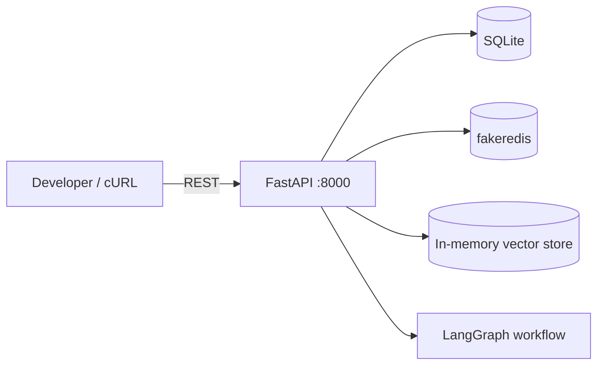
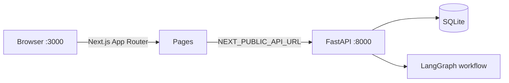
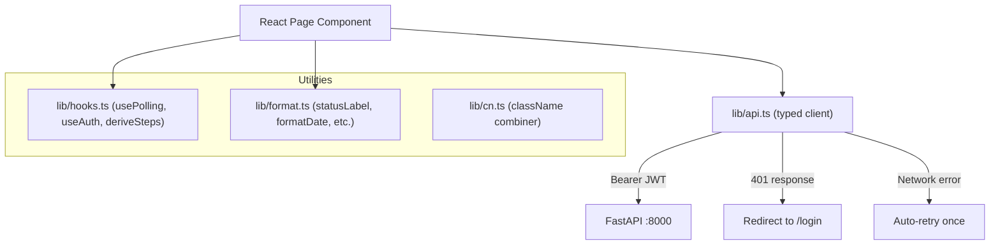
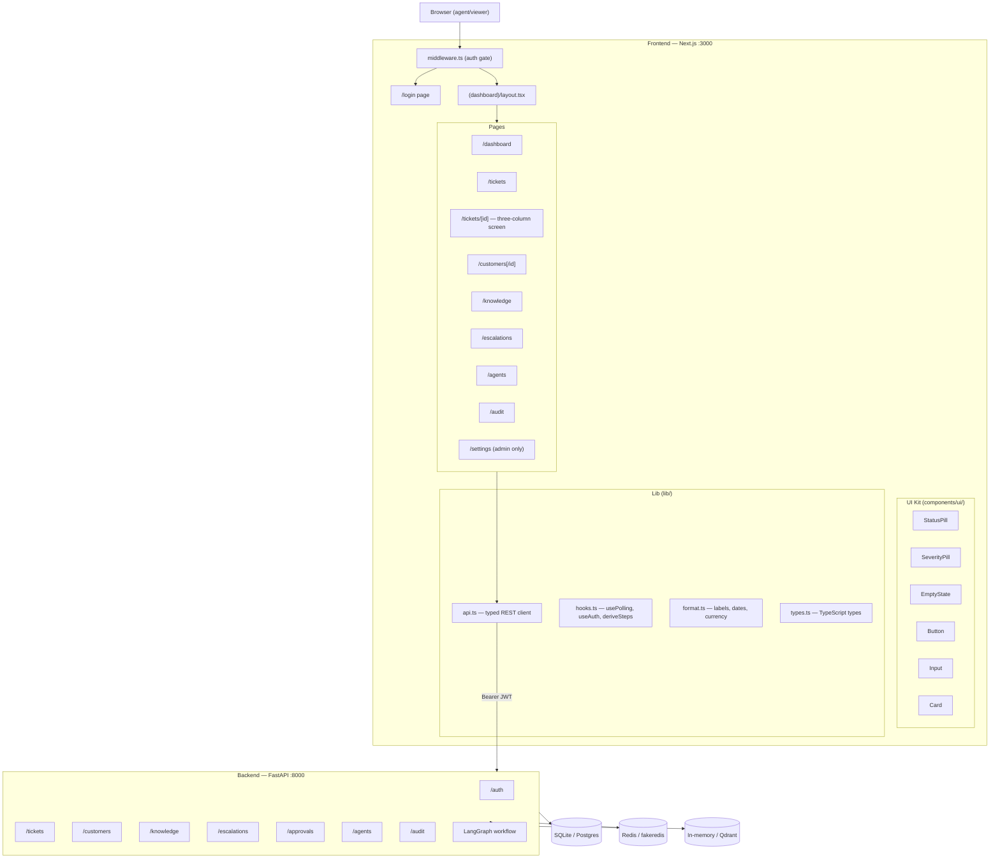
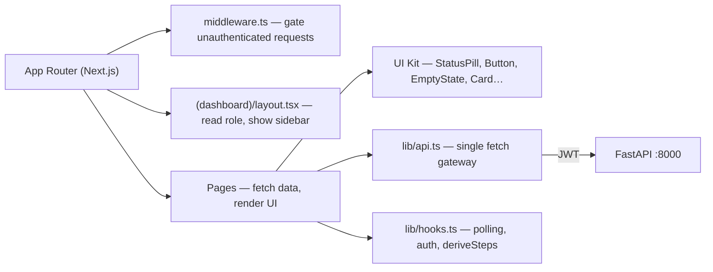

# Phase 12 — System Design Evolution: Agent Console

This document traces how the system design grew during Phase 12, from "AI backend with no UI" to "fully navigable web console."

---

## Starting point: What existed before Phase 12

After Phase 11, the system looked like this:



There was no browser-facing layer. Only developers or the demo script could trigger workflows.

---

## Step 1 — Adding a Next.js skeleton (P12-1)

The first step was to create an empty Next.js project and wire it to the backend through an environment variable.



**Key design decision:** Next.js 15 with the App Router was chosen because it supports server components, file-based routing, and the `standalone` output mode needed for the Docker image. The frontend communicates with the backend over REST — it does not connect directly to the database, Redis, or the vector store. The backend is the only entry point.

---

## Step 2 — Typed API client layer (P12-2)

Before writing any pages, a typed client layer was introduced. This is the layer that every page talks to — no page imports `fetch` directly.



**Key design decision:** The API client is grouped by domain (`auth`, `tickets`, `customers`, etc.) matching the backend router groups. This means adding a new backend endpoint requires editing one object in `api.ts` and one TypeScript interface in `types.ts` — both files are in the same `lib/` folder. The contract stays in sync.

The `usePolling` hook encapsulates the interval/cleanup pattern. The specialised `useWorkflowPolling` stops polling automatically on terminal states, avoiding wasted network calls after the workflow finishes.

---

## Step 3 — Authentication and role-aware layout (P12-3)

A login page and a Next.js middleware were added to gate all dashboard routes.

```mermaid
graph TD
    Browser -->|GET /dashboard| Middleware[middleware.ts]
    Middleware -->|No cd_session cookie| LoginPage[/login]
    Middleware -->|Cookie present| DashboardLayout["(dashboard)/layout.tsx"]
    DashboardLayout -->|Reads localStorage role| Sidebar[Sidebar component]
    DashboardLayout --> PageContent[Page content]

    LoginPage -->|POST /auth/demo-login| Backend[FastAPI :8000]
    Backend -->|{access_token, user}| LoginPage
    LoginPage -->|Writes localStorage| Browser
    LoginPage -->|Sets cd_session cookie| Browser
```

**Key design decision:** The session is stored in two places — a JWT in `localStorage` for API calls, and a plain cookie (`cd_session`) for the Next.js middleware. This is because `localStorage` is inaccessible to server-side code (the middleware runs on the server), while cookies are sent on every request automatically.

The role is derived client-side from `localStorage.role`. The `canAct` flag (`role === "agent" || role === "admin"`) is computed once in `useAuth()` and used by every action button to decide whether to render as enabled or disabled (or not at all).

---

## Step 4 — Read-only list pages and the ticket detail screen (P12-4)

This step added all eight dashboard pages and the UI kit.

```mermaid
graph TD
    subgraph Dashboard Pages
        DP[/dashboard]
        TP[/tickets]
        TD["/tickets/[id]"]
        CP[/customers]
        CD["/customers/[id]"]
        KP[/knowledge]
        EP[/escalations]
        AP[/agents]
        AuP[/audit]
        SP[/settings]
    end

    subgraph UI Kit
        StatusPill
        SeverityPill
        EmptyState
        Button
        Input
        Card
    end

    TD -->|polls every 2s| WorkflowState[WorkflowState API]
    TD -->|deriveSteps| WorkflowPanel[12-step tracker]
    TD -->|canAct=true| ApproveReject[Approve / Reject buttons]
    TD -->|canAct=false| ViewOnly[Buttons hidden / disabled]
```

---

## Final system design after Phase 12



---

## Design principles applied in Phase 12

| Principle | How it appears |
|---|---|
| **Single source of truth** | Navigation declared once in `nav.ts`; API types defined once in `types.ts` |
| **Backend is the security boundary** | Frontend gates are UX convenience; 403s from the backend are the real gate |
| **No gradients, no UI library** | All components are hand-written; `tailwind.config.ts` holds the design tokens |
| **Build-time vs run-time config** | `NEXT_PUBLIC_*` values are baked in at build time; `localStorage` is per-session |
| **Offline testing** | Tests use Vitest + jsdom; no browser launch, no backend needed |
| **Stop polling on terminal state** | `useWorkflowPolling` stops when status is completed/failed/escalated |

---

## Component responsibility map


