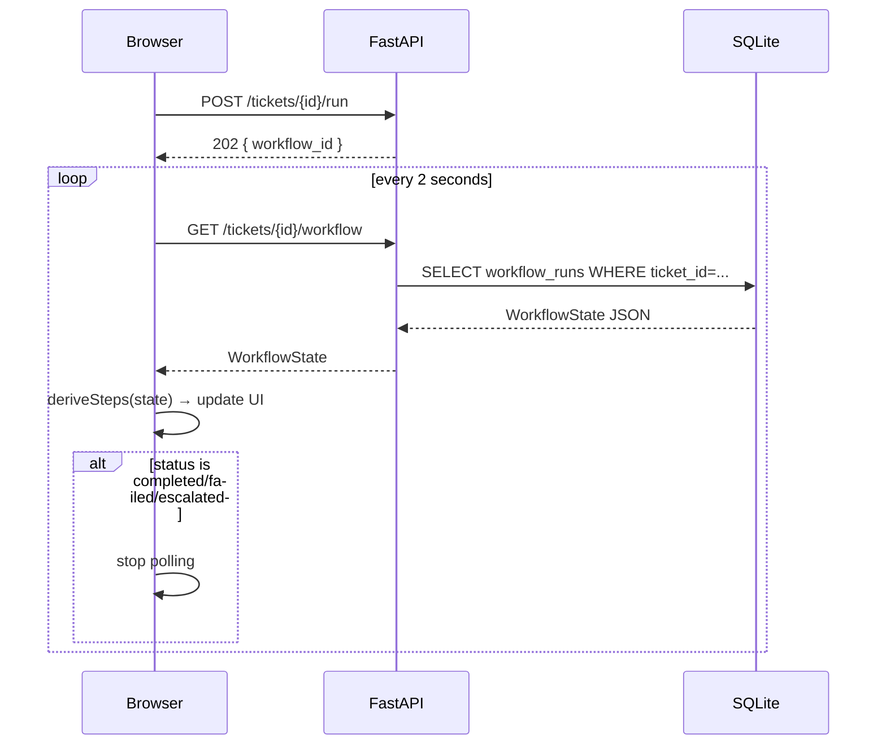
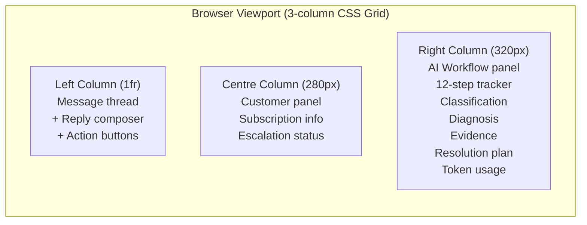
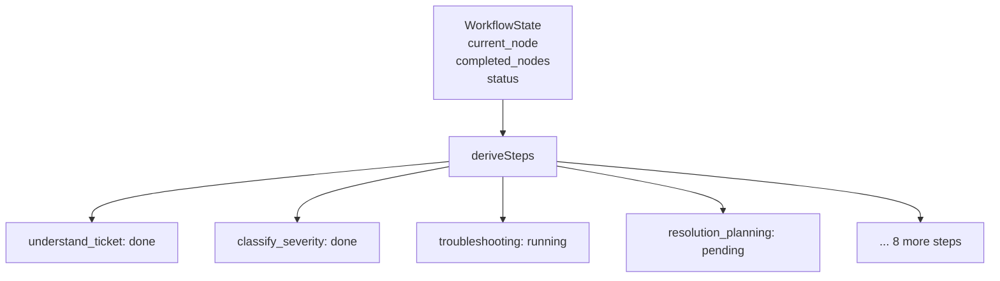
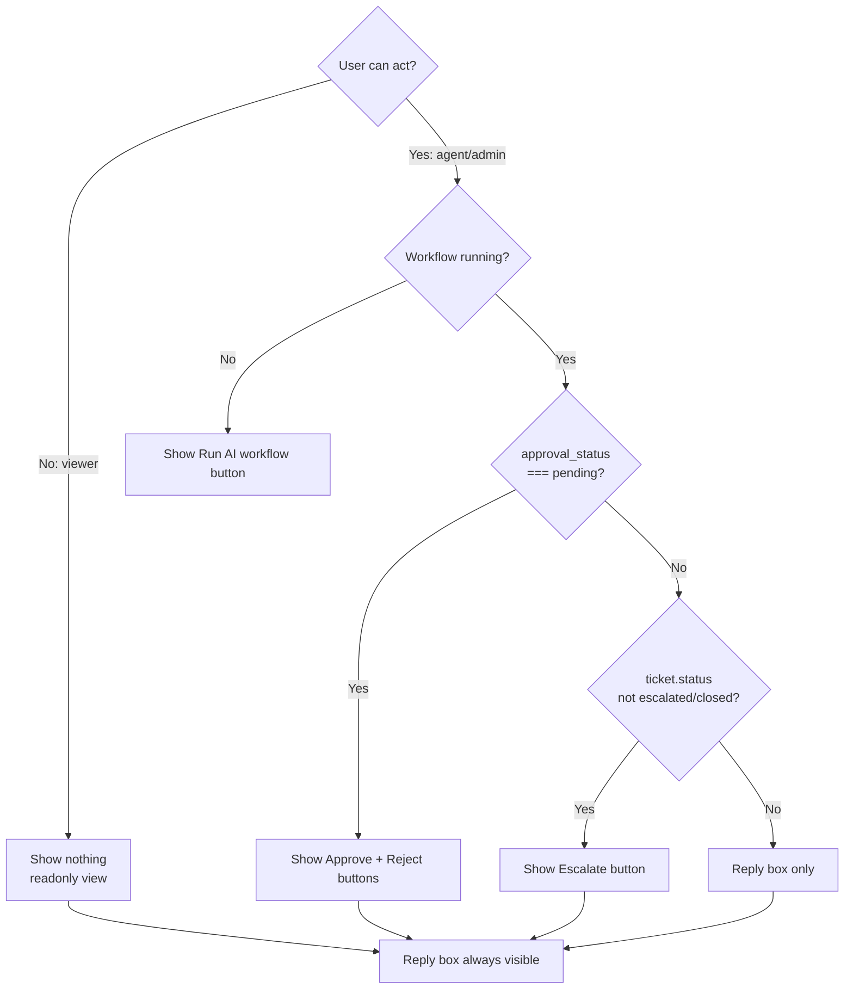
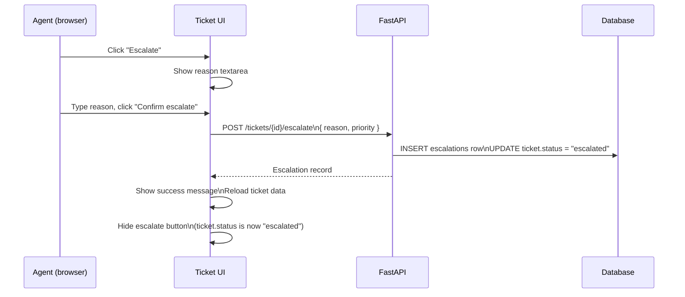
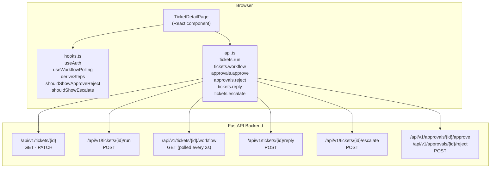

# Phase 13 — Ticket Workflow Screen: System Design Evolution

## Starting Point

At the beginning of Phase 13, the system had:
- A complete FastAPI backend with 10+ routes, full AI workflow, approval gates, and escalation
- A Next.js 15 frontend with navigation, list pages, and an API client
- A ticket detail page stub that showed messages and customer info but was not wired to the live workflow

The missing piece: **the ticket detail page was not connected to the live AI workflow**. There was no way to start a workflow from the browser, watch it progress, approve actions, or escalate tickets.

---

## Design Stage 1 — The Polling Architecture

### The fundamental challenge

The backend runs an AI workflow asynchronously. It could take 5–30 seconds to complete. The browser cannot receive a push notification from the server (that would require WebSockets or Server-Sent Events, which are out of scope for v1).

The solution is **polling** — the browser asks the server every 2 seconds: "has the workflow state changed?"



**Key design decisions:**
- Polling stops automatically when a terminal state is reached — no wasted calls after the AI finishes
- If the backend is temporarily unreachable, polling slows to 5-second retries instead of stopping
- The `useWorkflowPolling` hook encapsulates all of this so the page component is simple

---

## Design Stage 2 — The Three-Column Layout

### The information hierarchy

A support agent needs three types of information simultaneously:

1. **Conversation context** — what the customer said and what the team has replied
2. **Customer context** — who is this customer, what plan are they on, are they escalated
3. **AI context** — what has the AI found, what does it recommend, is there a pending action

Putting all three in one scrollable page would force agents to scroll back and forth constantly. The solution is a **three-column CSS Grid** that shows all three simultaneously.



**Column widths:**
- Left: `1fr` (flexible — takes all remaining space)
- Centre: `280px` (fixed — customer info is compact)
- Right: `320px` (fixed — AI output needs consistent width)

---

## Design Stage 3 — The `deriveSteps` Pure Function

### The 12-step status model

The AI workflow has 12 named nodes. Each node can be in one of three states relative to the current workflow run:

| State | Meaning | Visual |
|---|---|---|
| `done` | Node has completed and is in `completed_nodes` | Green circle with ✓ |
| `running` | Node matches `current_node` | Blue pulsing circle |
| `pending` | Node has not run yet | Grey empty circle |

The `deriveSteps` function maps `WorkflowState → WorkflowStep[]` as a pure transformation:



**Why pure?** No DOM references, no React imports, no network calls. The function takes a plain object and returns a plain array. This makes it trivially testable with:
```ts
expect(deriveSteps(null)).toHaveLength(12)
expect(deriveSteps(state).find(s => s.id === "troubleshooting")?.status).toBe("running")
```

---

## Design Stage 4 — The Conditional Action Panel

### The role-based action model

Not every user should be able to take every action. The action panel renders differently based on two signals:

1. **`canAct`** — derived from the user's role (agent/admin = true, viewer = false)
2. **`approval_status`** — from the workflow state (pending/approved/rejected/not_required)
3. **`ticket.status`** — from the ticket record (new/in_progress/escalated/closed/etc.)



**Two pure helper functions extract this logic:**

```ts
shouldShowApproveReject(approvalStatus, canAct): boolean
  // true only when status === "pending" AND canAct

shouldShowEscalate(ticketStatus, canAct): boolean
  // true only when status is not escalated/closed AND canAct
```

These functions are the testable unit of the conditional logic.

---

## Design Stage 5 — The Manual Escalate Flow

### Why manual escalation exists

The AI escalates automatically via rules (Phase 7) for security breaches, GDPR requests, payment disputes, and data loss. But agents sometimes see something the AI missed:
- A VIP customer the AI didn't recognise
- New information that arrived after the workflow ran
- A subtle compliance concern in the reply the AI drafted

The manual escalate flow gives agents a safety valve. It is intentionally gated behind a reason form to prevent accidental escalations.



---

## Final Architecture for Phase 13



**What this phase added over Phase 12:**
1. `useWorkflowPolling` — smart polling that stops at terminal states
2. `deriveSteps` — pure function mapping workflow state to 12-step display model
3. `shouldShowApproveReject` / `shouldShowEscalate` — pure conditional logic helpers
4. The three-column ticket detail layout wired to live data
5. The escalate form with reason capture
6. Unit tests for all pure logic functions
