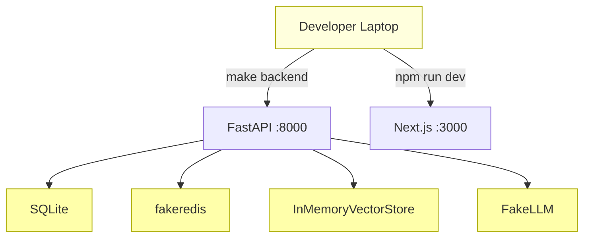
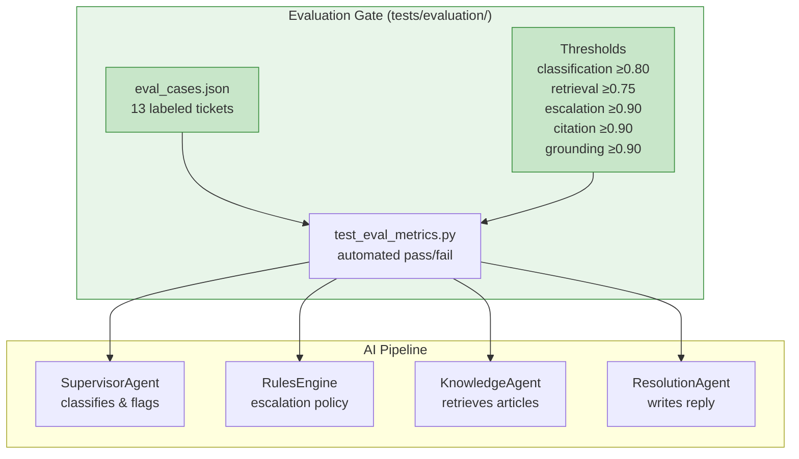
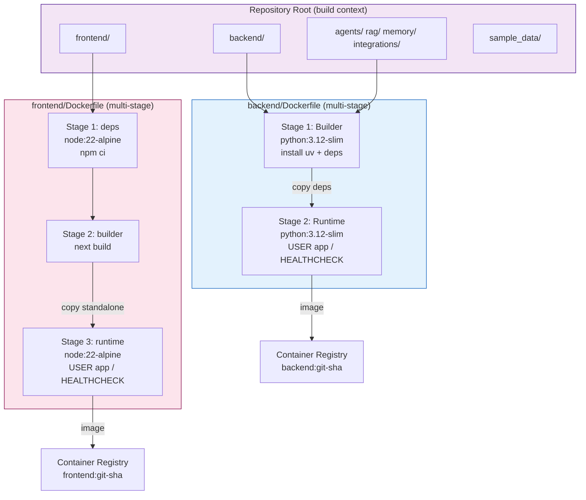
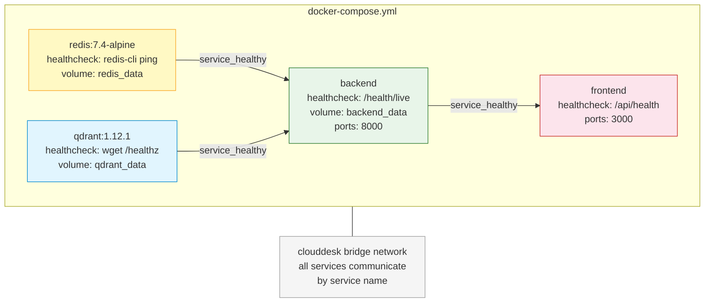
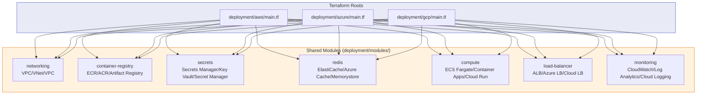
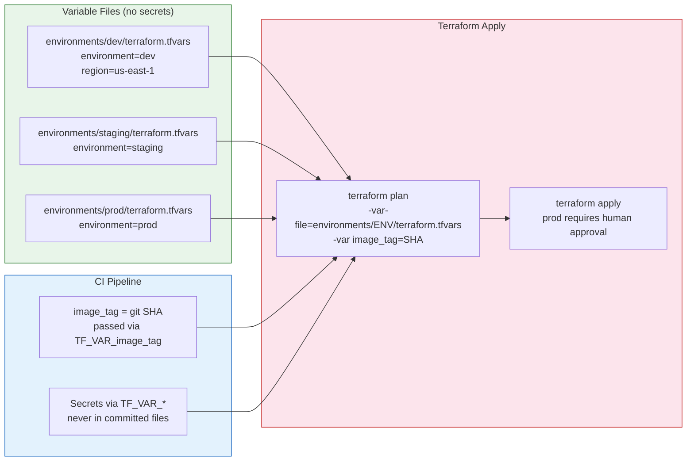
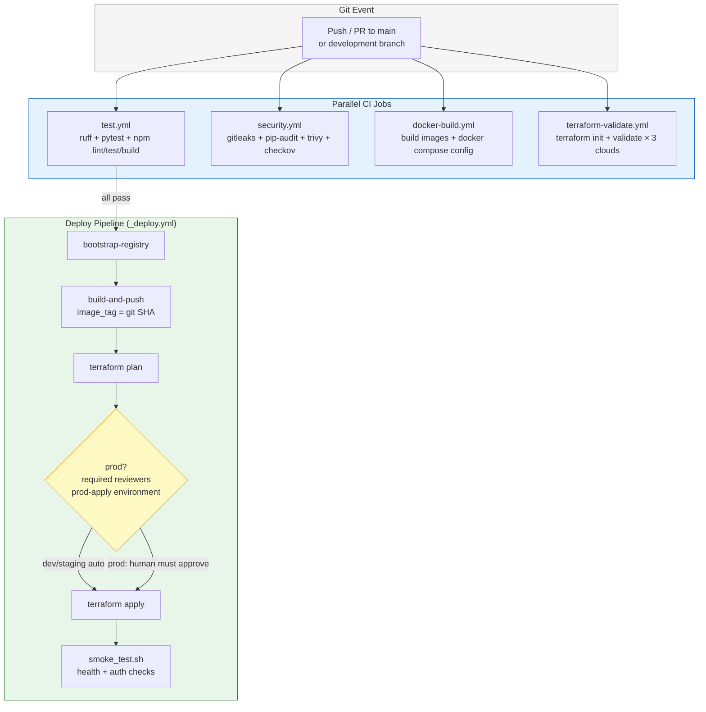
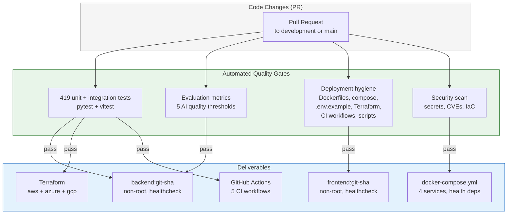
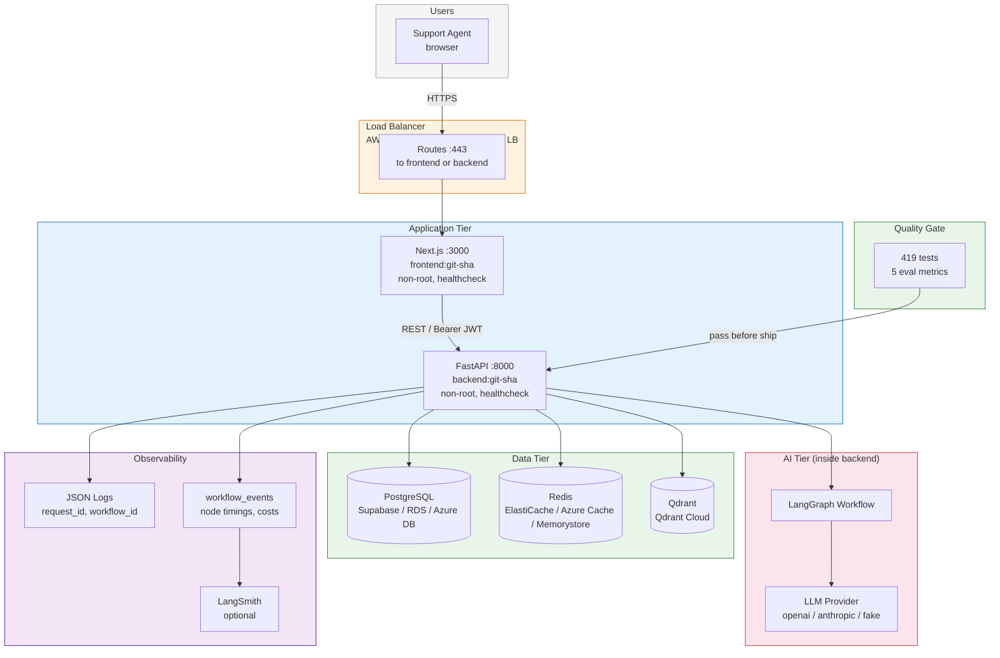

# Phase 14 — Project System Design Evolution: Evaluation and Delivery

> **Audience:** Technical reviewers and interview panels who want to understand how the system grew from "it runs on a laptop" to "it can ship to production."

---

## Where We Started at the Beginning of Phase 14

After Phase 13, the CloudDesk platform was functionally complete:
- A working LangGraph AI pipeline that processes support tickets
- A Next.js frontend with a full ticket workflow screen
- Approval and escalation flows
- Memory and observability

But the system had no formal quality proof, no packaging, and no cloud deployment path. The design at the start of Phase 14 looked like this:

### Design 14.0 — Start of Phase 14 (Pre-delivery)

**Gap:** Only runnable on the developer's machine. No quality proof. No production path.

---

## Step 1 — Adding Quality Gates (P14-1)

The first thing we addressed: how do we know the AI is good enough?

We built an evaluation test suite that acts as a **formal quality gate**. The system design didn't change structurally, but we added a measurement layer.

### Design 14.1 — Evaluation Layer Added

**Key design decision:** Thresholds are code-enforced, not documented aspirations. If classification accuracy drops below 80%, `pytest` fails and the build stops. This turns quality from a manual concern into an automated gate.

**Rules-first principle preserved:** The escalation metric (≥90%) is verified against the **deterministic rules engine**, not the LLM. Policy cases (security breach, GDPR deletion, payment dispute) must escalate 100% of the time — no model probability involved.

---

## Step 2 — Containerising the Application (P14-2)

The next design evolution: wrapping the application in Docker so it runs identically everywhere.

### Design 14.2 — Containerised Components

**Non-root containers:** Both images run as user `app` (UID 1001), not root. This limits blast radius if a container is compromised.

**Multi-stage builds:** The "build" stage installs compilers and dev tools. The "runtime" stage copies only the compiled output. The final image contains nothing that could be used to compile or modify the code — it's a sealed production artifact.

**HEALTHCHECK:** Docker probes the app every 30 seconds. If the probe fails three times, Docker restarts the container automatically, without human intervention.

---

## Step 3 — Composing the Full Stack (P14-3)

With individual containers ready, we needed to wire them together for local development and testing.

### Design 14.3 — Full Stack Compose

**depends_on with health checks:** The compose file uses `condition: service_healthy` for all dependencies. The frontend waits for the backend to pass its health check before starting — this prevents a race condition where the frontend boots before the API is ready.

**Named volumes:** Data persists across `docker compose down` and re-up without needing to re-seed or re-ingest. Only `docker compose down -v` removes the data.

---

## Step 4 — Infrastructure as Code for Three Clouds (P14-4)

The most significant structural expansion: a full Terraform design that lets CloudDesk deploy to any of three major cloud providers with the same codebase.

### Design 14.4a — Terraform Module Architecture

### Design 14.4b — Environment Layering

**Key security rule:** No secrets are ever in committed Terraform files. The image tag, database passwords, API keys, and cloud credentials are all passed via environment variables (`TF_VAR_*`) at deploy time.

**Image tag = git SHA:** The exact same container image that passed CI is what gets deployed. This traceability is a fundamental delivery principle.

---

## Step 5 — CI/CD Pipelines (P14-4 continued)

### Design 14.5 — Full CI/CD Pipeline Flow

---

## Step 6 — Deployment Hygiene Tests (P14-5)

The final piece: automated tests that verify the delivery files themselves are correct.

### Design 14.6 — Full System with Quality Gates

---

## Final Architecture — End of Phase 14

This is the complete, delivered system:

---

## Design Decisions Summary

| Decision | Why |
|---|---|
| Thresholds as code assertions | Quality failures are caught automatically, not discovered in production |
| Multi-stage Docker builds | Small, secure images with no build tools in production |
| Non-root containers | Limits damage if a container is compromised |
| `depends_on: service_healthy` in compose | Prevents startup race conditions |
| Shared Terraform modules | One set of modules serves AWS, Azure, and GCP — no duplication |
| image_tag = git SHA | The tested artifact is the shipped artifact — full traceability |
| --auto-approve refused for staging/prod | Human review is required before any production change |
| prod-apply GitHub Environment | An additional layer of human approval, enforced by GitHub |
| Smoke tests post-deploy | Fast sanity check that proves the deployment actually worked |
| Deployment tests in pytest | The delivery files themselves are tested just like application code |
