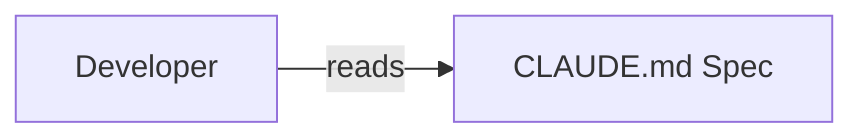
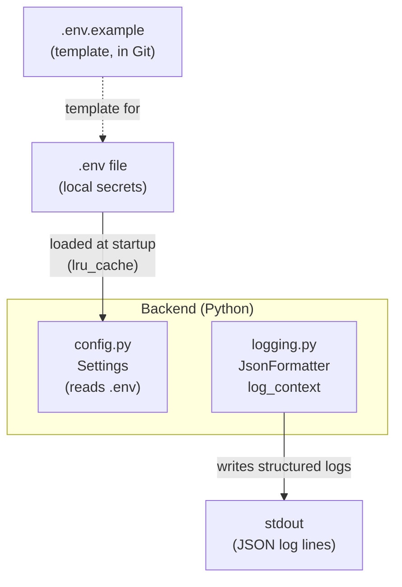
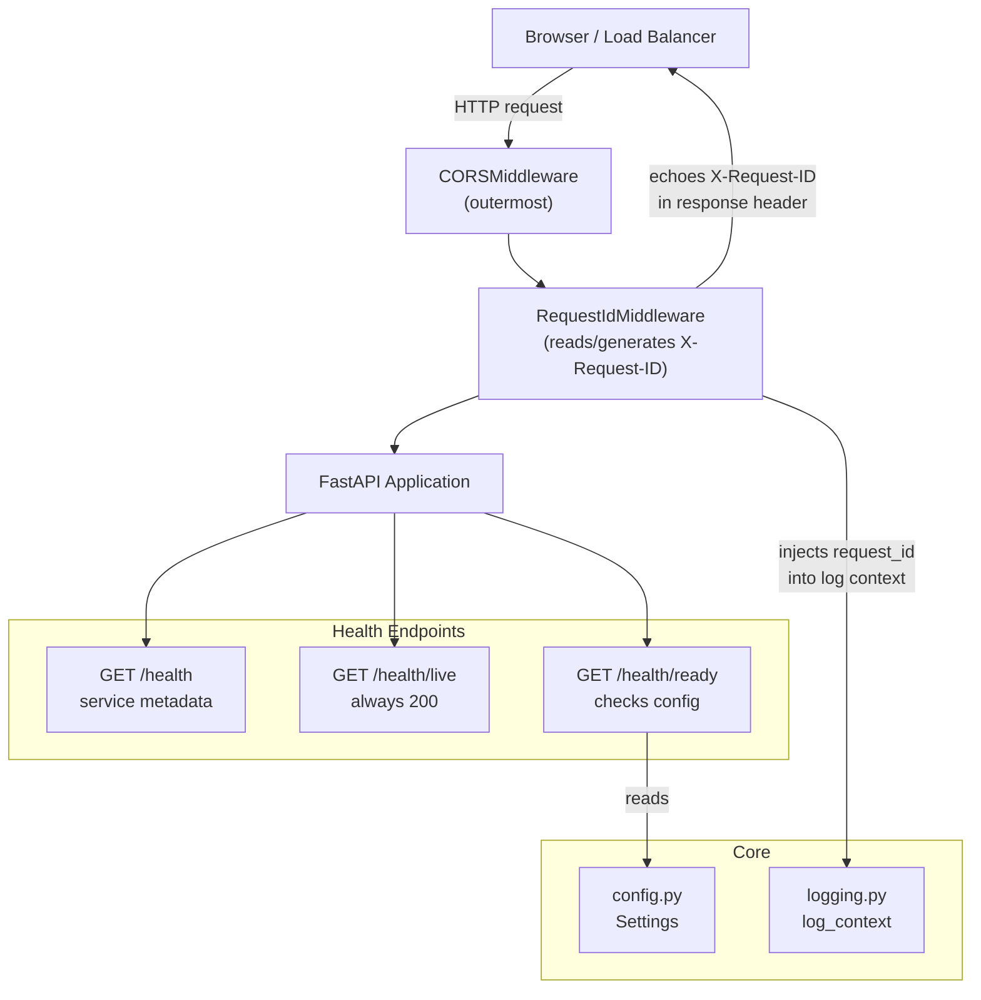
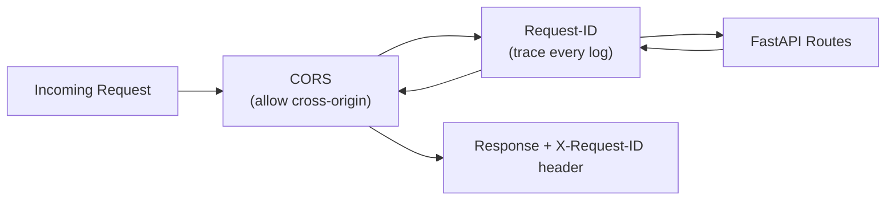
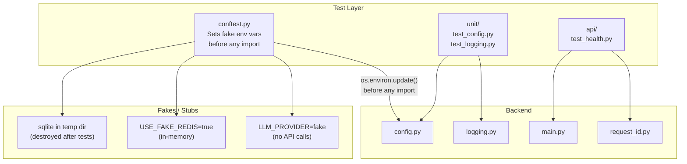
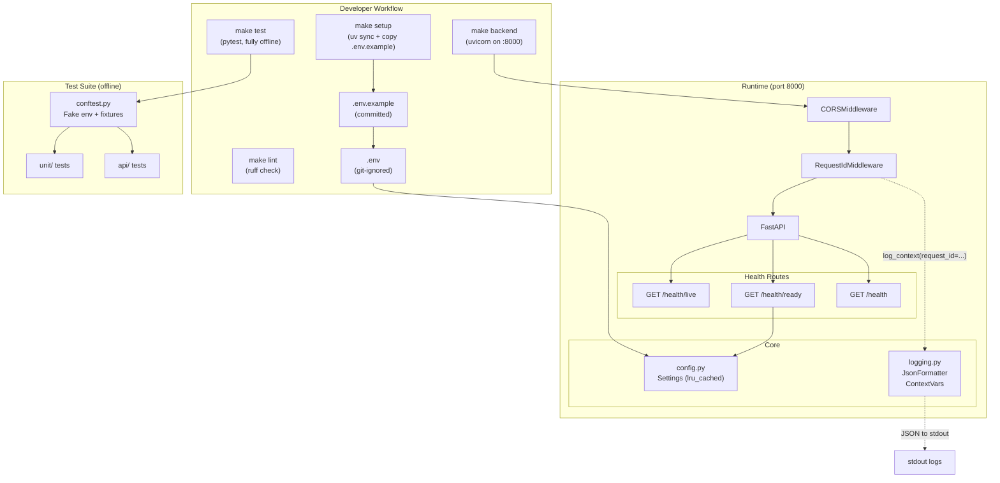

# Phase 1 — System Design Evolution

> This document traces how the system design grew during Phase 1, from an empty project to a working runtime skeleton. Each stage shows what was added and why, with a Mermaid diagram of the system at that point.

---

## Stage 0 — Empty Project (starting point)

Before Phase 1, there was nothing but a Git repository and the CLAUDE.md spec. The design existed only on paper.

**What existed:** Repository skeleton, `pyproject.toml`, `TASKS.md`, `.gitignore`

---

## Stage 1 — After P1-1: Settings and JSON Logging

The first real code defines how the application configures itself and records what it is doing.

### What was added
- `backend/app/core/config.py` — `Settings` class using `pydantic-settings`
- `backend/app/core/logging.py` — `JsonFormatter`, `log_context`, `setup_logging`

### Design at this stage

### Key design decisions at this stage

| Decision | Why |
|---|---|
| `pydantic-settings` with `SecretStr` | Secrets are never accidentally printed; validation happens at startup not at first use |
| `lru_cache` on `get_settings()` | Settings are read once; subsequent calls get the same object (fast, deterministic) |
| `ContextVar` for request/workflow IDs | Thread-safe context propagation without passing IDs through every function call |
| JSON logs | Machine-parseable; monitoring tools (CloudWatch, Datadog) can query them |

---

## Stage 2 — After P1-2: Health Routes and Request-ID Middleware

The application now starts and can receive HTTP requests. Health endpoints let infrastructure know the server is alive and ready.

### What was added
- `backend/app/main.py` — `create_app()`, three health endpoints, CORS and middleware setup
- `backend/app/middleware/request_id.py` — `RequestIdMiddleware`

### Design at this stage

### Middleware order (outermost first)

> Note: Audit and Rate-Limit middleware are defined in CLAUDE.md but are added in Phase 3. The order shown above will grow: `CORS → RequestId → RateLimit → Audit`.

### Key design decisions at this stage

| Decision | Why |
|---|---|
| Three separate health endpoints | Liveness (is the process alive?) and readiness (is it safe to route traffic?) serve different purposes in Kubernetes |
| Readiness checks config only, no I/O | A healthy-check that calls the DB can itself fail or hang. Config-based checks are instant and reliable |
| `RequestIdMiddleware` at ASGI level | Works for all responses including 404 and 500, not just routes that return cleanly |
| `expose_headers: ["X-Request-ID"]` in CORS | Browsers block custom headers by default; this allows the frontend to read the ID |

---

## Stage 3 — After P1-3: Offline Pytest Harness

A test infrastructure layer is added. No production code changes — only test scaffolding.

### What was added
- `tests/conftest.py` — environment variable overrides, role fixtures
- `tests/unit/test_config.py`, `test_logging.py`, `test_offline_harness.py`, `test_env_example.py`
- `tests/api/test_health.py`

### Design at this stage

### Key design decisions at this stage

| Decision | Why |
|---|---|
| `os.environ.update()` runs at module import time | Tests run before the app module loads, so settings see the overrides |
| `scope="session"` fixtures | The temp database directory is created once and cleaned up once per test run, not per test |
| Role fixtures (`agent_headers`, `admin_headers`, `viewer_headers`) | Shared across all future test files; any test can simulate a specific role in one line |
| `test_env_example.py` | Prevents drift: if a developer adds a setting without adding it to `.env.example`, the test fails |

---

## Stage 4 — After P1-4: Makefile and `.env.example` (Final Phase 1 State)

The developer experience layer is added. No new runtime components, but the project is now usable by any developer from a fresh checkout.

### What was added
- `Makefile` — `setup`, `backend`, `test`, `lint` targets
- `.env.example` — all variables with placeholder values

### Complete Phase 1 System Design

---

## Summary: What changed and why across Phase 1

| Stage | File(s) | What it enabled |
|---|---|---|
| 0 → 1 | `config.py`, `logging.py` | Safe configuration loading; structured logs with context IDs |
| 1 → 2 | `main.py`, `request_id.py` | HTTP server boots; health endpoints answer; every request is traceable |
| 2 → 3 | `conftest.py`, `tests/` | Entire test suite runs offline in ~6 s |
| 3 → 4 | `Makefile`, `.env.example` | Any developer can start the project in one command |

After Phase 1, the system cannot yet serve real tickets or call an AI. But it has:
- A working server that answers HTTP
- Structured, traceable logs
- Health checks for infrastructure
- A fully offline test suite
- A one-command developer setup

Every later phase builds directly on top of this.
