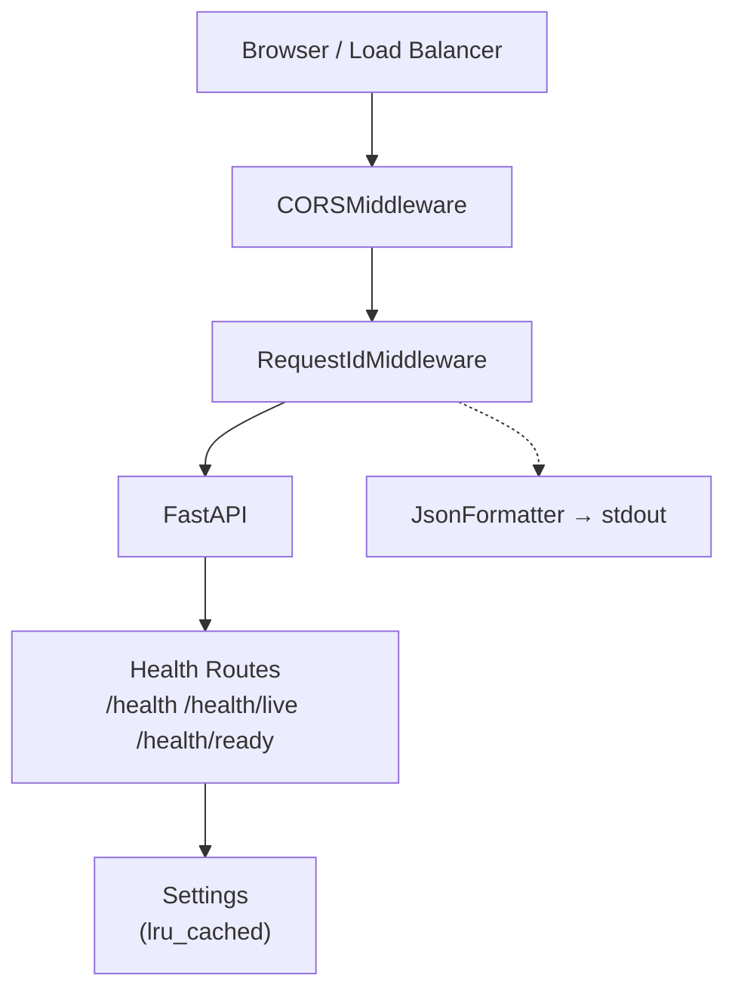
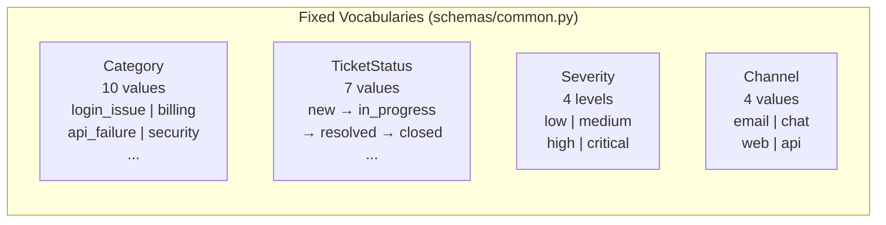
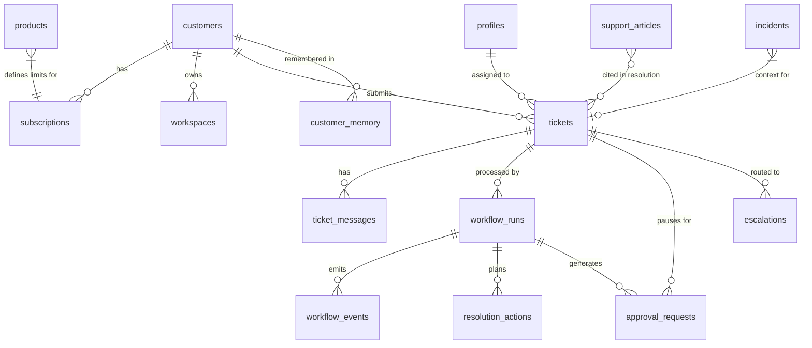
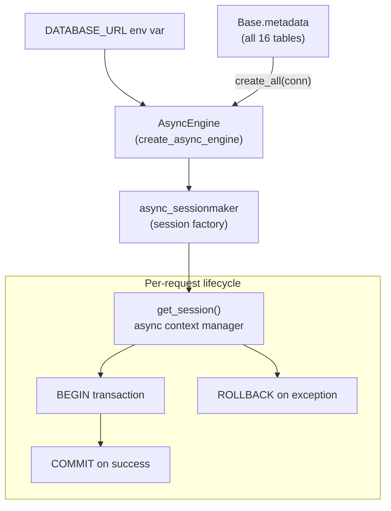
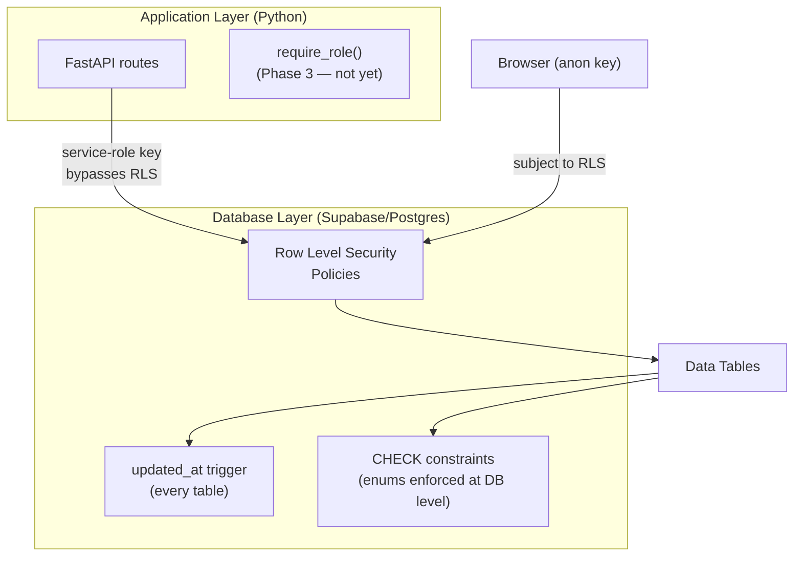
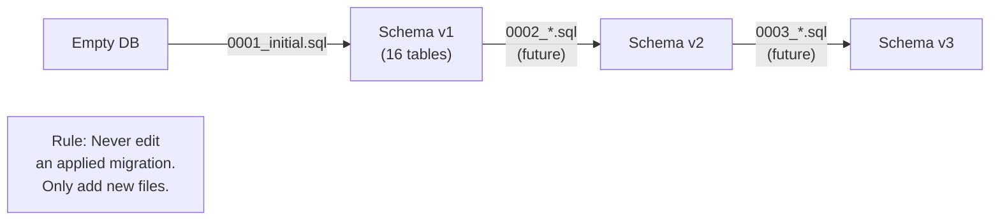
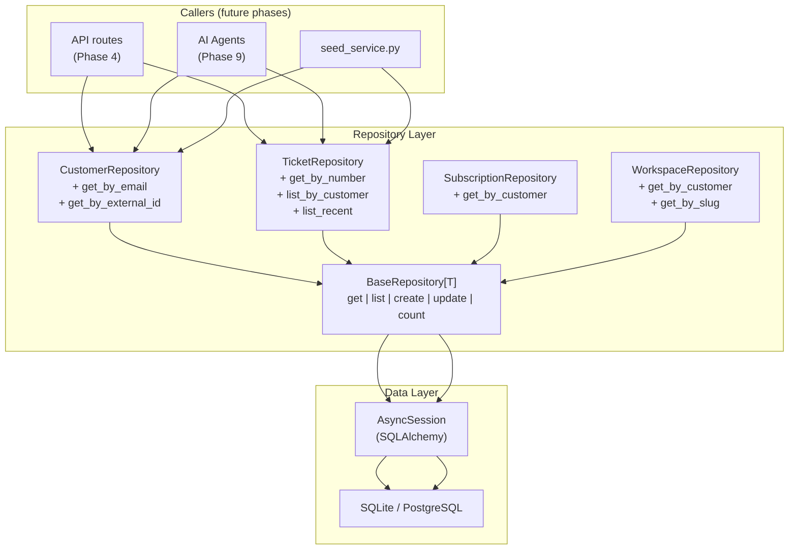
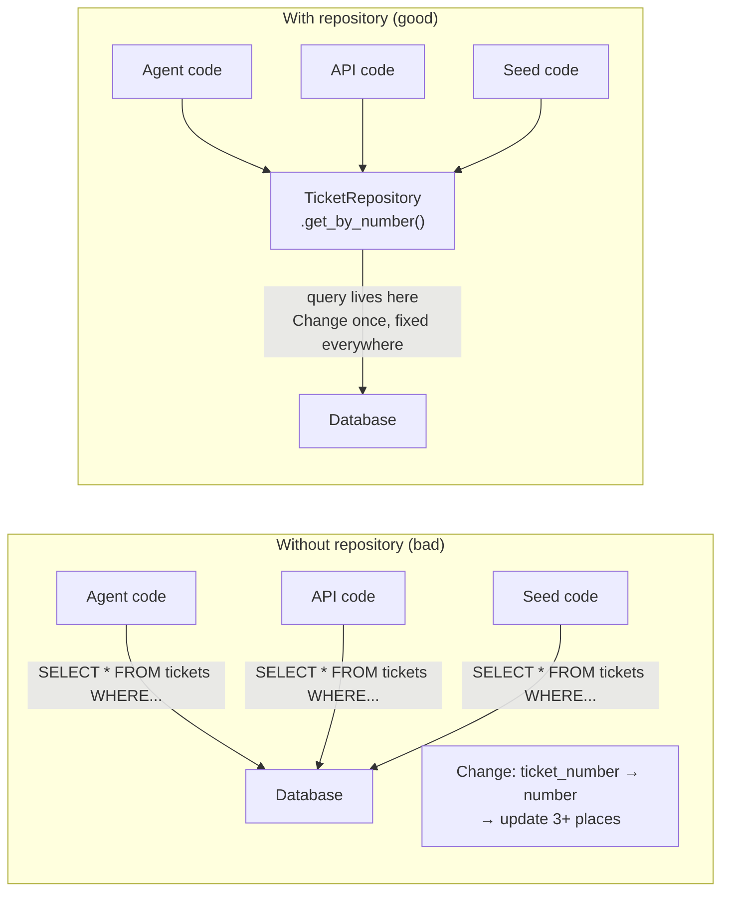
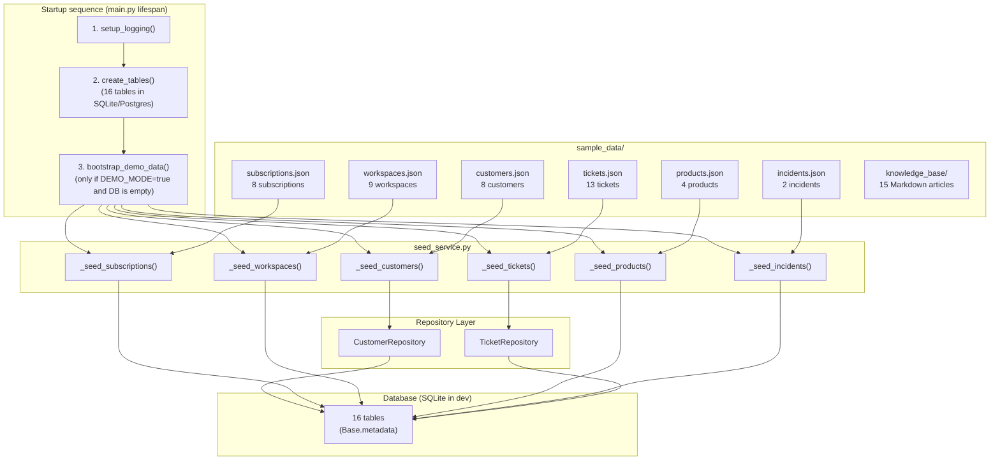
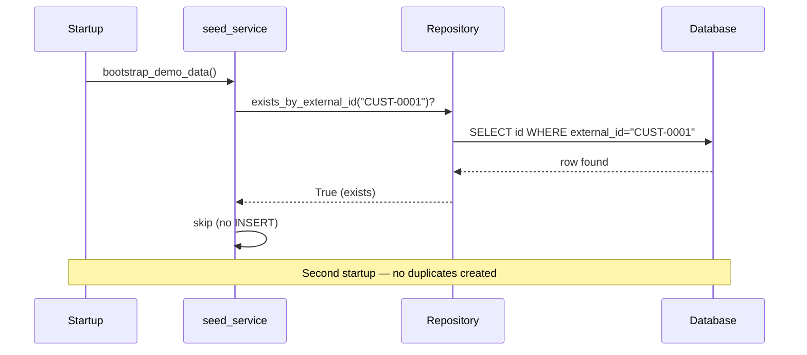

# Phase 2 — System Design Evolution

> This document traces how the system design grew during Phase 2, from "a web server with no memory" to "a web server with a full data model and seeded demo data." Each stage shows what was added, why, and how the design changed.

---

## Starting point: End of Phase 1

At the end of Phase 1, the system looked like this:

**What was missing:** No database, no data model, no way to store or retrieve anything.

---

## Stage 1 — After P2-1: Enums and SQLAlchemy Models

The first step of Phase 2 defines **what the data looks like** — the vocabulary and blueprints.

### What was added
- `backend/app/schemas/common.py` — Category, TicketStatus, Severity, Channel enums
- `backend/app/models/entities.py` — 16 SQLAlchemy model classes
- `backend/app/core/database.py` — Engine factory, `create_tables()`, `get_session()`

### Schema (data vocabulary)

The enums define the fixed vocabulary for the entire system. Nothing can be stored outside these values:

### Data model (16 tables)

### SQLAlchemy engine setup

### Key design decisions at this stage

| Decision | Why |
|---|---|
| `String(36)` for UUIDs (not native UUID type) | SQLite has no UUID type; String works on both SQLite and Postgres |
| `JSON` not `JSONB` for column type | SQLite uses JSON; Postgres uses JSONB. The SQLAlchemy `JSON` type maps to whichever is native |
| `Base.metadata.create_all()` at startup | Zero-config for new developers — the database is ready after `make backend` |
| `get_session()` as async context manager | Guarantees connection release even if an exception occurs mid-request |

---

## Stage 2 — After P2-2: Postgres Schema and RLS

The authoritative SQL definition and the cloud-database security layer are added. No new Python runtime code — this stage is about the cloud/production picture.

### What was added
- `database/schema.sql` — Postgres DDL with triggers, indexes, CHECK constraints
- `database/rls_policies.sql` — Row Level Security policies
- `database/migrations/0001_initial.sql` — First migration file

### Two-layer security model

**Why two layers?** Defence in depth. If the application layer has a bug (e.g., a missing permission check), the database's RLS policies still prevent unauthorised reads and writes. This is a standard security pattern for Supabase applications.

### Migration strategy

---

## Stage 3 — After P2-3: Repository Layer

The repository layer adds a clean separation between "how to access data" and "what to do with data."

### What was added
- `backend/app/repositories/base.py` — `BaseRepository` with generic CRUD
- `backend/app/repositories/customer_repository.py` — customer-specific queries
- `backend/app/repositories/ticket_repository.py` — ticket-specific queries

### Repository architecture

### Why the repository pattern matters

---

## Stage 4 — After P2-4: Sample Data and Demo Bootstrap (Final Phase 2 State)

The system now starts up and loads itself with realistic demo data automatically.

### What was added
- `sample_data/*.json` — 7 JSON files (customers, subscriptions, workspaces, products, incidents, tickets, previous_resolutions)
- `sample_data/knowledge_base/*.md` — 15 knowledge articles
- `backend/app/services/seed_service.py` — idempotent bootstrap service
- `main.py` lifespan updated to call `create_tables()` and `bootstrap_demo_data()`

### Complete Phase 2 system design

### Idempotency guarantee

---

## Summary: What changed and why across Phase 2

| Stage | Files | What it enabled |
|---|---|---|
| P2-1 | `schemas/common.py`, `models/entities.py`, `core/database.py` | Data vocabulary; 16-table schema; engine and session management |
| P2-2 | `database/schema.sql`, `rls_policies.sql`, `migrations/` | Cloud-ready Postgres DDL; two-layer security; migration history |
| P2-3 | `repositories/base.py`, `customer_repository.py`, `ticket_repository.py` | Clean data access layer; callers never write raw SQL |
| P2-4 | `sample_data/`, `services/seed_service.py`, `main.py` updated | Realistic demo data loaded at startup; `make seed` command |

After Phase 2, the system:
- Has a complete, portable data model (SQLite for development, Postgres for production)
- Loads 13 demo tickets, 8 customers, and 15 knowledge articles automatically
- Provides a clean repository layer all future phases will use
- Has 34 passing tests that run offline in ~5 seconds

The next phases build on this foundation: Phase 3 adds authentication, Phase 4 adds the HTTP API routes that expose this data to the frontend.
