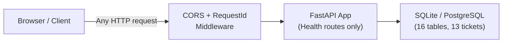
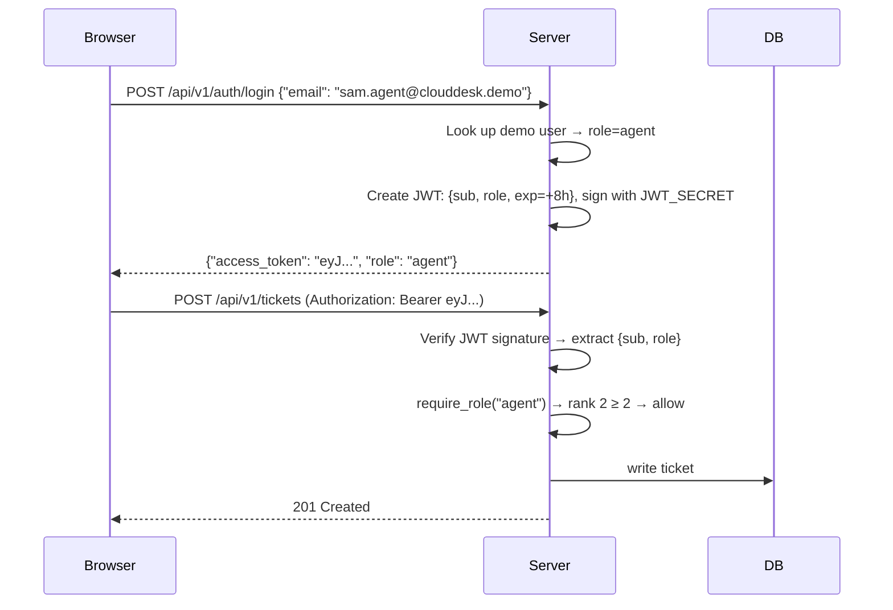
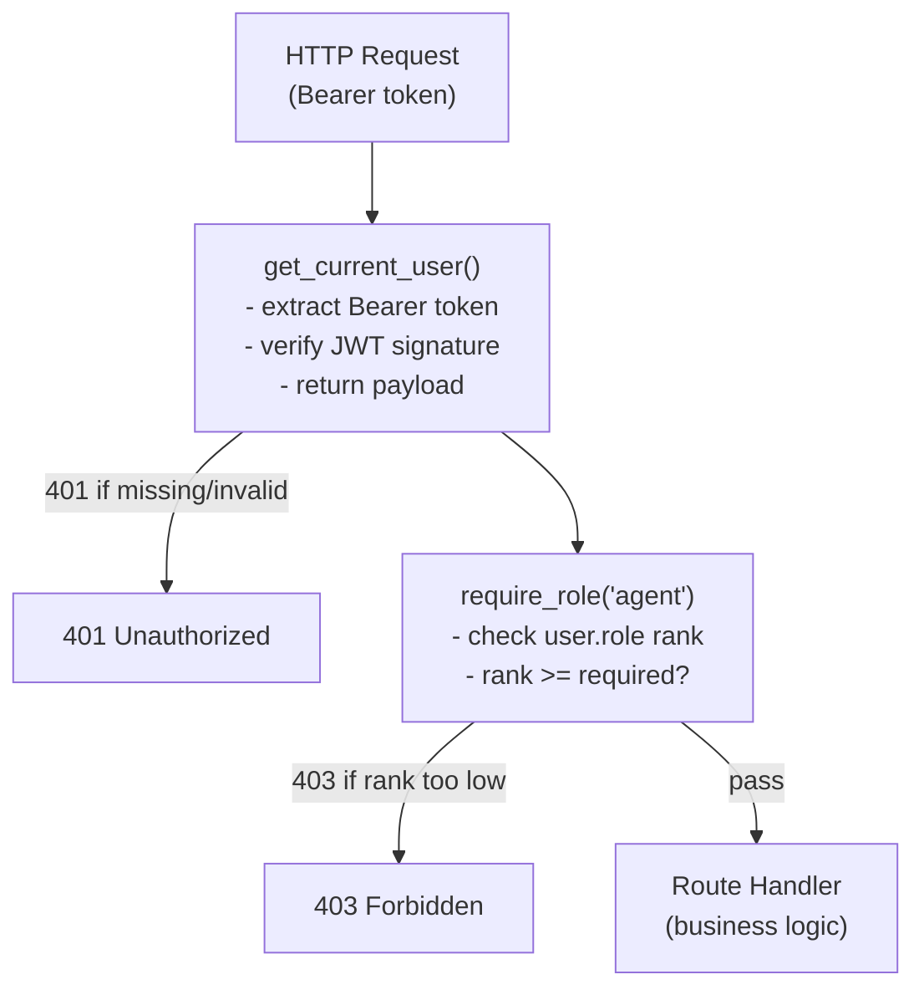
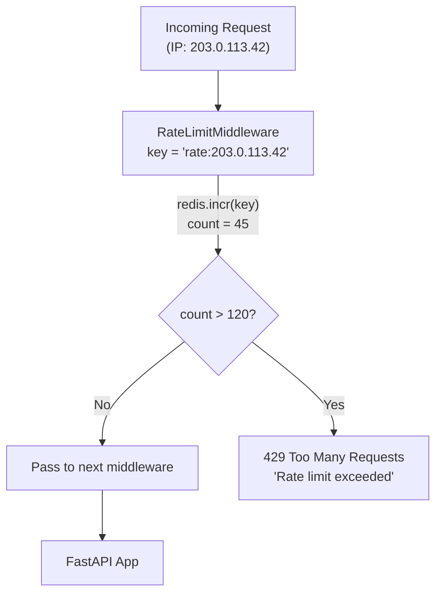
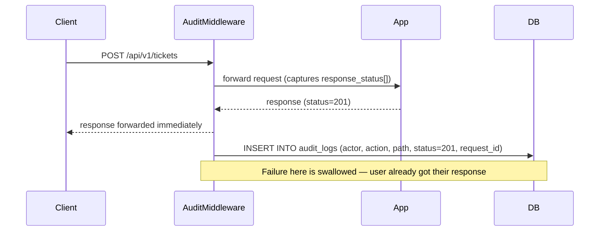
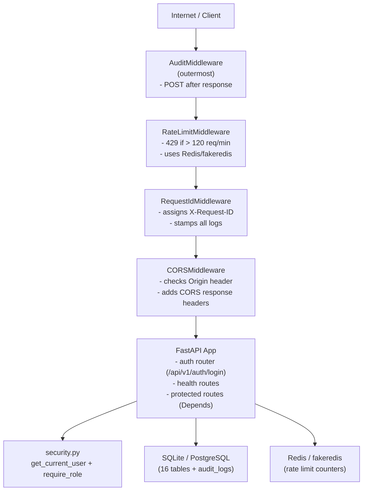
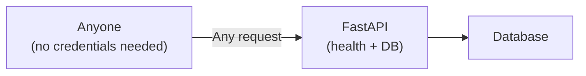
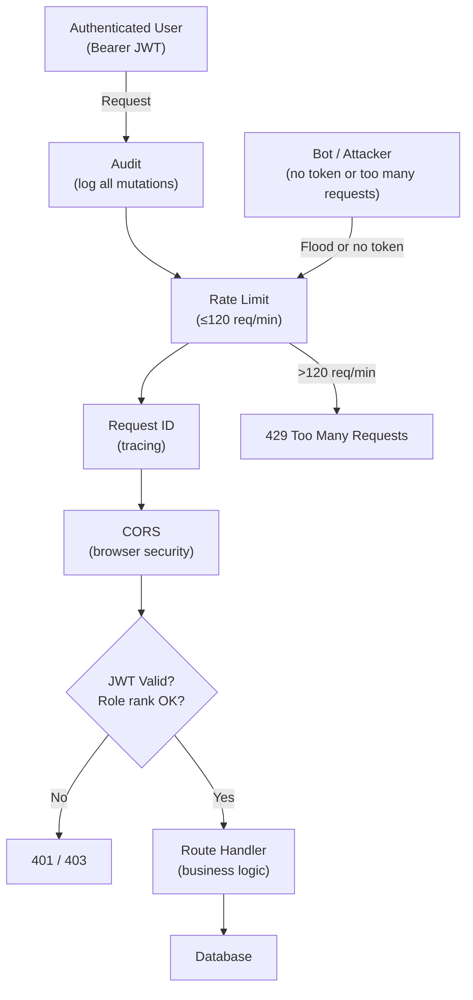

# Phase 3 — System Design Evolution: Identity and Request Guards

> This document traces how the system design evolved through Phase 3, from the starting point (after Phase 2) to the final state with a full security layer.

---

## Starting point: Phase 2 system (what we had before Phase 3)

At the end of Phase 2, the system had a FastAPI backend with health routes, database persistence, and demo data loading. But there was **no identity layer** — any HTTP call worked regardless of who sent it.



**Problem:** No authentication. No authorisation. No rate limiting. No audit trail.

---

## Step 1: Adding JWT authentication (P3-1)

The first design decision: **how should identity work?**

We chose **stateless JWT authentication** (not session-based). The server signs a token when the user logs in. That token travels with every request. The server verifies the signature — no database lookup per request.



**Key design:** The JWT claim `role` determines what the user can do. The numeric rank (viewer=1, agent=2, admin=3) means admin can do anything agent can do, and agent can do anything viewer can do — a clean hierarchy.

---

## Step 2: Adding role-based access control (P3-1 continued)

The `require_role` function acts as a **permission gate** on any route. The route declares what it needs; FastAPI enforces it via the dependency injection system.



**Example — viewer trying to approve a refund:**


---

## Step 3: Adding rate limiting (P3-2)

Rate limiting uses Redis as a shared counter. Each IP gets a fixed-window counter.



**Redis data model:**

```
Key:   rate:203.0.113.42
Value: 45          (integer counter)
TTL:   60 seconds  (auto-expires, window resets)
```

For tests: `fakeredis` replaces Redis entirely — same interface, runs in memory.

---

## Step 4: Adding audit logging (P3-3)

The audit middleware wraps the entire request-response lifecycle and writes a log entry *after* the response is sent — so the audit write cannot delay or fail the user's response.



**Audit log columns:**

| Column | Value example |
|---|---|
| actor_id | "demo-agent-001" (from JWT sub claim) |
| actor_role | "agent" |
| action | "POST" |
| resource_type | "tickets" (extracted from path) |
| request_id | "req-abc-123" (from X-Request-ID header) |
| ip_address | "203.0.113.42" |
| extra | {"path": "/api/v1/tickets", "status_code": 201} |

---

## Step 5: Final middleware stack (P3-4)

The four middleware layers are assembled in a specific order. This is the final architecture for Phase 3:



---

## Complete Phase 3 system: before vs. after

### Before Phase 3



### After Phase 3



---

## New files added in Phase 3

| File | Purpose |
|---|---|
| `backend/app/core/security.py` | JWT create/decode, `get_current_user`, `require_role`, demo_login |
| `backend/app/core/redis.py` | Redis or fakeredis client factory |
| `backend/app/api/__init__.py` | API package init |
| `backend/app/api/auth.py` | `POST /api/v1/auth/login` route |
| `backend/app/middleware/rate_limit.py` | Fixed-window rate limiter |
| `backend/app/middleware/audit.py` | Post-request audit log writer |
| `backend/app/repositories/profile_repository.py` | Profile DB queries |
| `backend/app/repositories/audit_repository.py` | Audit log DB queries |
| `tests/api/test_auth.py` | 11 auth tests (401, 403, demo login, audit log) |

---

## In one sentence

> Phase 3 transformed the application from an open system into a secured one by adding JWT-based identity, a three-tier role hierarchy, Redis-backed rate limiting, post-request audit logging, and a carefully ordered four-layer middleware stack that processes every request before the business logic runs.
