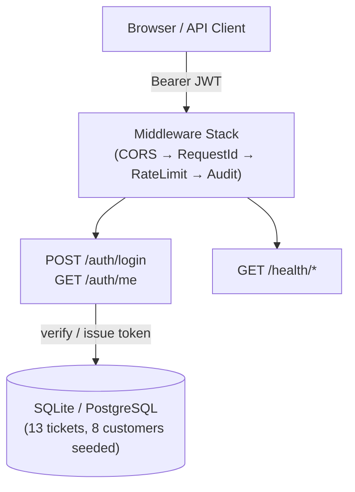
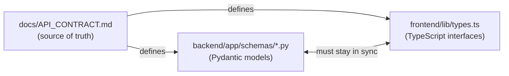
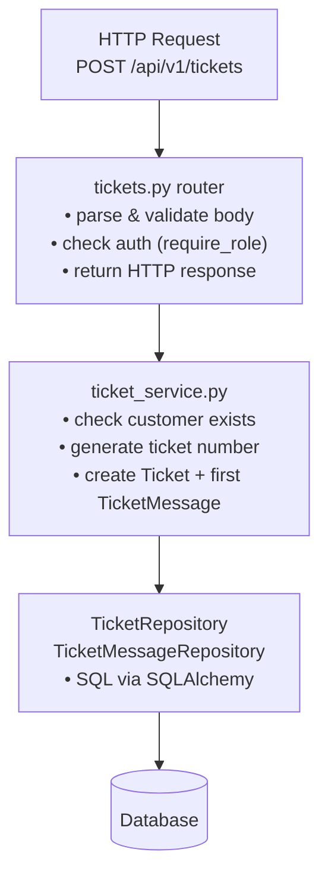
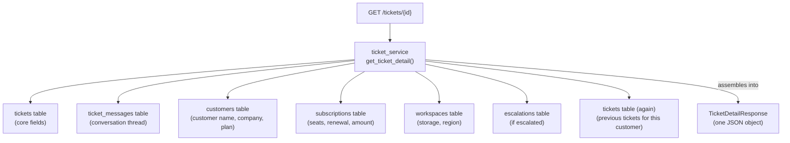
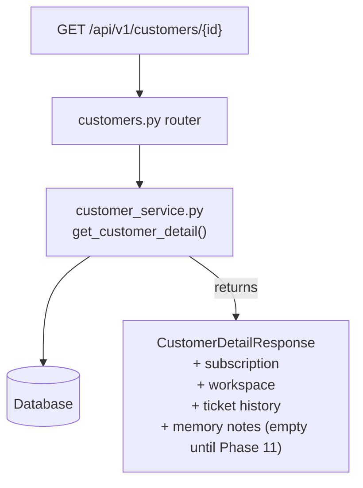
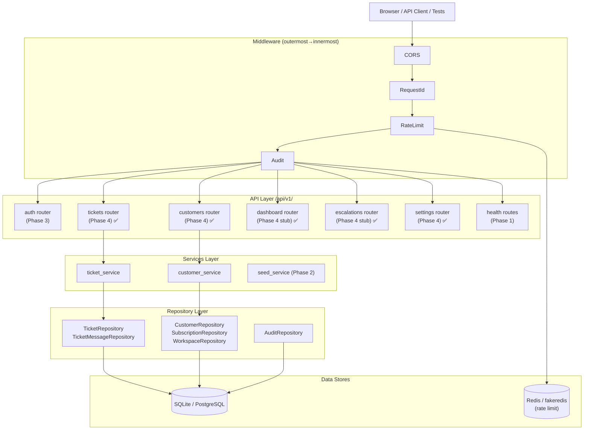
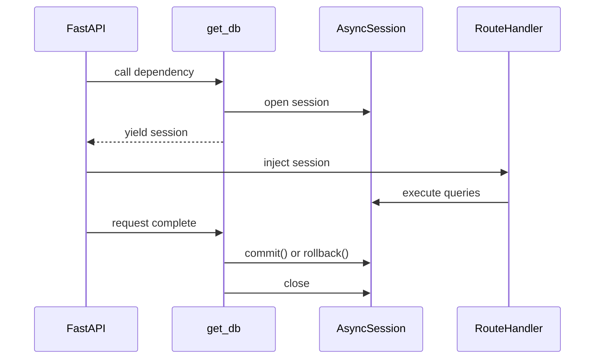

# Phase 4 — System Design Evolution: Support API

> This document traces how the system design grew during Phase 4, from "a database with no doors" to "a fully routable REST API for tickets and customers."

---

## Starting point (end of Phase 3)

After Phase 3 the system could authenticate users, enforce role-based access, rate-limit requests, and write audit logs. But it had no domain routes — no endpoints for tickets, customers, or anything a support agent would actually use.

**Gap:** The database had all the data (from Phase 2 seed), but nothing exposed it over HTTP.

---

## Step 1 — API Contract first (P4-1)

Before writing a single route, the team wrote the contract. This is a deliberate design choice: by defining request/response shapes in `docs/API_CONTRACT.md` and `frontend/lib/types.ts` *before* the implementation, the backend and frontend stay in sync from day one.

**Key insight:** The contract is not generated from code — the code is generated from the contract. Any change to a route *must* update `API_CONTRACT.md` first.

---

## Step 2 — Layered architecture for the Ticket API (P4-2)

The ticket functionality was split across three layers, each with a single job:

**Why this matters:** Each layer only talks to the layer directly below it. The router never writes SQL. The service never knows about HTTP status codes. The repository never applies business rules. This is the **layering rule** from CLAUDE.md §4.2.

---

## Step 3 — The full ticket detail response (P4-2 continued)

A `GET /tickets/{id}` call traverses multiple tables and assembles a rich response:

---

## Step 4 — Customer API (P4-3)

The customer layer mirrors the ticket layer in structure:

---

## Complete system design at end of Phase 4

---

## Design decisions made in Phase 4

### 1. The `get_db` dependency pattern

FastAPI's dependency injection requires async generator functions (using `yield`). The existing `get_session()` helper used `@asynccontextmanager` which is not compatible. A new `get_db()` async generator was added to `core/database.py` as the standard FastAPI dependency.

### 2. Ticket number generation

Ticket numbers follow the `CD-NNNN` format used in the demo scenario. The service counts existing tickets and continues from where the seed data ends (CD-1013). A collision-prevention loop handles edge cases.

### 3. Stub endpoints for phase-forward compatibility

The `/tickets/{id}/run`, `/tickets/{id}/workflow`, `/tickets/{id}/events` routes exist and return valid responses even though the workflow engine is not built yet. This keeps the frontend (Phase 12) from hitting 404s during parallel development.

---

## What the design does NOT yet include

| Feature | Phase |
|---------|-------|
| Run AI workflow (`POST /tickets/{id}/run` → 202) | 10 |
| Workflow state polling | 9 |
| Human approval flow | 10 |
| Escalation records | 10 |
| Memory notes in customer context | 11 |
| Full dashboard metrics | 9 |
| Frontend pages | 12 |
