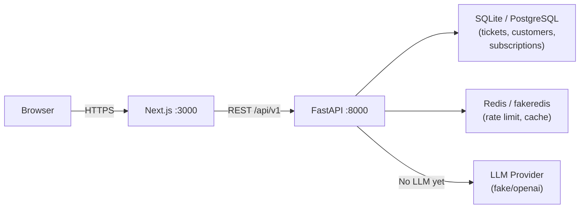
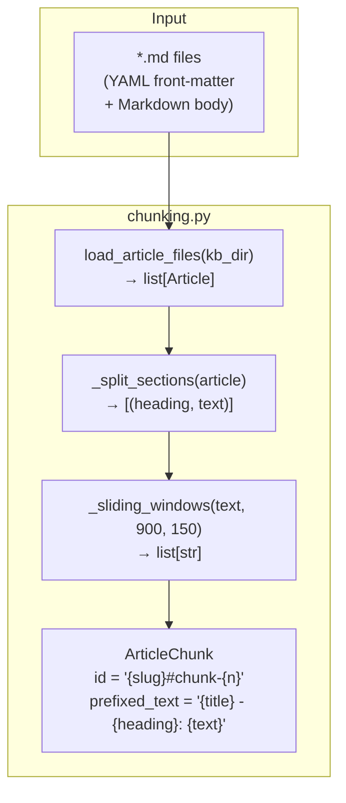
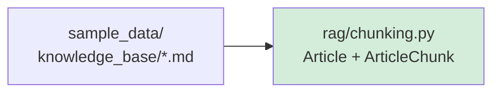
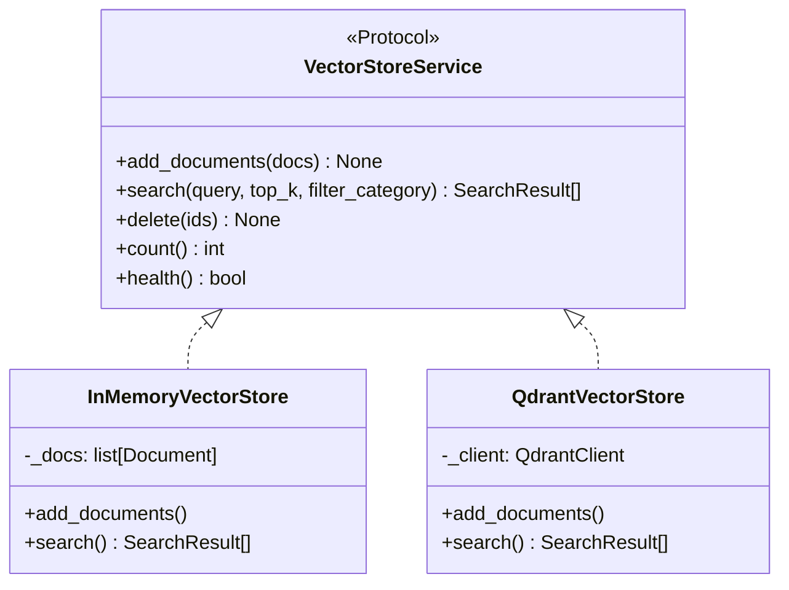
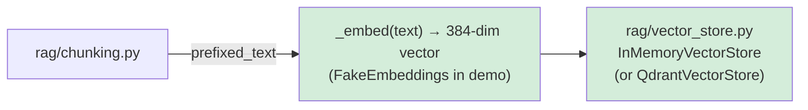
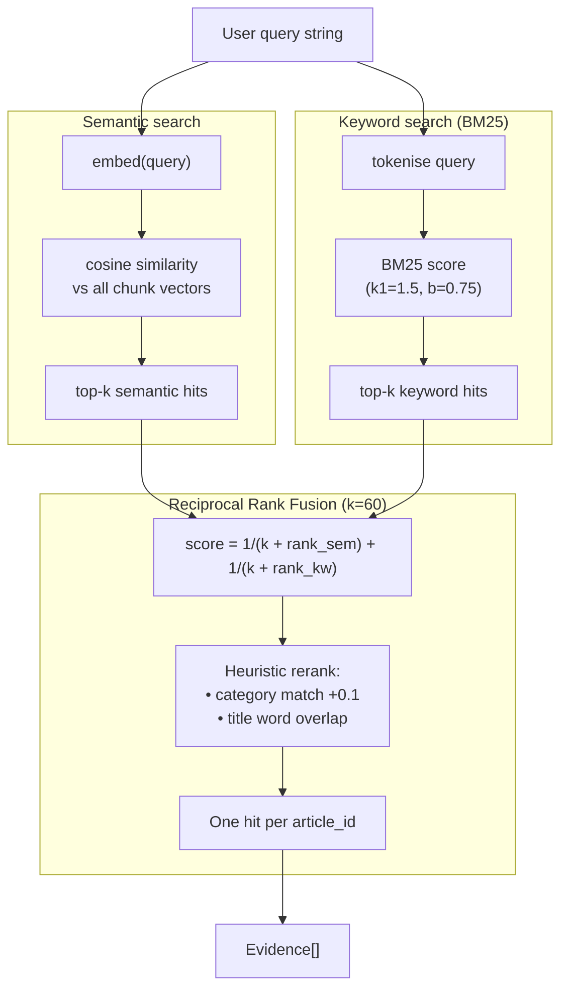
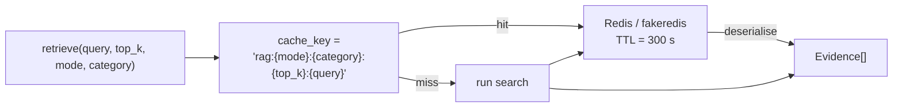
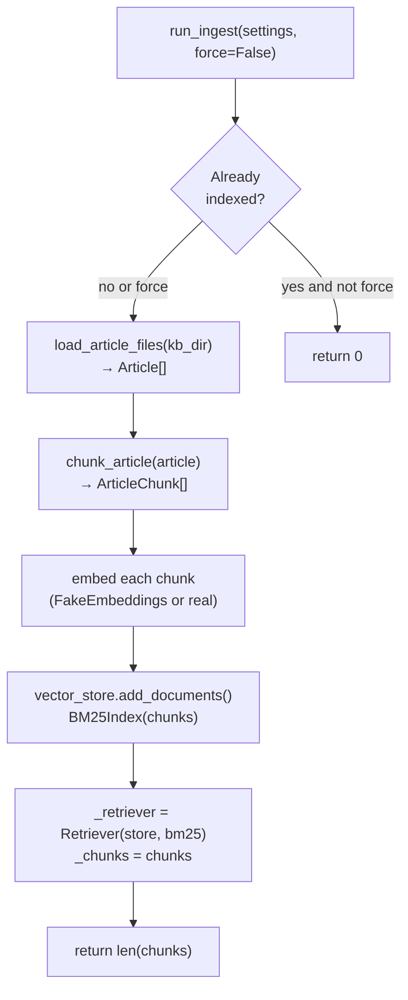
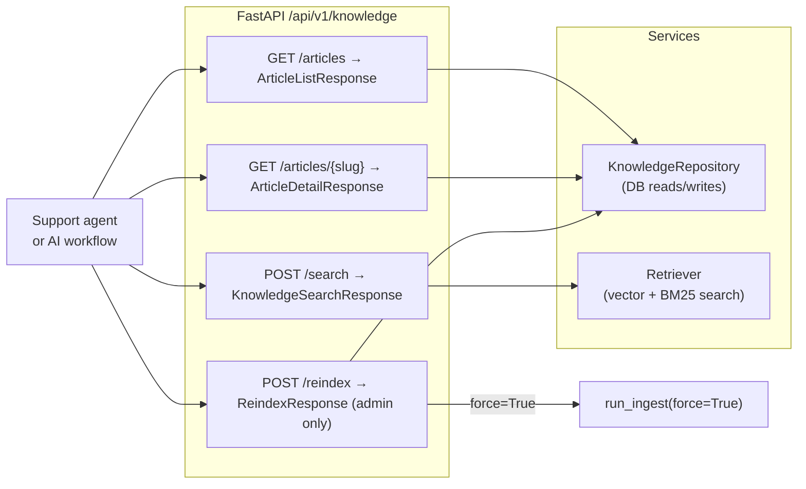
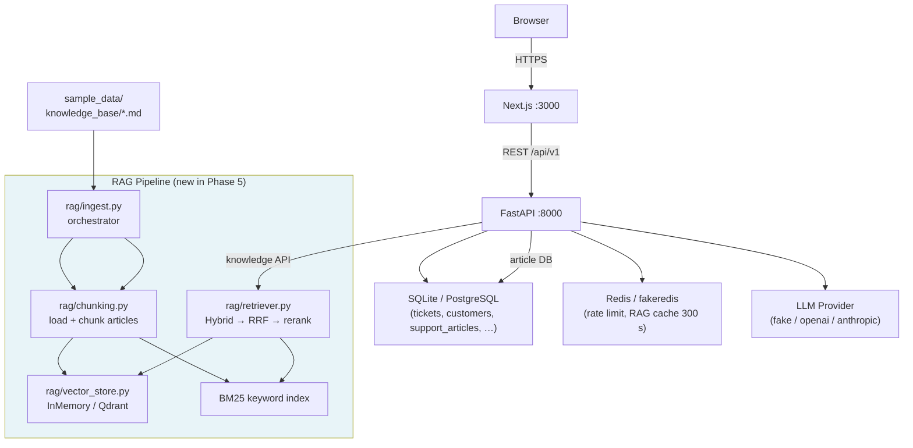

# Phase 5 — System Design Evolution: Knowledge Pipeline

---

## Starting point: What we had after Phase 4

After Phase 4, the system had a working support API — tickets could be created, listed, updated,
and assigned. But the AI workflow had no knowledge retrieval capability. The design was:

**Gap:** No knowledge base. No way to retrieve relevant help articles. No citations.

---

## Task 5.1 — Article loading and chunking

The first step was to ingest the 15 Markdown articles in `sample_data/knowledge_base/`.

### Design — article loader

Each `Article` holds: `slug`, `title`, `category`, `tags`, `summary`, `body`.

Each `ArticleChunk` holds everything needed to embed and return as a search result:
- `id`, `article_id`, `title`, `heading`, `text`
- `prefixed_text` — what actually gets embedded (richer context)
- `source` = `"kb://{slug}#{chunk-id}"`, `snippet` = first 120 chars

### Design after Task 5.1

---

## Task 5.2 — Embeddings and Vector Store

### Design — vector store protocol

A `Protocol` interface means the app can swap providers without touching the rest of the code.

**FakeEmbeddings** — deterministic 384-dim hashed bag-of-words, normalised to unit length. Works
fully offline, no API key required.

### Design after Task 5.2

---

## Task 5.3 — Retriever with hybrid search

This is the core intelligence of the pipeline.

### Design — retrieval flow

### Cache layer

---

## Task 5.4 — Ingest orchestrator

---

## Task 5.5 — Knowledge API

---

## Final design after Phase 5

---

## Design decisions and trade-offs

| Decision | Why | Trade-off |
|---|---|---|
| Protocol for VectorStoreService | Swap in-memory ↔ Qdrant without touching retriever code | Slightly more boilerplate |
| FakeEmbeddings (hashed bag-of-words) | Fully offline, deterministic, testable with no API key | Lower quality than real embeddings; must reindex when switching |
| Sliding windows (900 / 150 overlap) | Short chunks stay retrievable; overlap prevents boundary cuts | More chunks = more storage and slower ingest |
| Reciprocal Rank Fusion (not score fusion) | Scores from semantic and BM25 are on different scales; ranks are comparable | Does not exploit score magnitude |
| One result per article | Prevents one verbose article from dominating results | May miss two distinct sections from the same article |
| Cache keyed on mode + category + top_k + query | Different parameters need different cached results | Cache size grows with parameter combinations |
