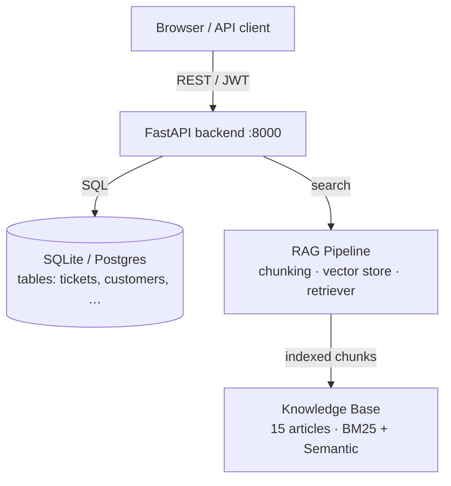
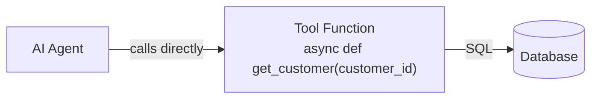
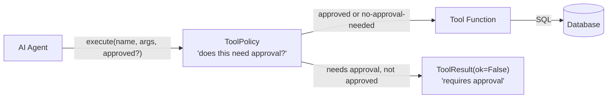
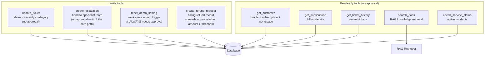
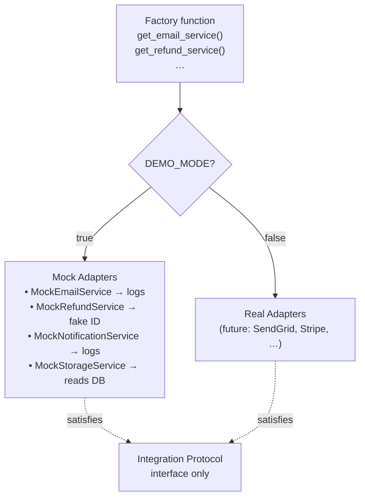
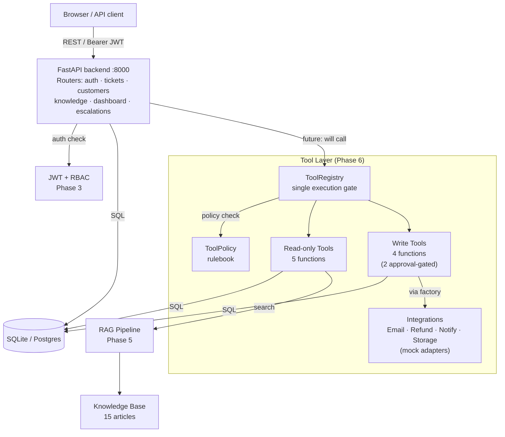

# Phase 6 — System Design Evolution: Tools and Policy

## Where we started (end of Phase 5)

After Phase 5 we had a full knowledge retrieval pipeline, but the system still had no concept of **actions**.  
The AI could read tickets and search articles but could not change anything.  
There was no safety mechanism to control what the AI was permitted to do.

### Phase 5 ending state



The system could answer questions but could not take action.

---

## Step 1: Defining what "actions" look like

The first design decision was to model every action as a **named, typed function** with a clear contract.



**Problem with this design:** nothing stops the agent from calling any function at any time, with no safety checks and no timeout. A refund could be issued without anyone knowing.

---

## Step 2: Adding a Policy layer

The fix is to never call tools directly. Every call goes through a **policy check** first.



The policy rulebook answers one question for each tool: **does this need a human to approve it?**

---

## Step 3: Wrapping policy + execution in a Registry

The registry is the single enforcement point:

```mermaid
graph TD
    Agent["AI Agent (future phases)"]
    Registry["ToolRegistry\n1. check policy\n2. lookup fn\n3. execute with timeout\n4. catch exceptions"]
    PolicyRulebook["ToolPolicy\nrulebook"]
    FnMap["fn map\nname → async function"]
    Tool["Tool Function"]
    DB[("Database")]
    Result["ToolResult\nok=True / ok=False"]

    Agent -->|execute(name, args, approved)| Registry
    Registry -->|requires_approval?| PolicyRulebook
    Registry -->|lookup| FnMap
    FnMap --> Tool
    Tool -->|SQL| DB
    Registry -->|always returns| Result
```

Key properties guaranteed by the registry:
- **Tool exceptions never crash** the graph — they become `ToolResult(ok=False)`.
- **Timeouts** are enforced — no tool can block forever.
- **Unknown tools** are automatically approval-required (safe default).

---

## Step 4: The nine tools

Tools are divided into read-only (no approval needed) and write tools (some need approval).



---

## Step 5: Mock Integrations

The write tools interact with external systems (email, billing, notifications, storage).  
In demo/test mode, mock adapters handle these calls safely offline.



The rest of the application only imports the Protocol interface. It never imports `MockEmailService` directly — that is the factory's responsibility.

---

## Final state at end of Phase 6



The Tool Layer is fully implemented and tested.  
It is not yet wired into the workflow graph (that happens in Phase 9).  
The approval UI does not exist yet (Phase 10 and 12).

---

## Design decisions made in Phase 6

| Decision | Reason |
|---|---|
| Single ToolRegistry singleton | Agents in Phase 9 can import one object; tests can reset it |
| Policy is a plain class, not config | Easy to unit test without touching the DB or settings |
| Unknown tools require approval | New tools start safe; opt-out of approval rather than opt-in |
| Exceptions → ToolResult(ok=False) | The workflow graph must never crash because a tool failed |
| Mock adapters satisfy protocols | Tests and demos work offline; swapping to real adapters needs zero code change in callers |
| create_escalation needs no approval | Escalating is always the safe, conservative choice |
