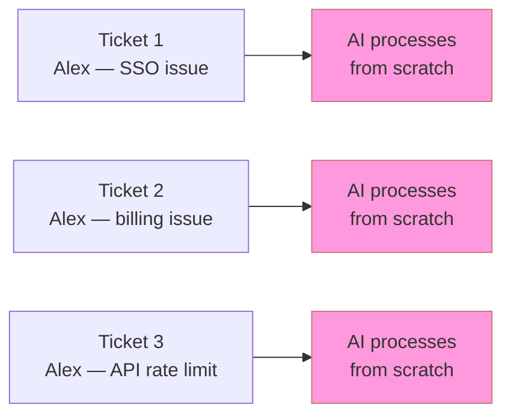
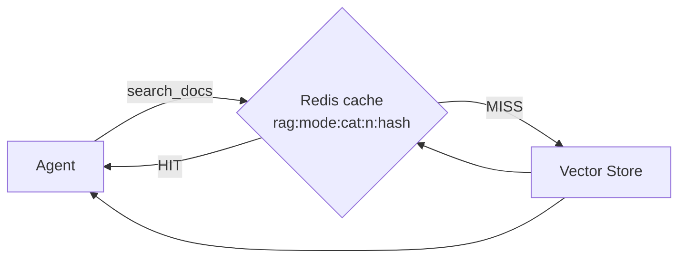
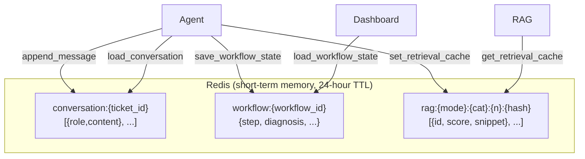
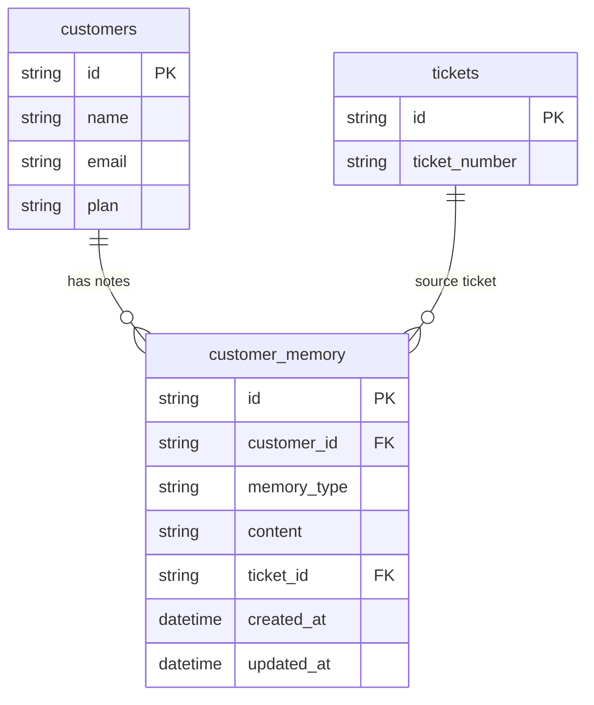
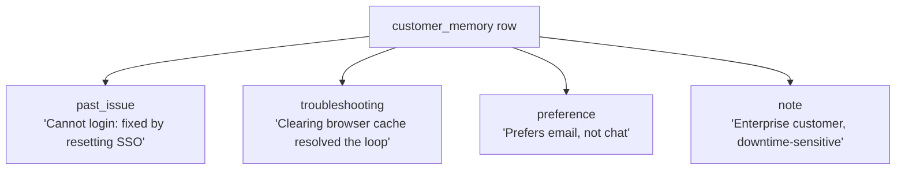
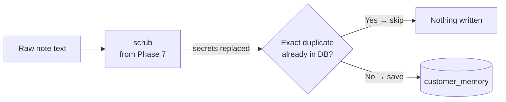
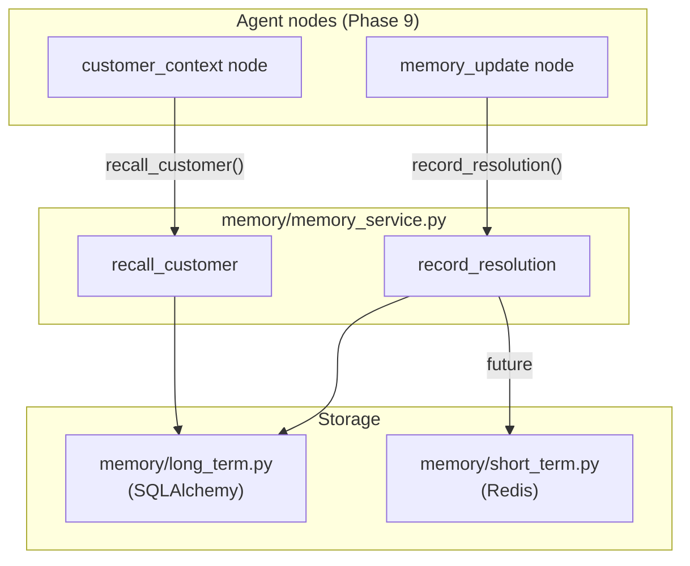

# Phase 8 — System Design Evolution: Memory

## Starting point: where Phase 7 left us

At the end of Phase 7 we had a rules-and-guardrails layer. The system could classify
tickets, detect injection attacks, and validate output. But every ticket still started
from a blank slate — no history, no customer context, no previous solutions.

This phase adds memory at two speeds: **fast and temporary** (Redis) and
**slow and permanent** (database).

---

## Design step 1 — The stateless problem

Before Phase 8, every ticket processing run was completely independent.



Every single run re-fetches the same customer data, re-runs the same knowledge searches,
and has no idea what solutions worked before. This is slow and produces generic answers.

---

## Design step 2 — Add a retrieval cache (short-term, P8-1 first cut)

The simplest memory win: cache the knowledge-base search results in Redis so the same
query does not hit the vector store twice within 5 minutes.



**Key pattern:** `rag:{mode}:{category}:{top_k}:{query_hash}`  
**TTL:** 300 seconds (5 minutes)

This alone saves the most expensive operation on repeated similar queries.

---

## Design step 3 — Add conversation state (short-term, P8-1 complete)

A ticket conversation can span multiple messages and a workflow run. The short-term
memory stores both.



The dashboard polls `workflow:{workflow_id}` every 2 seconds to show real-time progress
without re-running the workflow.

---

## Design step 4 — Add permanent customer memory (long-term, P8-2)

Redis forgets everything after 24 hours. For customer history, we need something
permanent. The `customer_memory` table (already defined in Phase 2) now gets its
access layer.



**Memory types:**



---

## Design step 5 — Safety before every write (scrub + dedup)

Every note must pass two checks before it reaches the database.



This is not optional — it is enforced inside `long_term.add_note()`. No code path
bypasses these two checks.

---

## Design step 6 — The memory service (P8-3): one door for agents

Agents must never call Redis or the database directly. The memory service is the
single controlled entry point.



`recall_customer()` reads up to 10 notes and returns plain dicts ready for the AI prompt.  
`record_resolution()` writes past_issue + up to 3 troubleshooting steps + a note, all
scrubbed and de-duplicated.

---

## Final design — the complete Phase 8 memory system

```mermaid
flowchart TB
    subgraph Client ["Browser / Dashboard"]
        UI[Ticket screen\npoll every 2 s]
    end

    subgraph API ["FastAPI (:8000)"]
        WF_API[GET /tickets/{id}/workflow]
    end

    subgraph Memory ["Memory layer"]
        direction TB
        ST["short_term.py\nRedis\n• conversation TTL 24h\n• workflow state TTL 24h\n• search cache TTL 5min"]
        LT["long_term.py\nSQLAlchemy\n• customer_memory table\n• scrub + dedup enforced"]
        MS["memory_service.py\n• recall_customer()\n• record_resolution()"]
    end

    subgraph DB ["PostgreSQL / SQLite"]
        CMT[(customer_memory)]
    end

    subgraph Cache ["Redis / fakeredis"]
        RDS[(keys by pattern)]
    end

    UI -->|poll| WF_API
    WF_API --> ST
    MS --> ST
    MS --> LT
    LT --> CMT
    ST --> RDS
```

---

## What changed, phase by phase

| Step | What was added | Effect |
|---|---|---|
| 7 (before) | Rules + guardrails | Safety checks only, no memory |
| 8-1 | Short-term Redis facade | Conversations persist within a session; cache saves search costs |
| 8-2 | Long-term DB memory | Customer history survives across sessions; scrub + dedup enforced |
| 8-3 | Memory service | Agents have one controlled, testable door to memory |
| 9 (next) | Specialist agents | They will call `recall_customer` and `record_resolution` |
