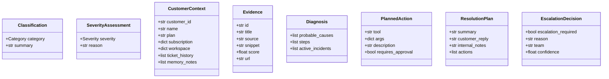
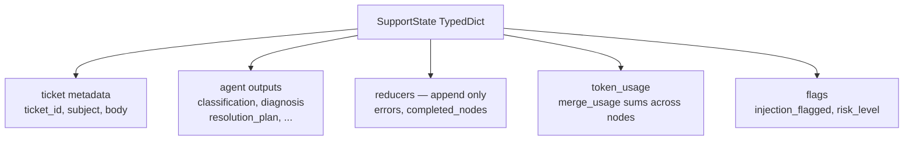
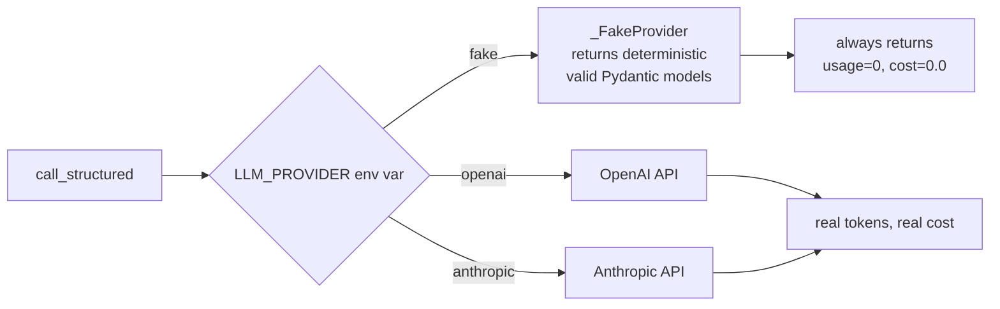
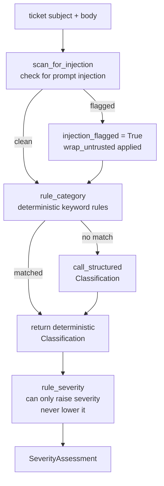
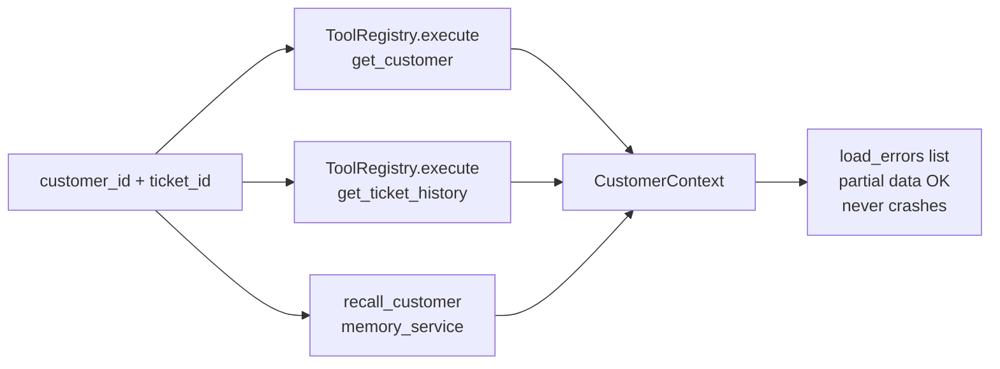
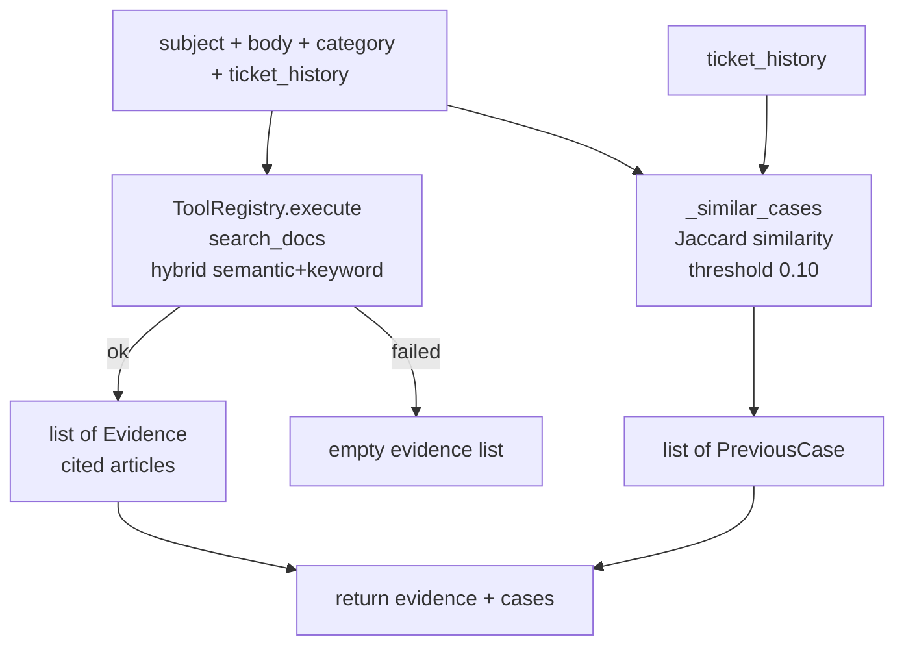
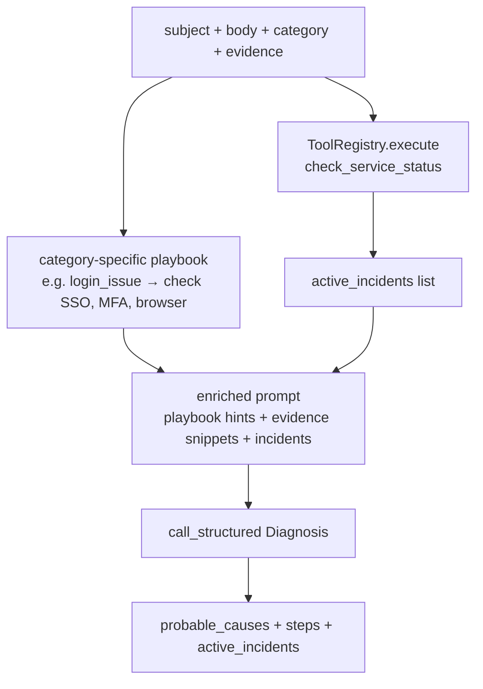
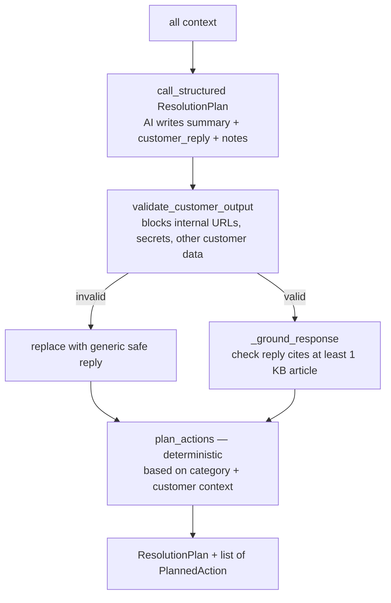
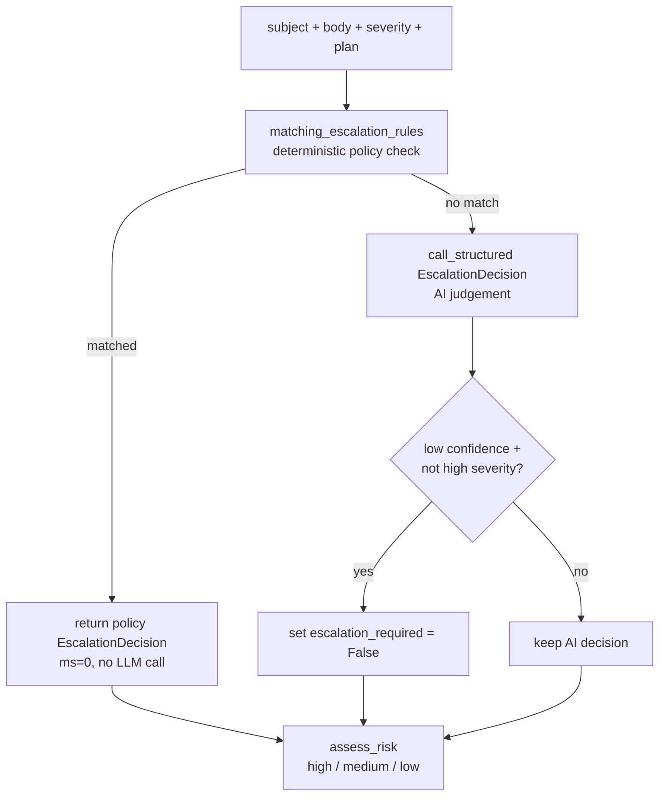
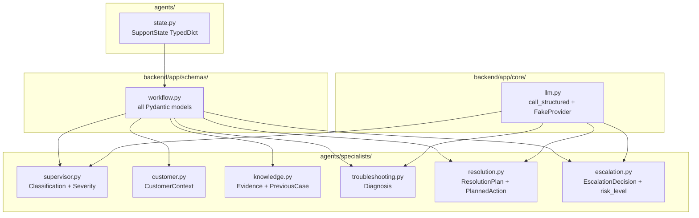

# Phase 9 — System Design Evolution: Specialist Agents

## Starting Point

At the beginning of Phase 9, we had a fully wired data layer (phases 1–8): a FastAPI backend, SQLite/Postgres persistence, Redis caching, a knowledge RAG pipeline, six tools with approval gating, deterministic rules and guardrails, and a short-term + long-term memory system. What we did **not** have was the agent layer — the components that reason over a ticket and produce a resolution.

---

## Step 1: Shared State and Schema Contract (P9-1)

Before writing any agent, we established the data contract they all share.

### Schemas (`backend/app/schemas/workflow.py`)

### State (`agents/state.py`)

The state uses Python `Annotated` reducers so `errors` and `completed_nodes` only ever grow — no node can erase another node's contributions.

---

## Step 2: Fake LLM Provider (P9-1 continued)

The fake provider dispatches on the response model class name and returns hardcoded but structurally valid objects. This is what makes all tests run offline.

---

## Step 3: Supervisor Agent — Classification and Severity (P9-2)

**Key design decision:** Rules run before the LLM for classification, and rules always win for severity. If the LLM says "medium" but the rules detect "enterprise + outage", severity becomes "critical".

---

## Step 4: Customer Agent — Pure Data Retrieval (P9-3)

No LLM call. The agent is a pure data assembler. If the customer is not in the database, it returns a `CustomerContext` with an empty `load_errors` entry rather than crashing.

---

## Step 5: Knowledge Agent — RAG + Jaccard (P9-4)

Jaccard similarity compares word-token sets. A score ≥ 0.10 is considered "similar". Tokenization strips punctuation and splits on underscores so "login_issue" contributes both "login" and "issue".

---

## Step 6: Troubleshooting Agent — Playbooks + AI (P9-5)

Playbooks are static lists of hints per category. They guide the LLM without constraining it — the LLM can still produce causes the playbook doesn't list, but it always starts from the right domain.

---

## Step 7: Resolution Agent — Deterministic Actions + LLM Prose (P9-6)

**Most important design decision in Phase 9:** `plan_actions()` is a pure Python function with no LLM involvement. The LLM writes the words; policy decides the deeds.

---

## Step 8: Escalation Agent — Policy Rules Win (P9-7)

`assess_risk()` is a pure function: no LLM, no randomness. It returns "high" if any of these are true: injection flagged, output validation failed, escalation required, critical severity, or approval-required actions present.

---

## End State of Phase 9

**Next phase (Phase 10)** will wire these six agents into a LangGraph workflow graph. The agents themselves will not change; we will write node functions that call them and pipe state through the graph.
